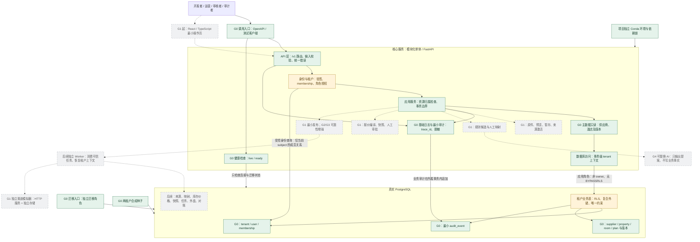
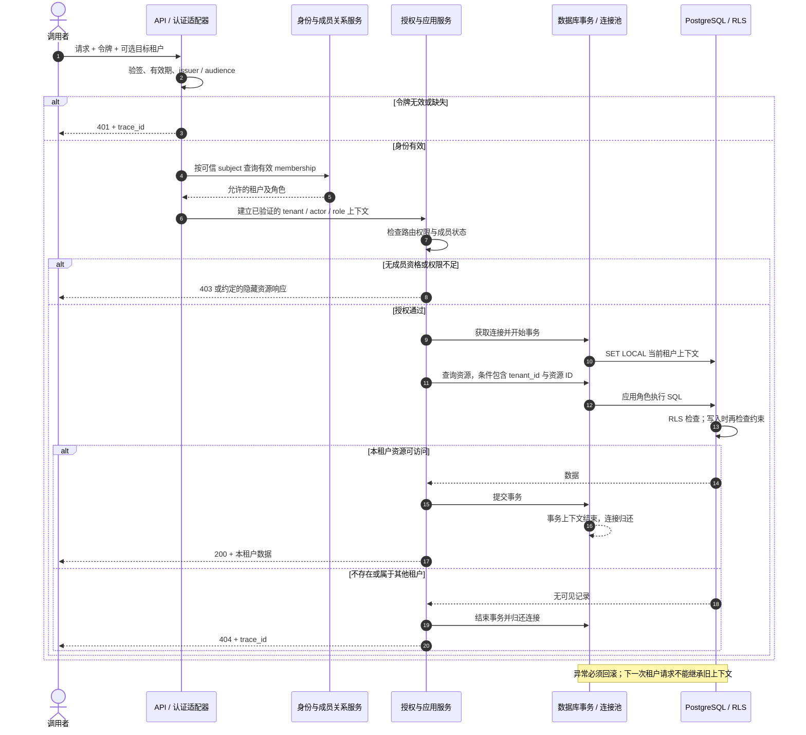
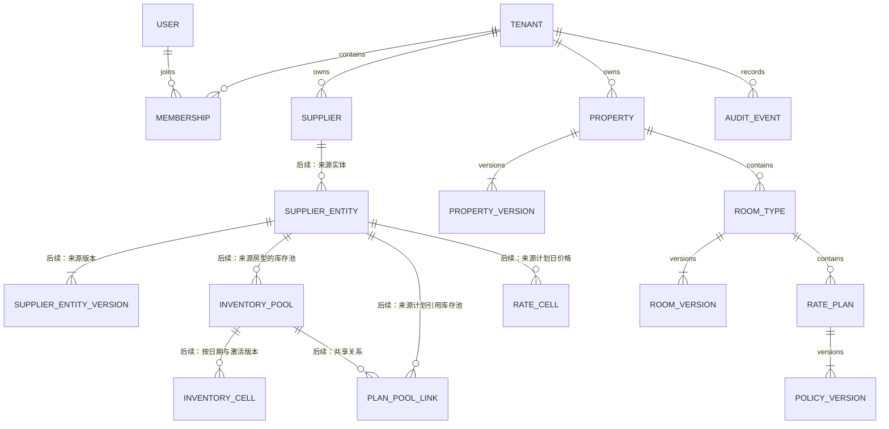
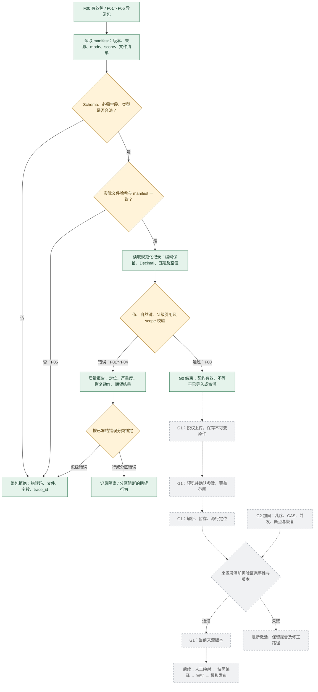
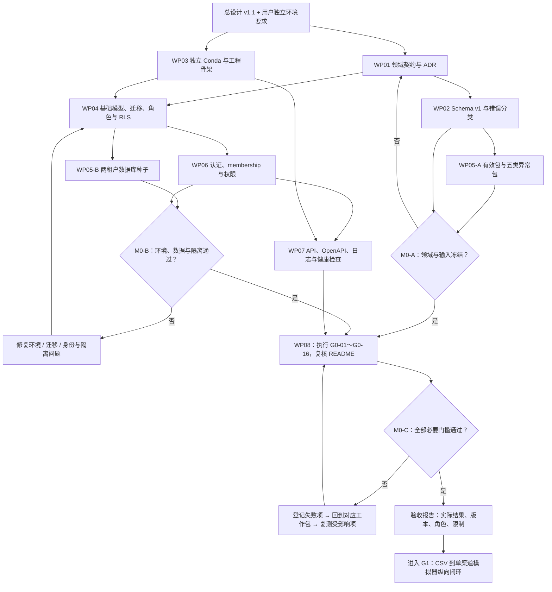

# AI 酒店库存匹配与多渠道分销平台：G0 阶段详细实施计划

> 文档版本：v1.0  
> 编制日期：2026-10-26  
> 设计依据：同目录《AI酒店库存匹配与多渠道分销平台-产品技术设计说明书.html》，设计版本 v1.1，修订日期 2026-10-25。  
> 阶段定位：领域与环境。按工作包、依赖与验收门槛推进，不精确到天。  
> 状态：待执行的实施计划；本文不代表环境、代码、数据或测试已经完成。

> 实施补记（2026-10-26）：已按用户最新要求将环境名调整为 `hotel_project`。本计划保留目标与验收规格，实际完成情况及测试证据见 `docs/acceptance/g0-report.md`。

## 1. G0 的目标与完成定义

G0 要把总设计转化为可执行、可验证的工程基线，使 G1 能直接围绕一份 CSV 数据包搭建纵向闭环，而不再反复讨论库存含义、文件格式、租户归属与工程运行方式。

总设计对 G0 的交付要求是：**领域契约、文件 Schema、测试种子、数据库迁移、认证租户、API 骨架**；退出要求是：**库存与报价口径可解释，租户隔离基本测试通过**。本文中的任务拆分、文件命名、测试编号和数据库切分是实施建议，不能被理解为总设计中已有的实现。

G0 完成时，应能做到：

1. 用书面契约解释酒店、房型、计划、库存池、日价格、报价及快照之间的区别。
2. 在项目独立环境下启动 API，连接真实 PostgreSQL，执行迁移并导入两租户合成种子。
3. 使用不同身份访问受保护资源，证明认证、角色权限与资源归属检查有效。
4. 使用应用运行角色直接访问数据库，证明 RLS 与复合外键能够阻断跨租户读取、写入和引用。
5. 校验一份有效输入包和五份异常变体，并给出稳定、可定位的期望结果。
6. 交付启动说明、测试证据和 G1 输入清单，公开尚未实现的能力。

## 2. 范围与阶段边界

| 范围 | G0 应完成 | 后续阶段承担 |
| --- | --- | --- |
| 领域 | 术语、数据粒度、不变量、版本及覆盖语义 | G1 实现映射、编译与审批业务 |
| 文件 | Schema v1、字段字典、有效/异常样例、契约校验 | G1 CSV 上传与解析；G2 XLSX/JSON 接入、批处理与完整质量流程 |
| 环境 | 独立 Conda、依赖锁定、数据库配置、启动与检查入口 | 按功能增长补充依赖和部署能力 |
| 数据库 | 身份租户、供应商、主数据与版本的基础迁移；完整逻辑模型和后续迁移清单 | G1 按闭环补齐来源、映射、快照、审批和渠道表；G2 补齐编排、外盒等可靠性设施 |
| 身份安全 | 开发认证、成员关系、角色、租户上下文、RLS、基础负测 | G5 完整安全加固与权限负测矩阵 |
| API | 应用骨架、健康检查、当前身份、供应商与主数据只读接口、统一错误 | G1 实现真实业务命令；后续完善任务和运营接口 |
| AI、前端与渠道 | 明确模块边界与替换接口，记录后续契约 | G1 最小操作页与单渠道模拟器；G4 实际 AI 能力和授权自动化策略 |

G0 不以完成整套 CRUD 或全部数据库表为目标。总设计中的完整逻辑 Schema 需要保留，但物理迁移按阶段交付。不得把占位接口返回的模拟成功计为业务完成。

## 3. 实施原则与基线决策

### 3.1 工程选择

计划默认采用总设计推荐的 FastAPI/Python、PostgreSQL，保留模块化单体、独立 Worker 与独立渠道模拟器的整体方向；前端后续采用 React/TypeScript。语言框架是实施基线，若调整为 Java，应先记录 ADR，并保持契约、领域边界与验收要求不变。

- 工作目录：`D:\hotel`。
- Python 环境：`D:\miniconda3\envs\hotel_project`，严格遵守每个项目独立 Conda 环境的用户要求。
- 禁止使用 base 或其他项目环境安装依赖、运行项目或执行测试。
- 先检查已有环境及依赖，再选择并锁定兼容版本；不在计划中虚构已安装版本。
- PostgreSQL 采用本地服务或容器，两者选择其一作为主路径并形成 ADR，另一种可作为补充说明。
- Python 依赖统一采用一套锁定方式；若 G0 未引入前端，无需提前安装 Node 依赖。
- G0 不引入 Redis、Kafka、向量数据库或专用工作流平台。

### 3.2 领域口径

| 项目 | 冻结口径 | 示例及禁止行为 |
| --- | --- | --- |
| 酒店与外部编码 | 内部物业 ID 独立；供应商编码限定在供应商范围 | 同名分店不能自动合并；字符串编码 `001` 不得转为 `1` |
| 房型 | 房型属于酒店，床型、人数等关键事实独立存在 | Twin 与 King 不能仅因名称相似认作等价 |
| 价格计划 | 餐食、取消、支付、税费及限制构成政策语义 | 不可退与可退计划不能直接互换 |
| 库存池 | 同池同版本同日只有一份库存事实 | 两个计划共享 4 间，不能合计为 8 间；未知共享关系不求和 |
| 日价格 | 计划、日期、人数、币种等维度共同确定价格粒度 | 单晚净价不等于入住总价或含税售价 |
| 金额 | 数据库存 `NUMERIC(18,4)`，业务使用 Decimal，输出按币种量化 | MVP 固定 USD 两位；拒绝 NaN/Infinity，不用二进制浮点计算金额 |
| 日期时间 | 房态日为酒店本地 DATE；事件为 UTC timestamptz；酒店用 IANA 时区 | 入住 `[check_in, check_out)`；退房日不占库存 |
| 入住范围 | 1 间房、2 成人、无儿童 | 超范围显式拒绝，不静默忽略 |
| 未知值 | 未知、零、缺失、停卖分别表达 | 未知库存不是 0；无法解释的取消条款不能由模型补成事实 |
| 来源版本 | snapshot/delta、scope、source_sequence 明确声明 | delta 缺行表示不变；snapshot 只有完整合法覆盖范围内才可解释缺行 |
| 快照与审批 | 发布内容不可变，审批绑定业务 payload hash | 更新来源或规则后不能沿用旧审批 |
| 租户 | 服务端从已认证成员关系建立上下文 | 客户端、文件和后台任务不得任意指定或伪造租户 |

这些规则在 G0 形成契约与有限的纯逻辑测试，不表示已经实现激活、报价编译或发布功能。

## 4. 工作包与推进顺序

建议按以下依赖推进：

`WP01 领域基线 → WP02 文件契约 → WP05 种子与异常样例`

`WP03 工程环境 → WP04 数据库迁移 → WP06 身份租户 → WP07 API 骨架`

`全部工作包 → WP08 联合验收与 G1 交接`

WP04 同时依赖 WP01；WP05 依赖 WP04 才能完成数据库种子；WP07 的受保护接口依赖 WP06。文件契约评审与环境准备可交替推进，无需等待所有设计材料完成才开始工程准备。

### WP01：领域契约与决策冻结

**目的：** 把总设计里的业务规则转成开发和测试可以共同引用的口径。

实施任务：

1. 整理领域词典，逐个说明对象、归属、自然键、版本键、生命周期和未知值表示。
2. 绘制逻辑关系图，区分实体从属关系、供应商映射关系、计划与库存池关联。
3. 编制不变量清单，覆盖共享库存、日期、金额、政策差异、历史不可变与租户引用。
4. 明确 source entity、source version、processing run、activation、mapping version 各自含义，避免用一个 `version` 混代全部版本。
5. 为状态契约标明所有者与合法转换，重点约定来源待处理/激活、映射待审核/批准、快照与发布任务状态的职责边界；完整状态机实现留到对应阶段。
6. 形成 ADR：技术栈、数据库运行方式、开发认证方式、G0 物理表范围。沿用总设计 ADR-001～008，不重新编号覆盖；新增决策可从 ADR-009 起。
7. 建立待确认项登记：问题、默认方案、影响、负责人角色、是否阻塞及关闭证据。

交付物建议：`docs/domain/glossary.md`、`invariants.md`、`data-model.md`、`state-contracts.md`、`docs/decisions/`。

验收：用“两个计划共享四间”“三晚入住”“同名异店”“同房不同取消政策”四组案例走读；每组能给出唯一可解释结论。暂不能确定的业务事实明确阻断，不猜测补齐。

### WP02：文件契约与 Schema v1

**目的：** 让 G1 的 CSV 接入面对明确输入，而不是边写解析器边定义格式。

实施任务：

1. 定义 `manifest.json`：`schema_version`、`supplier_code`、`source_sequence`、`generated_at`、`mode`、`scope`、文件名及 SHA-256、`contract_version`。
2. 定义 properties、rooms、rate_plans、inventory、rates 的字段字典：类型、必填性、枚举、空值、单位、唯一键、父级引用及错误码。
3. CSV 固定默认 UTF-8，明确表头、日期/金额表示、引号规则与空字段处理；外部编码始终按字符串读取。其他编码后续需预览显式确认。
4. 描述 XLSX 同名工作表与 JSON 同名数组的逻辑映射，保持跨格式业务口径一致；G0 不实现完整解析器。
5. 明确 rooms 的父酒店引用，以及计划、日价格等引用必须包含足以消除房型编码歧义的酒店范围。
6. 定义 snapshot/delta 覆盖规则、scope 区间边界和来源序号比较范围。明确重复包、同序号异内容、较旧序号的期望行为，供 G1/G2 实现。
7. 定义质量问题结构：文件、工作表或记录位置、字段、自然键、错误码、严重度、可恢复动作；区分整包拒绝、分区阻断、行隔离和警告。
8. 定义校验分层：结构与类型、包内引用、业务不变量、依赖当前数据库的版本检查。G0 实现可独立执行的契约校验；激活与并发检查只形成测试规格。
9. 固定 JSON Schema 方言并记录；对 CSV 使用同一规范化记录模型做类型和业务校验，不能声称仅靠 JSON Schema 就完成 CSV 验证。

建议交付物：`contracts/files/v1/` 下的 Schema、字段字典、错误码表、兼容性规则及契约校验入口。

验收：有效包通过静态校验；五份异常变体产生指定错误；每个错误可定位。文件 Schema 或错误语义变化必须更新版本或明确兼容策略。

### WP03：项目环境与工程骨架

**目的：** 建立可重复执行的开发入口。

实施任务：

1. 盘点 Windows、Conda、已有项目环境、PostgreSQL/容器运行条件及端口占用，记录实际结果。
2. 创建或复用本项目专属环境 `D:\miniconda3\envs\hotel_project`；复用前核实它确实属于当前项目。
3. 锁定 Python、Web 框架、数据校验、ORM/数据库驱动、迁移及测试依赖，保存环境规格和依赖锁文件。
4. 建立 core 模块目录、配置加载、数据库会话、日志、测试入口和格式检查配置。
5. 建立 `.env.example`、`.gitignore`，区分应用角色与迁移角色的连接配置；示例中只放占位值。
6. 提供 PowerShell 启动/检查脚本，显式通过项目 Conda 环境运行；不能依赖用户终端恰好激活正确环境。
7. 记录启动顺序、端口、停止方法和数据库不可用的排查方式。

建议命令形式：

```powershell
conda run -p D:\miniconda3\envs\hotel_project python -s -m pytest
```

具体启动模块名以实际代码为准，不能把尚不存在的入口写成已验证命令。

验收：记录实际解释器路径；项目依赖和测试均在专属环境执行；新终端按说明能启动 API。未配置外部模型密钥也能启动。

### WP04：数据库基础模型与迁移

**目的：** 先建立正确的租户、主数据和版本约束。

G0 建议物理范围：

| 表组 | 建议内容 | 关键要求 |
| --- | --- | --- |
| 身份 | tenant、user、membership | user 为全局身份；membership 建立租户归属，tenant+user 唯一 |
| 供应商 | supplier | tenant+code 唯一；保存契约版本及基础状态 |
| 酒店 | property、property_version | 名称不唯一；历史版本追加保存 |
| 房型 | room_type、room_version | 同租户酒店引用，床型/人数等有明确类型 |
| 计划 | rate_plan、policy_version | 同租户房型引用，政策版本与原文可追溯 |
| 最小审计 | audit_event | 为身份或管理变更保留追加记录；完整链路审计后续扩展 |

实施任务：

1. 为所有租户业务表建立非空 `tenant_id`，外部 ID 使用不透明 UUID；全局 user 与 tenant 表单独明确访问规则。
2. 建立 `(tenant_id, id)` 唯一约束和相应复合外键，防止只凭 UUID 关联到另一租户。
3. 为当前版本指针增加归属约束，保证指向本实体自己的版本，不能仅验证“版本存在”。设计插入顺序，避免循环引用导致种子不可导入。
4. 明确代码、版本号、有效状态等唯一性；采用软删除或部分唯一索引时写明适用范围。
5. 拆分迁移角色与应用角色。应用角色不能是超级用户、表所有者或拥有 BYPASSRLS 权限的角色。
6. 租户表启用 RLS，适用时 FORCE ROW LEVEL SECURITY；同时约束读取与写入，不能只写 SELECT 策略。
7. 明确迁移的执行顺序、开发库回退方式和失败处理；共享或有业务数据的库优先前向修复，禁止使用重置脚本代替迁移。
8. 为未落地表形成后续迁移清单：来源/暂存/激活、映射、库存价格、快照审批、渠道、任务外盒、回执对账与工作流。

验收：空库升级成功，重复执行升级不产生重复对象；数据种子可插入；跨租户外键引用失败；缺租户上下文时默认拒绝访问。迁移管理员权限不能作为应用隔离测试的执行身份。

### WP05：合成种子与五类异常变体

**目的：** 让契约、迁移、安全测试与 G1 演示使用同一组可解释事实。

建议最小种子规模如下，属于 G0 计划规模，并非总设计规定或现有数据：

- 两个租户 T-A、T-B，各有自己的供应商、酒店及操作身份。
- T-A 设置 S-A、S-B 两家虚构供应商，描述同一标准酒店的中英文别名；T-B 设置独立供应商与酒店。
- 标准房型至少包含 King、Twin；计划至少包含可退与不可退差异。
- 设置两个计划共享四间的库存池样例，覆盖三晚入住所需日期。
- 使用总设计示例的 2027-01-10 至 2027-01-12 房态日；样例业务时钟固定为 `2027-01-01T02:00:00Z`，明确标记为测试时钟。
- 为两租户设置不同 UUID，并故意复用部分供应商代码或酒店名称，证明隔离不依赖名称唯一。
- 准备管理员、导入运营、审核者和只读审计角色对应身份；高风险提交与审批使用不同账号。

输入样例至少包含以下六组：

| 编号 | 内容 | G0 校验期望 | 后续业务期望 |
| --- | --- | --- | --- |
| F00 | 有效包，引用、哈希、日期、金额均正确 | 静态契约通过 | G1 用作首条纵向闭环输入 |
| F01 | inventory 缺必需列或含负库存 | 明确结构/值错误并定位 | 阻断对应数据，不写入有效库存 |
| F02 | 房型引用不存在的酒店 | 包内引用校验失败 | 不产生孤立房型 |
| F03 | 同池同日重复且数量冲突 | 自然键冲突错误 | 不累加、不静默选最后一行 |
| F04 | snapshot 未声明完整日期或物业范围 | scope 不合法 | 不得把缺行推断为删除或售罄 |
| F05 | manifest 声明哈希与文件实际内容不符 | 完整性校验失败 | 整包拒绝，不进入激活 |

另外形成后续测试规格：旧序号激活、同序号异内容、King/Twin 误配、取消条款缺基数、重复导入。G0 不要求实现这些案例涉及的全部业务链路。

交付要求：数据库种子与输入包分开存放，附生成规则、固定标识、预期结果及“全部虚构”说明；manifest 哈希从实际文件计算。种子重复执行不增殖记录；重置入口仅面向明确标识的开发/测试库。

小型演示种子不充当 AI 冻结评估集。总设计建议的 300 酒店、900 房型、1,800 计划评估规模留到对应工作阶段。

### WP06：认证、租户上下文与基础权限

**目的：** 让 API 和数据库共同实施租户边界。

实施任务：

1. 采用可替换的本地开发认证适配器，建议使用服务端签发的短期签名令牌；验签算法、有效期、issuer/audience 等校验规则形成契约。
2. 测试身份使用服务端管理的 subject，不接受任意请求头直接充当用户。开发认证入口受环境开关限制，不把它宣称为生产身份系统。
3. 根据 subject 查询有效 membership；客户端若选择租户，服务端必须验证成员资格，再建立上下文。
4. 定义最小角色权限矩阵；G0 的供应商和主数据接口只读，未来命令权限仍在契约中预留。
5. 每个请求事务内设置租户上下文，使用 `SET LOCAL` 或等效事务级方式，连接归还后不残留租户信息。
6. 对服务层资源查询增加 tenant 条件与资源归属检查；RLS 作为数据库第二道边界。
7. 约定后台任务上下文由可信任务记录恢复，任务入口不默认全租户权限；G0 形成接口及测试规格，不提前实现任务系统。
8. 统一 401、403、404 行为：未认证为 401；已知接口权限不足为 403；跨租户对象按统一策略返回 404，避免泄露对象存在性。

建议权限基线：

| 角色 | G0 权限 | 后续职责约束 |
| --- | --- | --- |
| tenant_admin | 查看本租户配置与主数据 | 管理成员、供应商和授权策略 |
| operator | 查看本租户供应商和主数据 | 导入及提交，不批准自己的高风险发布 |
| reviewer | 查看本租户审核所需数据 | 映射审核、商品审批，受职责分离约束 |
| auditor | 本租户只读 | 不得修改事实、审批或审计记录 |

验收：同一 API 进程和连接池交替处理 T-A/T-B 请求，结果不串租户；伪造 tenant、无 membership、过期令牌、禁用成员均被拒绝；数据库角色自身也无法绕过隔离。

### WP07：API 骨架、错误与可观测基础

**目的：** 给 G1 提供可扩展的运行框架，而非虚假的业务闭环。

建议 G0 真实可用接口：

| 接口 | 行为 | 验收点 |
| --- | --- | --- |
| `GET /health/live` | 进程存活，不依赖数据库 | 数据库不可用时仍能区分进程存活 |
| `GET /health/ready` | 检查数据库及必要迁移状态 | 数据库不可用或迁移落后返回未就绪，无堆栈泄漏 |
| `GET /v1/me` | 返回当前身份、有效成员关系及当前租户 | 不暴露其他租户资源或敏感凭据 |
| `GET /v1/suppliers` | 查询本租户种子供应商，含基础分页 | 不返回另一租户供应商 |
| `GET /v1/properties/{id}` | 查询本租户酒店基础及版本信息 | 跨租户 ID 不能读取 |

实施任务：

1. 建立路由、依赖注入、应用服务、数据库访问、配置和异常处理边界，业务逻辑不堆在路由中。
2. 统一错误字段，建议包含 `code`、`message`、`trace_id`、`details`；字段错误允许返回安全的定位信息。
3. 统一请求关联 ID、结构化日志与敏感信息脱敏，区分认证失败、权限失败、输入错误及内部错误。
4. 生成并保存可复核的 OpenAPI；约定 `/v1` 版本规则、分页参数和响应结构。
5. 为导入、匹配、审批和发布形成后续契约清单；尚未实现的业务接口不挂载，或明确返回未实现状态，不能返回成功误导调用者。
6. Worker 与模拟器仅保留目录和职责说明；没有真实后台能力时不返回虚构任务 ID 或进度。

验收：OpenAPI 与实际五类接口一致；错误具有 trace_id；日志不含令牌、密码或完整敏感载荷；数据库故障的响应可解释。

## 架构与流程图解

本节从系统结构、请求安全、数据关系、文件校验和实施顺序五个角度说明 G0。图中绿色为 G0 应实现的能力，灰色虚线为后续阶段能力，黄色为必须检查的安全或质量关卡。图示属于目标设计，实际完成情况以验收报告为准。Mermaid 代码块可在支持 Mermaid 的 Markdown 阅读器中渲染。

### A. 系统总体架构与 G0 实现边界



架构约束：API 层处理协议，应用服务掌握授权与事务，数据库提供第二道租户边界。迁移角色不参与业务请求。身份引导查询必须限制为当前已认证 subject；未建立租户上下文时，不能开放查询全部成员关系的接口。普通技术日志写入日志输出，业务审计才进入审计表，二者不能混为一谈。

### B. 受保护 API 请求与租户隔离流程



这条流程对应 G0-04～G0-10。除了 API 请求，还必须以应用角色直接执行数据库负测，证明不能绕过 RLS。`/health/live` 与 `/health/ready` 走专门的最小健康检查路径，不返回租户数据。

### C. G0 核心数据关系与后续库存关系



关系图前半部分是 G0 物理模型，标记“后续”的对象在 G0 只定义契约。`SUPPLIER_ENTITY` 按 kind 区分酒店、房型和计划；库存池只能关联来源房型，日价格和计划池关联只能引用来源计划，实现时须保证类型正确。

物理落库需补充以下图中未展开的约束：

- 租户业务表的跨表引用使用 `(tenant_id, id)`；仅有图中的连线不能代替复合外键。
- current_version 指针必须属于当前实体；版本表保留不可变历史。
- 来源实体到标准酒店、房型、计划的映射在后续分表实现，不用无真实外键的通用 target_id 绕过归属校验。
- 两个价格计划可通过 `PLAN_POOL_LINK` 引用同一个库存池，日价格分别保存，库存只保存一份。

### D. 文件契约校验与后续导入流程



图中的 G0 校验入口针对受控测试包；G1 上传接口仍须自行完成上传安全检查、哈希计算与契约复验，不能因为样例曾经通过就跳过校验。行隔离不代表 snapshot 分区可直接激活，激活仍要满足完整覆盖要求。

### E. G0 实施依赖、验收与返工流程



联合验收需要 M0-A、M0-B 和 API 骨架均已完成，图中的汇合箭头表示这些条件必须同时满足。失败后按根因返回工作包，不以补写说明替代修复；涉及领域或 Schema 的变更，应同步更新样例、测试和版本记录。

## 5. 建议交付目录

以下为执行 G0 时应逐步建立的目标结构，并非本文已经创建的文件：

```text
hotel/
  AI酒店库存匹配与多渠道分销平台-产品技术设计说明书.html
  G0阶段详细实施计划.md
  README.md
  environment.yml
  <选定工具生成的依赖锁文件>
  .env.example
  .gitignore
  services/core/
    modules/identity/
    modules/master_data/
    modules/audit/
    workers/
    adapters/
  contracts/
    files/v1/
    openapi/
    events/
  datasets/
    seed/
    fixtures/F00-valid/
    fixtures/F01-invalid-inventory/
    fixtures/F02-missing-parent/
    fixtures/F03-conflicting-key/
    fixtures/F04-invalid-scope/
    fixtures/F05-hash-mismatch/
  infra/
    migrations/
    scripts/
  tests/
    unit/
    contract/
    integration/
    security/
  docs/
    domain/
    decisions/
    runbooks/local-development.md
    acceptance/g0-report.md
```

## 6. G0 验收用例

测试必须使用真实 PostgreSQL 验证事务、外键、角色和 RLS。单元测试可覆盖纯逻辑，但不能用 mock 数据库结果替代隔离证据。

| 编号 | 验收内容 | 通过标准 |
| --- | --- | --- |
| G0-01 | 独立环境 | 解释器路径属于项目环境，启动及测试未使用 base |
| G0-02 | 空库迁移 | 升级到目标版本成功；再次升级无重复对象；记录迁移版本 |
| G0-03 | 种子重跑 | 两租户数据数量与固定标识保持稳定，无重复增殖 |
| G0-04 | 未认证与令牌校验 | 无令牌、非法签名、过期令牌不能访问受保护资源 |
| G0-05 | API 资源隔离 | T-A 列表不含 T-B；按 T-B UUID 读取不能成功 |
| G0-06 | 成员关系检查 | 非成员不能切换到目标租户；禁用 membership 不能继续访问 |
| G0-07 | RLS 读隔离 | 应用角色直接查询只能看到当前租户；无上下文不能读租户数据 |
| G0-08 | RLS 写隔离 | 应用角色跨租户 INSERT/UPDATE/DELETE 被拒绝或不影响目标数据 |
| G0-09 | 复合外键 | T-A 房型不能引用 T-B 酒店；错误版本归属也不能建立 |
| G0-10 | 连接池复用 | 使用小连接池交替执行两租户请求及异常回滚，未出现上下文残留 |
| G0-11 | 角色授权 | 只读角色无法执行受限服务操作；不能只依赖前端隐藏按钮 |
| G0-12 | 文件契约 | F00 通过，F01～F05 各命中约定错误码与位置 |
| G0-13 | 关键业务口径 | 前导零保留、三晚日期区间、Decimal 金额、未知/零区别有确定性验证 |
| G0-14 | 共享池语义 | 两计划指向同一四间池；数据关系或纯逻辑不产生八间结果 |
| G0-15 | 就绪状态与错误 | 数据库不可用时 ready 失败、live 可用；错误脱敏且可关联日志 |
| G0-16 | 可复现性 | 按 README 从新终端完成环境定位、迁移、种子、启动及测试 |

说明：G0-11 若尚无业务写 API，应通过权限服务测试验证拒绝逻辑，不为测试专门增加无业务价值的公网写接口。共享池和多晚规则只验证 G0 契约及纯逻辑，不等同于 G1 报价编译器验收。

验收报告至少保存：代码版本（若已使用 Git）、依赖锁版本、数据库版本与执行角色、迁移版本、命令、结果、失败项、已知限制。只有实际执行通过才能勾选；计划目标不能写成测试实测。

## 7. 里程碑与退出门槛

### M0-A：领域与输入冻结

- [ ] 术语、关系图、关键不变量及状态职责已形成文档。
- [ ] Schema v1、字段字典和错误语义可用于编写解析器。
- [ ] 有效包与五类异常变体的人工期望结果已确认。
- [ ] 关键歧义已关闭，或明确配置/阻断方式。

退出条件：任何实现者能够独立判断示例记录是否合法，且不会对共享库存、日期范围、政策等价性给出相反结论。

### M0-B：环境、数据与安全基线可运行

- [ ] 专属 Conda 环境与依赖锁可使用。
- [ ] 空库迁移、两租户种子及重跑验证通过。
- [ ] 应用数据库角色与迁移角色已分离。
- [ ] 认证、membership、API 归属检查与 RLS 基础测试通过。

退出条件：由实际应用角色证明隔离，而非只展示接口代码或管理员执行结果。

### M0-C：G0 联合验收与交接

- [ ] API 骨架、OpenAPI、统一错误及日志可用。
- [ ] G0 验收表全部完成；必要条目不能以“后续补”替代通过。
- [ ] README 与本地运行手册通过实际复核。
- [ ] 验收报告记录实际证据，公开未实现范围。
- [ ] G1 输入包、接口清单和首条纵向任务已明确。

退出条件：可以进入 CSV→原件→校验→激活→人工映射→快照→审批→单模拟器的 G1 开发，无需返工身份与数据基础。

## 8. 责任分配与工作量管理

按单人项目安排，同一人可承担多个角色，但评审记录应区分视角：

| 责任角色 | 主要责任 | 评审输出 |
| --- | --- | --- |
| 领域/产品负责人 | 业务口径、样例期望、阶段范围 | 契约审阅记录与未决问题 |
| 工程负责人 | 环境、架构、迁移、API | 可运行工程与 ADR |
| 测试/安全评审者 | 权限负测、契约测试、可复现性 | 验收证据与缺陷清单 |

不按天承诺工期。可暂按“领域与文件契约约 30%、环境与迁移约 30%、认证和 API 约 25%、联合验收约 15%”分配投入，实际以门槛为准；该比例只是工作量参考。

如投入不足，优先削减前端页面、完整 CRUD、额外认证方案、未使用框架封装和大规模种子。领域口径、项目独立环境、真实数据库迁移及隔离测试不得削减。

## 9. 风险、阻塞与处理策略

| 风险/问题 | 影响 | G0 处理方式 | 是否阻塞退出 |
| --- | --- | --- | --- |
| 库存共享关系不明 | 后续重复累计 | 合成样例明确共享池；未知来源不合计 | 无安全口径则阻塞 |
| PostgreSQL/容器不可用 | 无法验证真实约束 | 确认一种可用运行方式，记录配置与角色 | 是 |
| 使用管理员跑隔离测试 | 得出错误安全结论 | 强制应用角色复测，检查表所有权和 BYPASSRLS | 是 |
| Schema 频繁漂移 | G1 解析与数据返工 | 冻结 v1，变更记录兼容性与样例更新 | 核心字段未定则阻塞 |
| 环境权限或路径不可写 | 无法遵守项目环境偏好 | 在实际执行时处理必要权限，不改用 base 绕过 | 是 |
| 开发认证被误认为生产能力 | 形成虚假安全承诺 | 环境开关、明确标签、替换边界和限制说明 | 无边界说明则阻塞 |
| 一次性实现全部逻辑表 | G0 范围膨胀 | 保留完整逻辑模型，物理表按闭环递进 | 否，应及时裁剪 |
| 合成数据被当成真实业务验证 | 误判产品或 AI 效果 | 标注虚构与用途，不报告未测商业收益 | 是，需更正交付表述 |

不阻塞 G0 的事项包括：真实渠道授权、真实供应商样本、外部模型选型、复杂管理后台、完整性能压测。它们应进入后续阶段清单，不能被悄悄视作已经解决。

## 10. G1 交接清单与首批任务

G0 结束后交付以下输入：

1. 版本化领域契约与文件 Schema v1。
2. F00 有效包及 F01～F05 异常包、期望错误与定位信息。
3. 可升级的 PostgreSQL 基础 Schema、应用角色、两租户种子。
4. 可复用的身份上下文、授权、事务会话、日志和错误组件。
5. 基础 API 与 OpenAPI、启动说明、隔离回归测试和 G0 验收报告。
6. 待决事项与 G1/G2 后续迁移清单，明确没有完成的业务功能。

G1 首批工作按一条真实链路推进：

1. 在 G0 身份与租户边界内实现 CSV 原件上传、SHA-256 与受保护存储。
2. 使用 Schema v1 实现预览、校验、暂存与行级来源定位。
3. 实现最小来源版本激活；复杂乱序、并发与崩溃恢复在 G2 系统加固，但不能静默破坏已冻结的口径。
4. 实现人工映射、纯函数报价编译、不可变快照与人工审批。
5. 接入独立单渠道模拟器与回执查询，用 F00 完成首条可追溯闭环。

G0 的最终成果应是可信的工程起点：语义明确、输入明确、环境可运行、数据库可演进、租户边界有证据，并且清楚知道 G1 接下来要实现什么。
