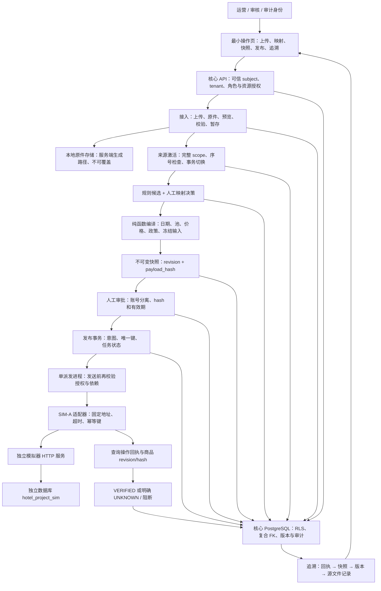
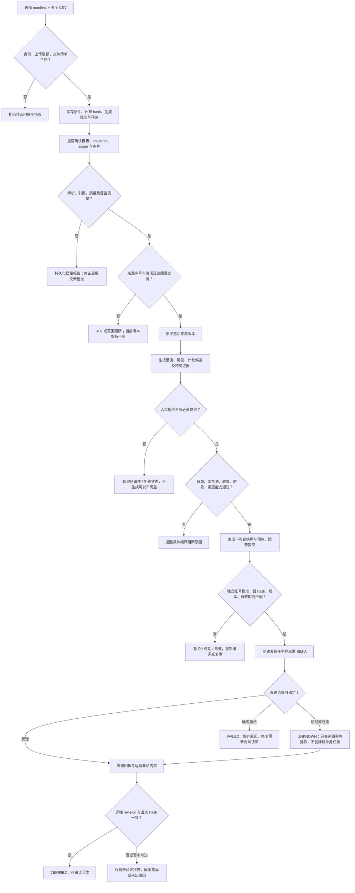

# AI 酒店库存匹配与多渠道分销平台：G1 阶段详细实施计划

> 版本：v1.0  
> 编制日期：2026-10-26  
> 阶段：最小纵向闭环  
> 状态：待实施的计划与验收规格，不代表下述功能已经实现。  
> 排期方式：按工作包、依赖和退出门槛推进，不精确到天。

> 实施补记（2026-10-26）：G1已按本计划完成实现与联合验收，57项自动测试通过，真实HTTP/独立派发与浏览器全流程到达VERIFIED。本文保留计划规格，实际取舍、证据和剩余边界见 `docs/acceptance/g1-report.md`。

## 1. 设计依据与 G0 交接基线

本计划依据根目录《AI酒店库存匹配与多渠道分销平台-产品技术设计说明书.html》v1.1、G0 实施计划、`docs/acceptance/g0-report.md`，并核对了现有文件契约、领域工具和启动入口。

总设计对 G1 的要求是：**先接 CSV；原件→校验→版本激活→人工映射→编译快照→人工审批→独立模拟器→回执查询；提供最小操作页。**退出标准是：**一份输入真实走完所有后端阶段，可以追溯到源行，而非多个不相连的 CRUD 模块。**规则候选先行，先单渠道，不建设复杂后台。

本计划中的迁移拆分、接口细节、默认资源限制及模拟器契约是建议实施基线。它们需要在 G1 第一个工作包中冻结，不是总设计已经规定或代码已经实现的事实。

### 1.1 已有能力与复用方式

| G0 已交付 | G1 如何复用 | 需要扩展的部分 |
| --- | --- | --- |
| 专属 Conda：`D:\miniconda3\envs\hotel_project` | 后端、模拟器、脚本和测试继续使用同一项目环境 | 新依赖加入锁文件，所有 Python 入口保持 `-s` |
| 本地真实 PostgreSQL 18.4、基础迁移 001 | 在同一核心数据库增量迁移 | 新增来源、映射、价格库存、快照审批及渠道表 |
| tenant/user/membership、身份及 RLS | 所有新 API、新表沿用可信租户上下文 | 新增命令权限、资源级检查及跨租户负测 |
| 酒店、房型、计划与历史版本种子 | 作为首次人工映射的目标主数据 | 建立供应商来源实体及正式映射决策 |
| F00～F05、manifest Schema、CSV 契约校验器 | 作为真实接入的基础样例和质量规则 | 增加 HTTP 上传安全、原件存储、预览、暂存与持久化报告 |
| Decimal、入住区间、共享池纯函数 | 复用口径并补足报价编译 | 完整日期覆盖、政策等价、来源时效及渠道表达校验 |
| 五类基础 API、开发登录、OpenAPI | 保留兼容，扩展业务路由 | 最小操作页与真实业务命令 |
| G0 验收报告：36 项测试通过 | 作为进入 G1 的历史基线 | 开工时复跑；不把历史通过当作当前环境仍然通过 |

G0 的双供应商别名是后续输入规格，尚不是有效映射；共享池测试也不是完整编译器。G1 不得把这些设计材料直接展示为业务执行结果。

### 1.2 G1 固定运行约束

- 项目目录保持 `D:\hotel`；不新建第二套后端环境，不使用 base 或其他项目环境。
- 手工命令和脚本均使用 `D:\miniconda3\envs\hotel_project\python.exe -s`，禁用用户级包污染。
- 核心 API 默认 `127.0.0.1:8000`；模拟器建议 `127.0.0.1:8001`，实际启动前检查占用。
- 核心数据库保持 `hotel_project`；模拟器使用独立数据库 `hotel_project_sim` 和独立数据库角色。可以共用本机 PostgreSQL 实例，但不能共享核心业务表。
- G1 不依赖 Docker、外部模型密钥、真实供应商服务或真实 OTA。
- 前端若采用 React/TypeScript，使用项目内依赖和 lockfile；Node 运行时属于前端工具链，不是借用其他项目的 Python 环境。

## 2. 目标、范围与不变量

### 2.1 G1 应展示的完整故事

运营以 T-A 身份选择 manifest 和五个 CSV → 上传不可变原件 → 查看预览和质量报告 → 确认并激活完整来源版本 → 审核员批准酒店、房型和计划映射 → 运营编译并提交商品快照 → 不同账号审核批准 → 服务端发往 SIM-A → 查询远端操作与商品内容 → 本地标记 VERIFIED → 审计者从远端商品回溯到原始文件及记录。

“一份输入”在本项目中具体指 G0 的完整逻辑数据包：`manifest.json` 加五个 CSV 文件，不要求塞进一个 CSV。G1 采用多文件上传，不引入 ZIP 解压；不允许调用者提交服务器磁盘路径。

### 2.2 范围控制

| 项目 | G1 必须完成 | 留到后续阶段 |
| --- | --- | --- |
| 输入格式 | G0 v1 完整 CSV 包；manifest 作为元数据 JSON | XLSX、数据型 JSON、压缩包、部分 delta |
| 来源激活 | 完整 snapshot、明示 scope、原子切换、基础序号保护 | 任意重叠分区、完整 delta、复杂并发与批量恢复 |
| 质量 | 明确错误与源行定位；任何阻断错误均不激活 | 大批量坏行部分激活、十万行流式优化 |
| 匹配 | 确定性规则候选；酒店/房型/计划分别人工确认 | 实际 AI、向量检索、自动批准、主数据合并 |
| 报价 | 两成人、一间、USD、固定规则、逐日日历与多晚检查 | 多币种、儿童、复杂取消阶梯、收益管理 |
| 审批 | 人工审批，独立账号、hash 绑定、有效性复查 | 授权自动化策略与常规更新全自动贯通 |
| 发布 | 单 SIM-A、独立 HTTP/存储、稳定幂等、回执与内容核验 | 第二渠道、429 预算、复杂退避、完整对账和紧急停卖 |
| 调度 | 短步骤显式命令；持久化发布意图；单派发进程 | 通用 run/step/wait、租约接管、通用 outbox/inbox |
| UI | 能完成一次全链路操作并理解阻断原因 | 仪表盘、批量操作、复杂图表、WebSocket |

阶段裁剪不意味着可以破坏安全语义。G1 即需拒绝未批准发布、旧来源覆盖、跨租户访问和结果未知时的盲目重发；复杂故障自动收敛留到后续。

### 2.3 必须持续成立的业务不变量

1. 来源记录、标准酒店、标准房型和标准计划独立建模；已批准酒店映射不能替代房型和政策检查。
2. 两计划共享每日四间库存，日历均引用同一池；不得宣传为可同时出售八间。未知跨供应商池不累计。
3. `[2027-01-10,2027-01-13)` 为三晚；缺一天价格、有效库存、可表达政策或命中 stop_sell 即不可售。
4. 金额使用 Decimal/NUMERIC；净价、售价及税费口径明确；不得凭名称或模型推断含税。
5. snapshot 只有在覆盖分区完整且合法时才能生效。G1 默认整包阻断，不在坏行场景下推断删除。
6. 映射、来源、政策、规则或渠道能力发生业务变更后，旧快照保持历史原文；旧审批不能授权新载荷。
7. 本地 HTTP 成功不等于远端已验证；必须比较远端 revision/hash。超时表示结果未知，不能自动解释成失败。
8. 新表、新下载入口、审核命令及模拟器账号均有租户边界。来源文本以普通文本显示。

## 3. 架构图与端到端流程

### 3.1 G1 系统架构



箭头表示领域依赖，不表示必须把全部步骤塞进一次长 HTTP 请求。人工等待以持久化业务状态表达，页面关闭后保留已完成结果；G1 不实现通用工作流引擎。

### 3.2 正常流程与阻断路径



## 4. 工作包与实施顺序

| 工作包 | 核心成果 | 前置依赖 |
| --- | --- | --- |
| WP01 基线与契约冻结 | 输入、状态、模拟器 payload、角色与版本规则 | G0 文件及基线回归 |
| WP02 数据模型与迁移 | 真实业务表、隔离、不可变与唯一约束 | WP01 |
| WP03 文件接入与激活 | 上传→原件→预览→校验→暂存→激活 | WP02 的来源迁移 |
| WP04 候选与人工映射 | 独立酒店/房型/计划审核 | WP03 |
| WP05 编译快照与审批 | 可复算载荷、hash、独立审批 | WP04、报价迁移 |
| WP06 独立模拟器 | HTTP、独立存储、幂等与查询 | WP01 契约、模拟库迁移 |
| WP07 发布与验证 | 持久化任务、发送、回执、UNKNOWN | WP05、WP06 |
| WP08 最小操作页 | 人能操作真实后端完成闭环 | 各真实 API 逐步可用 |
| WP09 联合验收与交接 | 端到端、失败证据、运行手册 | 全部工作包 |

建议先完成 WP01/02，再沿 WP03→04→05 推进。WP06 在 payload 契约冻结后可独立建设，WP08 随真实接口迭代接入。每一段都用 F00 验证，避免最后才联调。

### WP01：开工基线、契约和状态冻结

实施任务：

1. 复跑 G0 测试、依赖检查和当前启动入口，记录失败及环境变化；本计划编制不替代开工回归。
2. 保留 G0 迁移 001，不直接修改已经执行的 SQL；评估拆分现有 `main.py` 和 `domain.py` 的模块边界，保持旧 API 兼容。
3. 冻结完整包上传协议：multipart 内一个 manifest、五个固定 CSV；清单与上传文件一一匹配。
4. 冻结 G1 仅支持完整 snapshot 的规则；delta 明确返回 `MODE_NOT_SUPPORTED_G1`，不接受后再误按 snapshot 处理。
5. 定义来源分区为供应商+单物业+固定实体集合+日期范围。G1 允许同一分区更新、互不重叠分区新增；对同一物业的非完全相同重叠范围返回明确不支持，避免遗漏覆盖语义。
6. 约定 F00 的 R2 为“房型主数据存在但无计划和库存”，不要求它生成商品；完整性基于声明范围内实际计划与日期，不把未售卖房型误判为缺价。
7. 冻结 SIM-A v1 能力、取消条款表达、共享池表达、payload 规范化和错误码。兼容 G0 的 `rate_plans.csv` 与 rates.pool_code。
8. 记录 ADR-010（接入/激活）、ADR-011（编译/审批）、ADR-012（模拟器/发布边界）；编号在创建前检查避免冲突。

交付：`contracts/imports/`、`contracts/channels/sim-a/v1/`、状态表、权限表、ADR 及 G1 待决项清单。

验收：同一份输入在接入、编译、模拟器中使用一致的日期、币种、政策与库存语义；所有暂不支持项有明确错误，而非隐式默认。

### WP02：增量数据模型与迁移

建议按纵向需求分组迁移，编号在执行前核对：

| 建议迁移 | 新增对象 | 必须保证的约束 |
| --- | --- | --- |
| 002 来源 | artifact、import_batch、batch_artifact、processing_run、staging_record、dq_issue、supplier_entity/version、source_partition/activation、inventory_pool/cell、rate_cell、plan_pool_link | 原件路径服务端生成；自然键及行定位；引用同租户；分区序号和来源版本明确 |
| 003 映射 | property_mapping、room_mapping、rate_mapping、mapping_decision、match_proposal | 真实复合 FK；来源版本与目标版本绑定；来源当前有效批准映射唯一 |
| 004 商品 | pricing_rule/version、channel_account/mapping、offer、offer_snapshot、approval | offer+revision 唯一；hash 与审批绑定；不可变 payload；渠道账号归属 |
| 005 发布 | channel_listing、publish_task、task_attempt、channel_receipt | listing+revision+chunk 唯一；幂等键唯一；回执追加；任务状态迁移受控 |
| 模拟库 001 | sim_account、listing、operation、pool_calendar | 独立角色/库；账号范围唯一；key+request_hash；revision 原子比较 |

实施要求：

- 新租户业务表全部启用 RLS/FORCE RLS；新增跨表引用使用 `(tenant_id,id)`，业务权限由应用服务补充，不仅依赖数据库租户隔离。
- 原件、来源版本、映射决策、快照业务载荷、回执和审计采用追加或受控不可变设计；状态字段与业务载荷分开更新。
- 映射表的源 kind、父级链及目标实体类型可验证，不能只保存一个无法建立外键的 target_id。
- 关联表保存确定的 activation/version；库存、价格、计划关系不得各自查询“当前”后混拼不同批次。
- 新迁移更新 schema_revision、ready 判断和测试预期；当前代码硬编码 001，应改为统一的预期迁移常量或清单。
- 核心库与模拟库分别执行迁移、种子和 readiness，不授予对方数据库凭据或读表权限。
- 原件落盘与数据库提交不是同一事务：失败需清理本次临时文件或登记孤儿；不能返回数据库成功但原件丢失。

验收：空库从 001 升级、已有 G0 库增量升级、迁移重跑均通过；应用角色负测覆盖所有新增表；既有种子与 API 不回归。

### WP03：真实上传、原件、预览、质量与来源激活

实施任务：

1. 增加 multipart 上传依赖并锁定。建议初始限额：单文件 5 MiB、总包 20 MiB、仅 6 个文件、每类 CSV 最多 5,000 条记录；这些是资源保护配置，不是实测吞吐承诺。
2. 边读取边限制实际字节，不信任 Content-Length；验证精确文件集合、扩展名、manifest 内容、SHA-256、UTF-8 和 CSV 结构。拒绝重复文件、绝对路径、路径穿越及任意 URL 输入。
3. 原始字节存入 `.runtime/artifacts/<server-generated-key>`，不使用用户文件名拼接路径。文件元数据包含 tenant、supplier、大小、hash、上传者、时间与状态。
4. 按租户、供应商和规范化文件清单摘要识别同一逻辑包；重复上传返回已有可见批次，不重复激活。摘要计算与文件顺序无关。
5. 预览每类前 50 条记录、总条数、编码、字段、mode、scope、source_sequence。G1 固定模板不提供任意列映射；需要改映射时新模板/处理运行，不覆盖历史。
6. 运营提交 confirm，绑定 expected_version 与预览参数 hash；状态从 RECEIVED 到 VALIDATING/READY，暂存记录保留原始值、规范值、文件 ID、记录序号、规则版本。
7. 复用并重构 G0 校验规则；质量报告进入数据库。G1 任何阻断错误都停在 INVALID，原件和报告可查看，但不激活部分“好行”。
8. 激活前验证完整日期覆盖、同日唯一、计划池关系稳定、来源时效及父级引用；事务内锁定供应商/物业的激活保护行，检查 scope 和序号。
9. 只有更高 source_sequence 才可切换同分区。相同序号同内容返回已有结果，相同序号异内容或旧序号为冲突。未使用分区也需防并发首次插入。
10. 一个事务内生成不可变来源版本、库存价格日历与 activation，更新当前 pointer，追加审计；失败不能出现半激活。
11. 提供受保护的原件下载。下载路径不从请求直接取得；应用查资源归属后定位 storage_key，日志与错误不泄露真实文件系统位置。

验收：F00 通过真实 HTTP 上传与激活；F01～F05 均有持久化错误并保持当前版本不变；旧序号不能覆盖；重复输入不重复生效；T-B 无法读取 T-A 原件、报告和激活资源。

### WP04：规则候选与人工映射

实施任务：

1. 首次激活后，为需要编译的来源酒店、房型和计划产生候选；候选只写提案，不直接修改事实。
2. 酒店候选使用国家/城市、地址及显式合成别名；名称标准化后排序。规则版本固定并保存，排序分数不当作概率。
3. 房型仅在已批准的目标酒店内检索；KING/TWIN、人数冲突列为硬阻断。未知床型不能被自动补成确定床型。
4. 计划仅在已批准的目标房型内检索；餐食、取消 kind/deadline/basis、支付和税费逐项比较。未知或不支持的条款进入待补充，不能批准为等价计划。
5. 审核接口支持批准、拒绝、待补充，保存操作者、理由、来源/目标版本与 expected_version；陈旧页面提交返回 409。
6. 酒店→房型→计划依次检查父级。客户端传入的 target ID 必须同租户、同父级链；审核员不能越过硬冲突强制批准。
7. G1 只映射到已有主数据；缺少目标时明确等待，不自动建酒店或合并主数据。审核员与高风险发布审批账号职责在后续审批环节再检查。
8. 相同已批准事实在后续激活中无关键变化时，可复用映射规则，但必须记录有效来源事实 hash；关键字段变化使受影响映射待复核。

交付：候选服务、三类映射表及审核 API、证据对照、冲突码、人工决策审计。

验收：S-A 的 001 与 S-B 的 B700 可经人工映射到同一标准酒店；KING/TWIN 及 FLEX/NONREF 冲突均被阻断；同店不同来源不因此累计库存。双供应商样例为扩展验收数据，不要求同时做来源择优算法。

### WP05：报价编译、不可变快照与人工审批

实施任务：

1. 采用纯函数 compiler，输入为冻结的来源、映射、目标政策、价格规则、渠道能力及业务时钟；禁止在编译过程中发 HTTP 或自由查询不断变化的“当前”事实。
2. G1 指定单一来源和 SIM-A；不跨供应商自动择优。完整检查三晚价格/库存、stop_sell、人数、币种、政策与来源 TTL。
3. 提供版本化演示价格规则：建议 `sell_amount = usd(net_amount × 1.10)`，USD 100.00 输出 USD 110.00；保持 `NET_EXCLUSIVE` 等明确税费口径。SIM-A 必须支持该口径，否则阻断。
4. SIM-A 使用共享池维度日历：一个酒店可有多个计划引用相同 pool；池每晚只发布一次 quantity=4，不按计划各自生成独立四间 allotment。
5. 编译内容按明确规范 canonicalize：键排序、日期排序、金额固定两位字符串、布尔真实类型、禁止 NaN；排除 trace_id、生成时间等非业务元数据。定义规范版本并计算 SHA-256。
6. offer+revision 单调递增，重复编译相同输入和业务 hash 复用已有快照或返回无变化，不无意义分配新业务版本。
7. 快照保存所有输入版本、逐日数据、规则、源行定位及 payload_hash。业务 payload 不允许更新；状态与审批单独管理。
8. 快照预览展示源净价、计算规则、售价、税费、计划差异、共享池与有效期。G1 展示首版完整预览；高级差异编辑留到后续。
9. 运营提交快照后，具有审核权限且 subject 不同的账号批准或拒绝；保存理由和 expires_at。默认审批有效期建议 30 分钟，可配置。
10. 编译、提交、审批、派发前都核查当前来源/映射/政策依赖及 freshness；状态过期返回具体原因。审批的有效性取审批和来源有效期的更早者。
11. 保留历史快照，不因来源更新修改已发布历史。G1 新版本替换前须重新人工审批，不实施自动审批策略。

**时钟约定：**G0 样例 observed_at 固定在 2027 年，不能直接套真实时钟后假装永不失效。G1 演示包在显式 `DEMO_CLOCK_ENABLED` 下使用固定业务时钟，所有页面显示“模拟业务时钟”；默认关闭。JWT 使用真实时钟，模拟时钟仅作用于明确的演示来源/编译时效，禁止启用真实连接。另做真实业务时钟下来源过期的负测。来源 TTL 建议演示配置为 24 小时，属于可调整风险参数。

验收：纯函数可复算 USD 110.00、三晚合计 USD 330.00；退房日不收费；共享池不翻倍；未映射、缺价、停卖、条款未知、过期和自审批均不能放行；业务载荷变化不能沿用旧审批。

### WP06：独立 SIM-A 服务与存储

实施任务：

1. 独立进程/应用工厂、独立数据库、独立迁移角色及运行角色；核心服务仅通过 HTTP 调用，不能直接查询模拟库确认结果。
2. 种子创建 T-A/T-B 对应的独立模拟账号。模拟器令牌仅允许访问自己的账号；请求体 tenant_id 不能决定身份。
3. 冻结 capability v1：USD、两成人、逐日日历、FLEX/NONREF、明确税费口径及共享池引用；不支持字段明确拒绝。
4. 发布采用酒店+账号聚合的完整 listing bundle，内含房型、计划、共享池及其日历。该粒度避免多个计划分别写入后把同一池复制成不同配额。
5. 提供 `PUT /v1/listings/{key}`、`GET /v1/operations/{idempotency_key}`、`GET /v1/listings/{key}`，路径 key 由契约定义，不能包含本机路径或真实 OTA 地址。
6. 在单事务内检查账号、payload、hash、revision，保存 listing 和 operation 回执。同 key+同 request_hash 返回原结果；同 key+不同内容返回 409；旧 revision 不能覆盖新内容。
7. 同 revision+同 hash 可返回已有状态；同 revision+不同 hash 为冲突。响应含 operation_id、applied_revision、payload_hash 和处理状态。
8. 提供一个受开发配置限制的“落地后延迟响应”故障，用于最小 UNKNOWN 路径验收；默认关闭。多种网络故障组合留给 G3。
9. 核心适配器固定 loopback 地址和服务端账号配置，禁用重定向、环境代理及任意出站目标；普通业务请求不能提供 endpoint URL。

验收：核心和模拟器分进程运行，核心仅凭 HTTP 回执与读取内容证明落地；重复写入远端只有一个业务效果；跨模拟账号读取被拒绝。

### WP07：持久化发布意图、单派发与远端验证

实施任务：

1. 发布命令事务内验证审批、当前依赖与渠道账号，写入 publish_task、desired_revision 和审计。任务表本身是 G1 的持久化派发意图，不能提交后只靠内存回调发送。
2. API 返回可查询任务；单派发进程从数据库读取 READY 任务并以原子状态转换认领。G1 限定单实例，第二实例应明确拒绝启动或竞争同一全局 advisory lock。
3. 网络请求在数据库事务外执行；发送前再次验证审批与依赖。认领状态 SENDING 在事务内提交，保存 attempt、幂等键、请求 hash 和 actor。
4. 幂等键基于 tenant/account/listing/revision/chunk 的稳定标识生成。HTTP 重试不得创建新业务 key；客户端 Idempotency-Key 同 key 异请求返回 409。
5. 明确成功受理后查询 operation 和 listing；revision 与 hash 都一致才写 VERIFIED。只有回执而无法核验内容时不冒充最终成功。
6. 超时、断连或无法解释的服务错误进入 UNKNOWN；只能查询原 operation。确认未执行且仍有有效授权时，可显式重试原任务、原 key；未知状态下不允许“再创建一单”。
7. 单进程启动时将遗留 SENDING 转为待查询状态，不盲目重新发送；G1 不提供多 Worker 租约接管，但不能忽略遗留风险。
8. 确定性能力或校验错误为 FAILED；返回运营可理解原因。审批过期/依赖变化为 BLOCKED，必须重新编译或复审。
9. 发布/查询回执追加保存，查询结果不清空历史尝试。任务读取、重试、查询均做角色与租户检查。
10. 保留 G2/G3 扩展点：任务 lease、fencing token、outbox/inbox、重试预算、按聚合顺序和三方对账，当前不宣称这些增强已具备。

验收：正常任务 VERIFIED；重复提交只产生同一业务意图；落地后超时经原 key 查询恢复确认；未知时不产生第二次副作用；未批准或审批失效不得发送。

### WP08：最小操作页与审计追溯

建议沿用总设计的 React/TypeScript，代码放 `apps/admin`。G1 实施时再细化视觉设计，不因页面风格延迟后端闭环。

页面按四个工作区组织，复用同一导入/快照上下文：

| 工作区 | 必需内容 | 用户完成的动作 |
| --- | --- | --- |
| 导入 | 文件选择、scope/时钟提示、预览、质量、批次状态 | 上传、确认、查看阻断、激活 |
| 映射 | 来源/目标字段并排、父级、冲突、规则版本 | 分别批准/拒绝酒店、房型、计划 |
| 商品与审批 | 价格计算、三晚日历、共享池、hash、版本与有效期 | 编译、提交、切换独立身份审批 |
| 发布与追溯 | 任务、UNKNOWN、回执、远端核验、原件行定位 | 发布、查询、解释失败、审计回放 |

实施要求：

- 账号、租户和模拟业务时钟始终可见；切换身份需重新授权，不在客户端伪造角色。
- 登录令牌仅放内存，刷新后重新登录；不把密钥写入前端配置或源码。
- UI 只展示后端已存在的结果；按钮禁用不能替代服务端授权。
- 等待使用有限轮询或显式刷新，页面关闭不删除业务状态；G1 不要求每一段自动恢复推进。
- UNKNOWN 展示“结果待确认”，只提供查询，不提供误导性一键重发。
- 文件名、地址、条款、审核理由以文本转义渲染；跨租户资源、原件下载和错误消息均不泄露信息。
- 本地前端与 API 使用明确允许的 origin；不使用带凭据的通配 CORS。

验收：无需直接修改数据库或调用开发人员私有脚本，即可由页面完成 F00 正常闭环；审计者只读查看证据，不具备审批发布权限。

## 5. API 与状态契约建议

### 5.1 核心 API

以下路径为实施建议；最终需对照总设计 API 章节统一并生成 G1 OpenAPI。命令携带 expected_version，涉及重复副作用的命令支持 Idempotency-Key。

| 方法与路径 | 目的 | 成功语义 |
| --- | --- | --- |
| `POST /v1/imports` | 上传完整包、创建原件与批次 | 201；重复包可返回已有批次，明确 reused |
| `GET /v1/imports/{id}` | 状态、预览与版本 | 200，不跨租户 |
| `POST /v1/imports/{id}/confirm` | 冻结参数并校验暂存 | 有界同步完成为 200；若选择后台则 202 并真实持久化任务，不能假进度 |
| `GET /v1/imports/{id}/issues` | 持久化质量问题 | 200，分页与行定位 |
| `POST /v1/imports/{id}/activate` | 激活来源分区 | 200/201；陈旧版本或序号冲突为 409 |
| `GET /v1/artifacts/{id}/download` | 授权下载原件 | 200，服务端定位路径 |
| `GET /v1/match-proposals` | 查询候选与硬冲突 | 200，限定来源版本 |
| `POST /v1/mappings/{kind}/{id}/decisions` | 人工决策 | 200/201，版本冲突为 409 |
| `POST /v1/offers/compile` | 生成或复用快照 | 201 或明确无变化的 200；阻断原因结构化返回 |
| `GET /v1/snapshots/{id}` | 冻结预览与依赖 | 200 |
| `POST /v1/snapshots/{id}/submit` | 提交审批 | 200/201，记录 submitted_by |
| `POST /v1/snapshots/{id}/decisions` | 独立账号批准/拒绝 | 200/201，自审批为 403 |
| `POST /v1/publish-plans` | 创建单渠道发布意图 | 202 + 持久化任务 ID，不代表已成功 |
| `GET /v1/publish-tasks/{id}` | 任务和回执 | 200 |
| `POST /v1/publish-tasks/{id}/query` | 查询原操作并核验远端 | 200/202，不能创建新发布副作用 |
| `GET /v1/snapshots/{id}/provenance` | 回溯来源及版本 | 200，所有关联资源同租户 |

### 5.2 角色矩阵

| 行为 | operator | reviewer | tenant_admin | auditor |
| --- | --- | --- | --- | --- |
| 本租户查看/追溯 | 是 | 是 | 是 | 是 |
| 上传、确认、激活 | 是 | 否 | 是 | 否 |
| 人工映射决策 | 否 | 是 | 是，遵守审核规则 | 否 |
| 编译及提交快照 | 是 | 否 | 是 | 否 |
| 批准快照 | 否 | 是，必须非提交者 | 是，必须非提交者 | 否 |
| 发布/显式查询恢复 | 是 | 只读查看 | 是 | 只读查看 |

后台派发使用受控 system actor，并保留发起者，不把系统执行伪造成审核员批准。

### 5.3 最小状态机

| 对象 | 主要状态 | 转换约束 |
| --- | --- | --- |
| Import | RECEIVED → VALIDATING → READY → ACTIVE；INVALID | 仅 READY 可激活；INVALID 不部分生效；重复激活复用已有 activation |
| Mapping | PENDING / APPROVED / REJECTED / NEEDS_INFO / STALE | APPROVED 绑定来源与目标事实；硬冲突不能批准；关键事实变化需复核 |
| Snapshot | COMPILED → SUBMITTED → APPROVED / REJECTED；STALE / EXPIRED | 业务 payload 始终不可变；审批独立账号与同 hash；失效不能发布 |
| Publish task | READY → SENDING → ACKNOWLEDGED → VERIFIED；UNKNOWN / FAILED / BLOCKED | 只有远端内容匹配才 VERIFIED；UNKNOWN 优先查原操作；BLOCKED 不发送 |

这些是 G1 的拟议最小状态集合，WP01 需与总设计状态命名协调。导入、快照和任务状态分开保存，不能用一个 SUCCESS 字段代替全部阶段。

## 6. 样例、测试与验收矩阵

### 6.1 数据准备

- 保留 G0 F00～F05 原样及 expected，不为通过测试篡改错误样例。
- 新增 S-B/B700 完整有效包、旧序号包、同序号异内容包、缺一天价格、stop_sell、条款 UNKNOWN、King/Twin 错配和来源更新包。
- 生成器同时生成实际 manifest hash 和期望结果；不手写虚假的摘要。
- 区分冻结演示业务时钟与真实时钟测试；不在 JWT 时间校验中使用模拟时钟。
- 每个 E2E 使用独立测试数据范围或专属可重建测试库；不得默认清空开发库，更不得重置不属于本项目的数据库。

### 6.2 验收项目

| 编号 | 场景 | 通过标准 |
| --- | --- | --- |
| G1-01 | G0 回归与增量迁移 | 原 36 项适配最新迁移后仍通过；空库/已有库升级和迁移重跑通过 |
| G1-02 | 正常全链路 | F00 经真实上传、激活、映射、审批、HTTP 模拟器到 VERIFIED，可回溯源记录 |
| G1-03 | 上传安全 | 超限、重复文件名、路径穿越、缺文件、非法 manifest 均拒绝；不留下可激活半包 |
| G1-04 | F01～F05 | 命中预期错误并持久化；当前来源版本不变 |
| G1-05 | 幂等导入 | 相同包重复上传/确认/激活不重复生效；摘要不受文件上传顺序影响 |
| G1-06 | 激活完整性与顺序 | 缺日期/冲突不激活；旧序号和同序号异内容不能覆盖；不支持重叠范围明确阻断 |
| G1-07 | 人工映射 | 酒店、房型、计划各有批准记录；不同来源同酒店可解释；未映射不能编译 |
| G1-08 | 硬冲突与父级 | KING/TWIN、FLEX/NONREF、错父级、跨租户目标均不能批准 |
| G1-09 | 金额日期与库存 | USD 100→110；三晚330；退房不计夜；两计划共享四间而非八间 |
| G1-10 | 不可售与 TTL | 缺价、stop_sell、UNKNOWN 条款、真实时钟过期均阻断；模拟时钟标识明确 |
| G1-11 | 快照/hash | 相同业务输入 hash 稳定；业务字段变化 hash 改变；已保存 payload 不可改 |
| G1-12 | 审批约束 | 自审批、过期审批、旧 hash、来源/映射变化均不能派发；陈旧审核请求 409 |
| G1-13 | 独立模拟器 | 核心无模拟库读写权限；通过 HTTP 验证远端内容，而非本地假回执 |
| G1-14 | 远端幂等/revision | 重复 key 同内容单一效果；异内容 409；旧 revision 不能回写覆盖 |
| G1-15 | 最小 UNKNOWN | 落地后延迟响应导致 UNKNOWN；查询原 key 后确认；无新 key 重复副作用 |
| G1-16 | 进程边界 | 页面关闭保留状态；派发单实例；遗留 SENDING 不被盲重发，查询后收敛或显式未解决 |
| G1-17 | 权限与隔离 | 两租户对所有新命令、报告、下载、快照、任务及模拟账号的越权负测通过 |
| G1-18 | 安全显示与错误 | 原文、文件名、理由不执行脚本；日志无口令/令牌；错误含 trace_id |
| G1-19 | 最小操作页 | 人工切换账号即可完成故事；不依赖手改库；UNKNOWN 无误导性重发按钮 |
| G1-20 | 可复现交付 | 项目脚本可启动核心/模拟器/单派发；OpenAPI、测试报告与限制一致 |

测试分层：纯函数测试验证编译与规范化；真实 PostgreSQL 集成测试验证约束/激活/审批；独立 HTTP 契约测试验证模拟器；E2E 测试覆盖同一数据包全链路。不能只用 mock 外部响应后声称独立渠道闭环完成。

最低证据包括正常 VERIFIED 链路、无效包阻断、硬冲突、自审批拒绝、审批失效、重复发布去重、落地后超时查询及跨租户拒绝。测试数量由实际实现决定，不提前承诺“恰好新增多少项”。

## 7. 里程碑与退出门槛

### M1-A：数据真实进入平台

- [ ] 开工基线回归和 WP01 契约冻结完成。
- [ ] 增量来源迁移、上传、不可变原件、预览、暂存和质量报告可用。
- [ ] F00 可激活；异常、重复和旧序号处理有证据。

退出门槛：能从当前来源记录定位上传原件，不存在半激活或坏行被误当删除。

### M1-B：合格商品真实形成

- [ ] 三类人工映射、硬冲突与父级约束可用。
- [ ] 编译器、价格规则、共享池和多晚验证可复算。
- [ ] 不可变快照和独立人工审批可用，来源变化使旧审批无效。

退出门槛：能够回答“为什么是这家酒店、这个房型、这套条款、这个价格和库存”，并提供确定版本证据。

### M1-C：商品真实落地独立模拟器

- [ ] SIM-A 独立服务与存储可用，账号隔离和幂等/revision 通过。
- [ ] 持久化发布意图、单派发与远端内容核验可用。
- [ ] 正常任务 VERIFIED；最小 UNKNOWN 查询路径可解释且不重复副作用。

退出门槛：核心只通过 HTTP 证明远端落地，不以本地任务成功或 200 响应替代核验。

### M1-D：可操作、可追溯、可交接

- [ ] 最小操作页能完成正常故事；阻断与恢复动作清楚。
- [ ] G1 验收矩阵必要条目全部通过，G0 回归无未解释失败。
- [ ] README、启动脚本、OpenAPI、演示数据和实测报告一致。
- [ ] G2/G3 待办与当前剩余风险明确，未实现项没有包装成完成。

退出门槛：新终端按说明可运行完整故事，审计者可从远端商品追到源文件记录。

## 8. 交付目录与运行入口

建议在现有项目增量形成以下结构；下列名称是目标，不表示已创建：

```text
apps/admin/                         # 最小 React/TypeScript 操作页与 lockfile
services/core/modules/
  ingestion/ matching/ offers/ approval/ distribution/ audit/
services/core/adapters/channels/    # SIM-A HTTP 适配器
services/core/workers/              # 单实例派发入口
services/channel_simulator/        # 独立 HTTP 服务
contracts/imports/
contracts/channels/sim-a/v1/
contracts/openapi/g1.json
infra/migrations/002...005*.sql
infra/simulator_migrations/
datasets/g1/
tests/unit/ integration/ contract/ e2e/ security/
docs/decisions/ADR-010...012*.md
docs/runbooks/g1-local.md
docs/runbooks/g1-unknown.md
docs/acceptance/g1-report.md
docs/acceptance/g1-tests.xml
```

运行入口在现有 `infra/scripts/hotel.ps1` 增量扩展：核心 API、模拟器、单派发、数据库迁移、演示种子、测试和端到端 smoke。必须区分准备数据库、启动服务和运行测试；不让 start 默认重置数据。

后台进程需保存可核验的 PID 和日志，停止时确认是本项目进程；不结束占用相同端口的无关程序。后端继续 `python -s`，本地 HTTP 适配器禁用环境代理。

## 9. 风险、取舍与工作量管理

| 风险 | 处理与范围约束 | 退出影响 |
| --- | --- | --- |
| G0 业务规则工具被误当成完整实现 | 开工分别验证上传、激活、映射、编译和发布事实 | 缺任一段则不能退出 |
| snapshot 覆盖含义失控 | G1 仅完整 snapshot、受限分区；不支持的 overlap/delta 拒绝 | 静默错误则阻塞 |
| 原件写入与数据库不一致 | 临时存储、状态标记及孤儿清理，保留失败证据 | 丢原件仍宣称成功则阻塞 |
| 双计划库存被各发一份 | SIM-A 使用共享池及引用，listing bundle 原子写入 | 无法表达则阻断发布 |
| 审批与派发之间事实变化 | 派发前核查依赖、hash、时效，旧任务 BLOCKED | 可绕过则阻塞 |
| 超时重复发送 | 稳定幂等键、UNKNOWN 查询、单实例、遗留 SENDING 查询 | 无安全依据重发则阻塞 |
| 多步 UI 分散状态 | 以批次/快照/任务串联；先真实 API，再页面联调 | 不能完成故事则阻塞 |
| 为 G1 提前实现 G2/G3 全部可靠性 | 只做底线保护与一个超时案例，增强列入交接 | 可裁剪增强，不能裁剪底线 |
| 测试污染开发数据 | 专属测试库/范围、恢复夹具，不默认破坏性清库 | 目标未隔离则停止执行测试 |

不承诺逐日工期。建议投入参考：契约/迁移 15%，接入/激活 25%，映射/编译/审批 25%，模拟器/发布 20%，最小页面与联合验收 15%；此比例是范围管理参考，不是性能或交付承诺。

时间不足时优先减少页面装饰、统计、复杂搜索、额外格式及来源择优；不削减原件追溯、独立审批、共享池语义、真实远端核验与权限负测。

## 10. G2/G3 交接与开始实施检查表

### 10.1 G1 完成后交接

交给 G2：完整包到真实快照/发布的代码、来源分区与状态契约、激活基础锁、三类映射、冻结输入编译器、持久化发布意图及单派发恢复限制。在此基础上扩展 XLSX/JSON、delta、流式处理、坏行、run/step/wait、CAS、租约、outbox/inbox 与人工事件恢复。

交给 G3：SIM-A 能力、幂等与 revision 契约、真实 HTTP 回执与内容核验、最小 UNKNOWN 案例；在此基础上增加第二渠道、限流/退避、复杂故障、三方对账和停卖止损。

G1 不以实际 AI 或自动审批作为退出条件；可替换候选接口和证据版本是后续 G4 的输入。

### 10.2 开始实施时的首批动作

1. 检查工作目录、专属环境、当前服务及本项目端口，复跑 G0 基线。
2. 冻结上传、分区、payload、共享池、审批和时钟契约，登记 ADR。
3. 先实现来源迁移及 F00 真上传/预览/激活，完成 M1-A。
4. 依次接入人工映射、编译快照及人工审批，完成 M1-B。
5. 用独立模拟器接入持久化派发与核验，完成 M1-C。
6. 通过最小操作页串联同一数据包，执行验收矩阵并保存实测，完成 M1-D。

本文件交付的是 G1 详细计划。进入开发后，进度和实测记录写入单独的 G1 验收报告，避免计划目标与已完成能力混淆。
