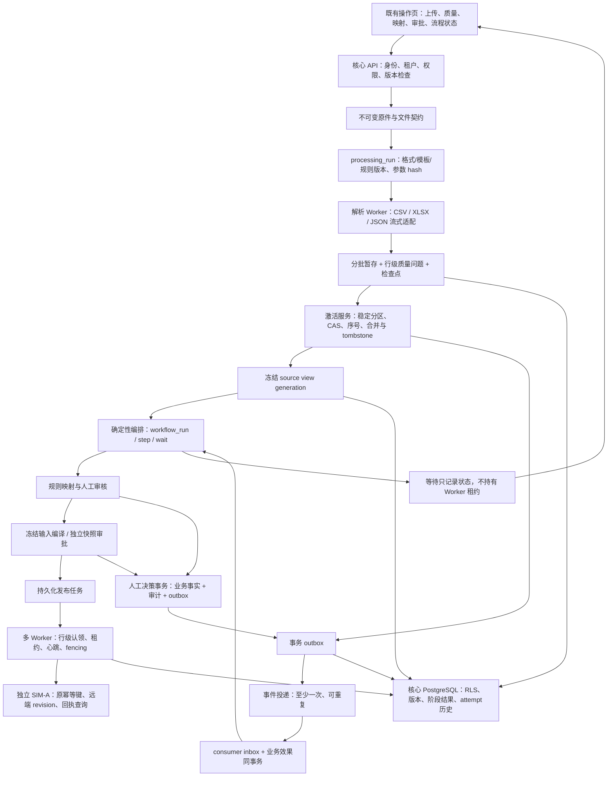
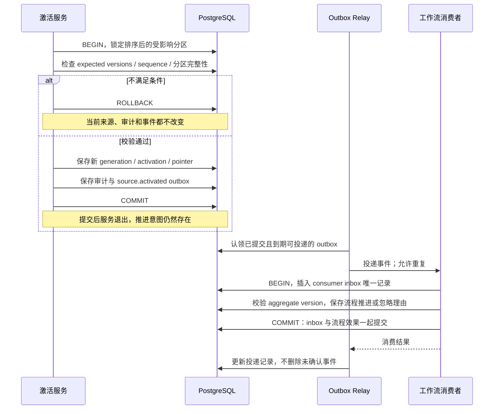
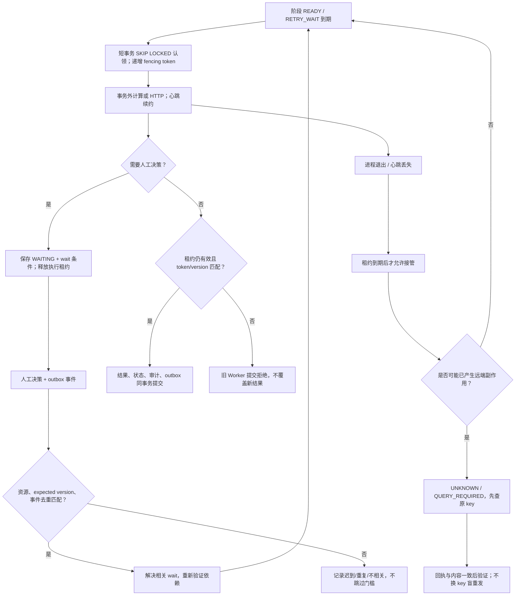

# AI 酒店库存匹配与多渠道分销平台：G2 阶段详细实施计划

> 版本：v1.0  
> 编制日期：2026-10-26  
> 阶段定位：数据与工作流可靠性  
> 状态：已按本计划实施；最终实测、范围收敛及限制见 `docs/acceptance/g2-report.md`。原计划正文保留设计时态，实际目录采用 `services/core/g2/`。  
> 推进方式：按依赖、工作包和验收门槛推进，不精确到天。

## 1. 设计依据、目标与进入条件

依据根目录总设计说明书 v1.1、G1 详细计划、`docs/acceptance/g1-report.md`、ADR-010/012，以及当前 `services/core/workers/dispatch.py` 和迁移版本文件制定。本次为计划编制，没有重新执行 G1 测试或修改运行中的服务。

总设计对 G2 的要求是：**XLSX/JSON、流式批处理、坏行、snapshot/delta、持久化 run/step/wait、CAS、租约、outbox、去重、人工事件恢复。**退出标准是：**乱序与并发激活不覆盖新版本；崩溃可恢复；重复决策不重复推进。**本阶段先证明事实、事务和状态的正确性，再增加模型复杂度。

G1 证明“一份输入能真正走到独立模拟渠道”，G2 要进一步证明：同一事实不会因为重传、乱序、并发、进程中断或重复人工决策而产生错误版本或重复副作用；已完成步骤可保留，人工处理异常后能从明确等待点继续。

### 1.1 G1 实际交接基线

| 当前已实现 | G2 改造方向 | 必须保留的能力 |
| --- | --- | --- |
| 完整六文件 CSV 包，固定 v1 模板 | 三种格式适配到同一规范化记录；引入版本化处理运行 | 原始字节、摘要、记录编号、租户授权 |
| 有界小包读取，issues 在批次 JSON | 流式/分批暂存、持久化行级质量问题和检查点 | 错误可定位，不能以坏行推断删除 |
| 单物业完整 snapshot，拒绝 delta/非相同重叠 scope | 显式覆盖契约、稳定逻辑分区、增量合并及 tombstone | 原子激活、来源时效、旧序号拒绝 |
| 三类映射和确定性编译/独立审批 | 记录依赖与输入 hash，人工事件只唤醒相关流程 | 硬冲突拦截、快照不可变、非自审批 |
| 持久化任务，进程级 advisory lock | 行级认领、租约、心跳、fencing token、多 Worker | 稳定业务幂等键、远端 revision、真实 HTTP 核验 |
| 启动时将全部遗留 SENDING 改 UNKNOWN | 仅在租约到期后接管，区分计算阶段与外部副作用阶段 | 不盲目重发结果未知任务 |
| 单实例循环显式处理 A/B 租户 | 受控租户任务分配和公平调度，不放宽 RLS | 可信租户上下文与数据库角色隔离 |
| 无通用工作流和 outbox/inbox | 数据库内版本化工作流与至少一次事件投递 | 业务状态必须有持久化依据 |

G1 报告记录 57 项测试通过，属于历史实测。G2 开工应先复跑并记录当前基线，不把历史结果当成现时验证。

### 1.2 固定工程约束

- 项目目录保持 `D:\hotel`；专属 Conda 环境保持 `D:\miniconda3\envs\hotel_project`，不另借 base 或其他项目环境。
- 后端、Worker、模拟器、测试入口保持 `python -s`，依赖统一锁定；前端仍使用项目内 Node 依赖和 lockfile。
- 核心 PostgreSQL 当前迁移为 **004**，模拟库为 **001**。新增迁移从实际最新版本向前追加，不修改已执行 SQL。
- 保留 `hotel_project` / `hotel_project_sim` 的数据库及角色隔离；自动验收继续使用独立测试库和测试原件目录。
- 不要求引入 Redis、Kafka、微服务或专用工作流平台；PostgreSQL 先承担任务、租约、事件和流程持久化。
- G2 仍只连接 SIM-A，不接真实供应商/OTA，不以本阶段计划授权任何外部连接。

## 2. 范围、退出结果与阶段边界

### 2.1 G2 完成时的可演示结果

1. CSV、XLSX、JSON 的等价输入形成相同规范化事实和业务载荷；原件及定位方式各自保留。
2. snapshot/delta、缺行、显式删除、零库存与未知值语义清晰，不同日期的更新不会互相误覆盖。
3. 含坏行的批次可完成质量分析并保留有效暂存结果；可证明完整的独立分区才能在重新确认后激活。
4. 重复上传、重解析、任务重复投递和人工重复决策都不产生第二份业务效果。
5. 两个 Worker 竞争同一阶段时只有持有有效租约者可提交；旧 Worker 迟到提交失败。
6. 数据激活、状态更新、审计与后续 outbox 原子提交；提交后进程退出不会丢失后续推进意图。
7. 未知房型或审批等待只阻断依赖路径，人工决策经事件唤醒后继续，不重跑已成功副作用。
8. 解析、激活、事件消费及外部写入后的典型崩溃均有真实故障证据和恢复记录。

### 2.2 与 G3/G4 的边界

| 领域 | G2 必须完成 | 后续阶段承担 |
| --- | --- | --- |
| 文件与来源 | 三格式、流式批处理、质量分级、snapshot/delta、稳定分区与 CAS | 真实供应商 API、实时可订与复杂合同接入 |
| 工作流 | 确定性 run/step/wait、依赖失效、人工事件恢复 | G4 授权策略下的自动审批及实际 AI |
| 任务可靠性 | 多 Worker、租约/fencing、崩溃恢复、outbox/inbox、有限重试 | G3 多渠道配额、复杂退避矩阵与故障组合 |
| 渠道副作用 | 保持单 SIM-A；验证落地后崩溃按原 key 查询恢复 | G3 第二渠道、三方对账、漂移修复、紧急停卖 |
| UI | 原操作页增补质量定位、流程等待、恢复与租约/任务信息 | 复杂统计大屏、全新视觉系统、WebSocket |
| 性能 | 可重复的批处理基准、内存与吞吐实测 | 生产 SLA、水平扩容容量承诺 |

G2 的“自动推进”指确定性阶段编排，并不取消人工映射、来源范围确认和独立发布审批。初次映射仍必须审核，快照仍必须独立审批；它与 G4 的授权自动化策略是不同能力。

## 3. 必须冻结的数据与并发语义

### 3.1 三种版本必须分开

| 标识 | 表达的事实 | 不可混用 |
| --- | --- | --- |
| artifact/package hash | 原始输入字节与文件清单 | 相同原件不等于相同解析结果 |
| processing_run + parser/template/normalizer version | 某份原件在确定规则下的一次逻辑处理 | 重试 attempt 不新建业务来源版本；改模板则应新建逻辑运行 |
| source_sequence + partition version + source view generation | 外部更新顺序、内部 CAS 版本、当前合并事实 | 上传时间不能替代来源序号；同一 generation 可引用多批来源记录 |

同一原件用新模板处理，应复用原件并生成新 processing_run；不能因包摘要命中就返回“已全部完成”。相同原件、相同契约/模板/解析器版本、相同确认参数才复用同一逻辑运行。对已激活来源重解析不自动覆盖，仍通过新激活命令和版本检查。

### 3.2 稳定分区与序号作用域

G1 的“scope hash 即分区”不适合任意重叠更新。G2 建议使用以下有界基线，WP01 中冻结其最终契约：

- 日历分区：`tenant + supplier + property + CALENDAR + stay_date`。一个日历分区同时约束相关库存池与计划日价格，避免同一天共享池和计划被拆开提交。
- 主数据分区：`tenant + supplier + property + MASTER`，管理酒店、房型、计划及其依赖；G2 不支持未声明影响范围的主数据级联删除。
- 同一供应商配置明确的 sequence stream。输入声明 stream/version，只有同一约定 stream 内的 sequence 才可比较；日历与主数据若不是同一序列来源，分开配置，不能全局比较。
- 一个输入可以覆盖多个稳定分区。激活前锁定全部受影响分区及首次创建保护记录，固定排序加锁，核对 `expected_active_versions` 向量与来源序号，再一次性切换选定分区。
- 同一选定激活集合要么全部提交、要么全部回滚；不把事务中途成功的部分误报为整批成功。独立分区部分激活通过单独、已确认的子激活命令表达。
- 同序号同内容/同已提交操作返回既有结果；同序号异内容、旧序号或 CAS 不符均冲突。不能“高序号覆盖一部分、低序号跳过一部分”后静默成功。

“日期分区”是 G2 建议的范围控制策略，并非总设计已有物理模型。若真实来源序列不是上述粒度，应在配置/契约中明示并阻断不兼容输入，而不是猜测。G2 不据此承诺任意供应商更新语义均可接入。

### 3.3 snapshot、delta 与删除

| 输入情况 | 期望行为 |
| --- | --- |
| snapshot 明示完整权威范围 | 选定范围内完整替换；缺项才可能表达关闭/删除 |
| snapshot scope 不完整或含阻断坏行 | 不激活受影响分区；不得把失败解析的记录当作缺项删除 |
| delta 省略某字段/日期/实体 | 原事实不变；不把缺失值填成零或空政策 |
| delta upsert | 按完整自然键更新已声明事实；业务可空字段需显式 null 语义 |
| delta delete | 明示 operation=delete、目标自然键和范围，创建 tombstone；不物理删除历史 |
| quantity=0 / stop_sell=true | 明确业务事实，与未知和删除分开保存 |
| 不支持的 master 级联删除 | 明确阻断；不自动删除仍被计划/池/快照引用的父实体 |

v2 契约须明确 snapshot 的权威目标集合，例如物业/日期下受管理的房型、计划、池集合及其契约版本。不能仅凭一个日期区间猜测该删哪些计划；继承供应商已配置的权威集合时，也必须把所用集合版本冻结进处理输入。

G2 第一版显式支持日历事实 tombstone；酒店/房型/计划停用需影响分析，不做隐式级联硬删除。delta 的父级可引用当前有效主数据或同包合法新实体，不再要求五类文件全部存在。

### 3.4 增量合并视图与来源追溯

delta 不能只切换到“本次改动行”，否则未更新日期会消失。建议新增不可变 `source_view_generation`：由基线 generation 加本次 upsert/tombstone 产生确定的合并视图，记录每条有效事实真正来自哪个原件、处理运行和激活。

G2 初期可对有界窗口物化合并视图；若采用共享历史事实引用，必须同样可以冻结输入、查询有效事实和解释 tombstone。物化范围与写放大在基准中实测，不先承诺无限历史复制。

编译器改为接收冻结 generation 与完整依赖向量，而非把全部事实假定来自一个 import_batch/activation。已有 G1 快照保留原 payload/hash；新追溯接口须兼容旧格式，不能重写历史快照来迁就新模型。

## 4. 架构、激活与恢复流程图

### 4.1 G2 目标架构



外盒不要求引入外部消息代理。第一版允许数据库内 relay/consumer；无论是否进程内调用，都必须有持久化投递和消费去重边界，不能以“同一机器”省略事务语义。

### 4.2 激活与事件原子性



### 4.3 崩溃、租约和人工等待



## 5. 工作包、依赖与实施顺序

| 工作包 | 主要成果 | 前置依赖 |
| --- | --- | --- |
| WP01 语义与迁移契约冻结 | v2输入、稳定分区、序号、状态、事件、兼容规则 | G1基线回归 |
| WP02 数据库演进与兼容 | processing/DQ、generation、workflow、lease、outbox/inbox | WP01 |
| WP03 三格式与流式暂存 | 统一记录、批处理、检查点、质量定位 | WP02处理表 |
| WP04 snapshot/delta与原子激活 | 完整性、合并视图、tombstone、CAS/并发 | WP03、来源迁移 |
| WP05 事务事件与去重 | outbox relay、inbox、重投、事件顺序保护 | WP02事件表；与WP04联调 |
| WP06 持久化工作流与人工恢复 | run/step/wait、依赖、确定性推进 | WP04、WP05 |
| WP07 多Worker与崩溃恢复 | 行级认领、心跳、fencing、外部副作用恢复 | WP05、WP06 |
| WP08 操作页与运行保障 | 质量分区、等待/恢复、调度与积压可见 | 真实API逐步接入 |
| WP09 故障/性能/联合验收 | 并发、崩溃、格式等价、报告与交接 | 全部工作包 |

建议顺序：先冻结分区和增量语义，再做数据库与解析；先完成 source generation，再把编译接到工作流；先证明 outbox/inbox 原子性，再移除 G1 单实例派发限制。WP08随真实接口增量接入，不能最后才串联。

### WP01：开工基线与契约冻结

实施任务：

1. 复跑G1隔离测试、HTTP smoke及前端构建，记录代码/依赖/数据库版本、已知warning与失败项；确认独立测试库仍有效。
2. 审阅G1的整包middleware缓冲、`list(DictReader)`、逐行INSERT、JSON issues、整scope分区、单activation编译、进程级advisory lock及A/B固定循环等改造点。
3. 冻结v2 manifest、格式映射、自然键、scope权威集合、序号stream、delta操作与可空字段语义。旧v1接口继续可用，不能静默升级为不同删除语义。
4. 冻结处理运行逻辑幂等键、步骤input_hash组成、事件信封及各状态所有者。
5. 冻结租约参数、心跳、重试上限、队列预算及安全取消语义；它们是建议配置，不是性能实测。
6. 新增ADR建议从013开始，创建前检查实际编号：格式/增量、来源合并、工作流/事件、租约/副作用四项决策。

交付：`contracts/files/v2/`、`contracts/workflows/v1/`、`contracts/events/v1/`、`docs/decisions/`及G2未决项登记。

验收：同一“缺行”“坏行”“显式删除”“过期worker”案例在接入、激活、编译与任务层获得一致结论。未定义的语义是阻断项，不由模型补齐。

### WP02：前向迁移与旧数据兼容

建议迁移分组如下，编号以开工时最新迁移为准：

| 建议分组 | 核心对象/字段 | 必须证明的约束 |
| --- | --- | --- |
| 005 处理与质量 | processing_run、processing_attempt、parse_checkpoint、dq_issue；staging增加run/定位/规则版本 | 同逻辑运行幂等；run+实体+自然键/位置去重；检查点不能先于对应行提交 |
| 006 来源视图 | source_view_generation、source_fact_reference或有效事实物化表、tombstone、稳定partition与activation关联 | 保留父generation、分区版本和源行血缘；CAS及序号作用域明确 |
| 007 事件 | outbox_event、event_delivery/attempt、consumer_inbox | consumer+event_id唯一；payload不可变；消费效果与inbox同事务 |
| 008 流程 | workflow_run、workflow_step、workflow_wait、step_dependency | run逻辑触发唯一；step_key+input_hash唯一；等待事件归属可验证 |
| 009 租约/执行 | job/step/task lease_owner、lease_until、fencing_token、next_run_at、attempt budget | token单调；提交WHERE含owner/token/version；运行角色不能绕过隔离 |

实施要求：

- 所有新增租户表延续RLS/FORCE RLS和复合外键；不为调度创建可任意读全租户数据的公共接口。
- G1历史原件、快照payload/hash、审批、回执不回写；来源generation增加兼容适配，旧快照仍能追溯。
- 既有source_partition回填为稳定分区时，生成可核查的迁移映射；若旧数据存在冲突或重叠，输出报告并停止切换，不能随意选“最新创建”记录。
- 切换时短暂停止旧dispatcher/激活命令，完成版本检查、回填与验证，再启动新入口；不允许旧全局锁worker和新租约worker同时派发。
- schema_revision/ready统一更新；迁移幂等检查、checksum与独立测试库准备逻辑同步演进。
- 大表回填可分步迁移，但每一步可验证；新增字段先兼容旧读路径，验证后再启用新写路径。

验收：空库完整升级、已有G1库前向升级、升级重跑、历史快照回放与迁移失败不留半切换均有证据。数据库DDL回滚不撤销模拟器外部效果。

### WP03：三格式接入、流式解析与检查点

实施任务：

1. 在现有独立环境中锁定XLSX只读解析、增量JSON解析等实际所需依赖；避免为接入整套数据分析框架。
2. CSV按记录迭代；XLSX以只读模式遍历白名单工作表；JSON使用约定实体数组的增量解析，不能一次性load全部大文档。
3. XLSX校验压缩展开大小/条目数/压缩比、工作表数和单元格限制；拒绝宏文件、外部关系与不允许的公式。关键数值/编码位置含公式时阻断，不依赖缓存值假装已计算。
4. 代码列必须是文本。XLSX把001写成数值1时，要求按模板确认或报告编码丢失风险，不从显示格式猜回真实业务ID。JSON金额用十进制字符串，禁止先转float再转Decimal。
5. 三格式均产出统一NormalizedRecord：entity_kind、natural_key、raw/normalized值、artifact、sheet/JSON路径、record_number、raw_hash、template/parser/normalizer version。
6. 通过批量INSERT/COPY等实际选型写staging与dq_issue，建议初始每批1000条，可配置并实测。数据库事务仅覆盖短批次提交，不包住整个文件解析。
7. 检查点至少保存已提交逻辑记录位置、文件摘要、解析参数和规则版本；恢复先核对输入未变，再跳过/重放已提交前缀。即使格式不支持字节随机恢复，也要保证重扫前缀无重复效果。
8. 确认上传后创建真实持久化运行，返回202和run/job链接；服务端后台推进。不能继续在HTTP线程内处理十万行，也不能用不可恢复的内存BackgroundTask承担唯一执行依据。
9. 上传接收与预览均改为有界读写；预览最多50条/实体，报告分页，避免“解析已流式、预览又全量加载”。
10. 资源上限按格式与测试档位配置。可保留G1小包默认档，另设受控基准档承载十万行；不得移除大小上限换取跑通大样例。

质量分级与部分激活：

- 包级错误：manifest、hash、格式不可解析、无法确定记录所属分区，阻断全包。
- 分区级错误：重复自然键冲突、关键引用失败、必需日历不完整，阻断相关逻辑分区。
- 可隔离行：记录明确可定位且契约允许隔离，但仍参与“该分区是否完整”的判定，不能隔离后自动当成snapshot缺行删除。
- 警告：无需猜测关键事实，且不改变可售含义的可接受问题；保留证据和规则版本。
- 部分激活必须展示好/坏分区、影响范围及删除风险；操作者重新选择并确认缩小的effective_scope，生成独立子激活，不修改原manifest。

验收：三格式等价；中途退出后恢复不重复staging；同原件新模板可重解析；坏行可定位且不污染active view；同一分区不完整时不能靠“只导入好行”绕过。

### WP04：增量合并、tombstone与并发激活

实施任务：

1. 实现v1完整包适配和v2snapshot/delta规范化；v2delta只要求声明涉及的实体文件/工作表/数组，父级可从冻结当前视图解析。
2. 明确manifest generated_at、observed_at和source_sequence用途：生成时间/事实时效/业务顺序独立，禁止按上传先后来覆盖。
3. 建立稳定分区和已确认的权威集合，计算影响计划/池/日期；同一日期的共享池和关联计划作为依赖整体校验。
4. 根据冻结基线generation合并upsert/delete；未提及事实继承，显式delete产生tombstone；校验引用与多晚完整性，再准备新generation。
5. 事务内按固定顺序锁定所有分区，比较expected versions向量、基线generation与来源序号。首次创建分区也必须防竞争。
6. 激活事务同时提交source generation、activation、pointer、审计及source.activated outbox；失败回滚全部。重计算不得复用已失效基线。
7. 同一批次的重复激活复用结果；同序号异内容明确409；死锁/序列化冲突仅有限重试，CAS冲突不能在后台无提示变成“强行覆盖”。
8. 识别受影响映射：事实未变可沿用已批准决策并留下依据；关键事实变化只使相应映射/商品依赖失效。不能因更新一个日期而删除所有房型映射。
9. 编译与发布读取generation冻结依赖，不跨多个“当前指针”拼装不一致数据。新的来源变化生成新运行/步骤输入，不修改旧快照或沿用旧hash审批。

验收：两个并发请求相同旧expected version时至多一个成功；不相交日期分区可独立推进；乱序更新不回退；delta缺行不变；snapshot坏行不被误当删除；分区与事件无半提交。

### WP05：事务外盒、至少一次投递与消费去重

实施任务：

1. 统一事件信封：event_id、type/schema_version、tenant_id、aggregate_type/id/version、occurred_at、trace_id、causation_id、correlation_id、payload；事件引用资源优先，不复制大原文或密钥。
2. 激活、映射决定、审批决定、阶段完成/等待创建等状态转换与outbox同事务保存。业务事务内不调用外部队列或HTTP。
3. Relay以短事务认领可投递事件，记录owner/租约/attempt/next_run_at；投递可重复，确认后才更新记录。租约到期可重投，不删除未派发事件。
4. 消费者先在同一事务建立inbox唯一记录，再检查资源/版本、写业务效果和后续outbox，最后一起提交。不能先提交inbox再执行业务导致“已去重但效果丢失”。
5. 区分投递成功、消费者事务提交和后续阶段完成。outbox published_at不等于整条工作流完成。
6. 同聚合版本顺序有保护：旧事件不覆盖新状态；前置版本未就绪时延后或基于当前事实重新计算，不把乱序事件直接推进到后续关卡。
7. 重投保留原event_id；不能每次重试生成新ID躲过去重。超过预算进入明确的人工处置/死信记录，保留原事件和失败原因。
8. Inbox及幂等记录保留期覆盖最大重试/恢复窗口；G2阶段默认不自动清理未结流程依赖的记录，另写归档策略。

验收：在业务提交前、提交后未投递、投递后未确认、inbox插入后事务回滚等位置注入故障，分别证明不丢后续推进、不重复业务效果、可重试且可解释。

### WP06：持久化run/step/wait与人工恢复

建议流程骨架：

`RECEIVE → PARSE_VALIDATE → WAIT_CONFIRM_SCOPE → ACTIVATE → RESOLVE_MAPPINGS → WAIT_MAPPING_REVIEW → COMPILE → WAIT_APPROVAL → CREATE_PUBLISH_TASK → DISPATCH_QUERY → VERIFIED`

具体阶段必须与现有命令兼容。首次scope确认可以在上传预览后先完成；图中的等待点表达权限闸门，不要求无意义重复确认。

实施任务：

1. workflow_run绑定可信trigger、definition_version、来源generation、发起者和逻辑幂等键；相同trigger/定义不创建重复活跃运行。
2. workflow_step使用run_id+step_key+input_hash唯一标识，保存attempt、输出引用、状态与租约。input_hash包含所有影响业务结果的来源/映射/规则/渠道版本。
3. 有效SUCCEEDED步骤复用输出；输入变更创建新步骤版本/子运行并失效后继依赖，不原地篡改历史输入。
4. 持久化人工wait的gate_type、resource_id、expected_version、责任角色、状态、deadline及resolved_event_id；等待不占Worker、不保留数据库长事务。
5. 审核/审批命令继续执行原权限和业务检查，在同一事务写决定与事件。客户端只能提交合法命令，不能伪造resolved事件、任意跳步或重置SUCCEEDED。
6. 事件消费者匹配租户、资源、期望版本和wait条件，幂等解决对应等待；重复点击、迟到决定或不相关资源决定不重复推进。
7. WAIT恢复后重新验证当前依赖。来源/政策已变化时转STALE或新运行，不能“等待解决了”就继续发旧快照。
8. 一条流程中局部未映射只阻断依赖商品；其他无依赖分支可继续。G2最小分支粒度需在契约中明确，不承诺任意DAG编辑器。
9. 暂停、取消与恢复有不同语义：暂停阻止新派发；取消仅对未产生外部效果的阶段生效；SENDING/UNKNOWN继续查询，不能通过取消删除风险。
10. COMPLETED只在所有G2必需输出已VERIFIED后成立；人工等待、质量阻断、失败和UNKNOWN不可算成功。G2仍只有单渠道。

验收：未知房型等待审核，批准后从相关等待点继续；无需重新上传、不重跑成功副作用；同事件/同决定重复到达不创建第二快照或第二任务；等待期间Worker进程重启后状态仍在。

### WP07：租约、心跳、fencing与副作用恢复

初始建议参数：lease=30秒、heartbeat=10秒、可重试计算阶段最多3次；测试用短租约单独配置。这些是起点，需通过故障实测调整，不能以进程本地时钟代替数据库租约时间。

实施任务：

1. 移除G1“一库只有一个dispatcher”的全局业务约束，改为每个可执行step/task的原子行级认领，使用SKIP LOCKED和单调fencing_token。
2. 认领、心跳和结果提交都校验tenant、resource、owner、token及期望状态；租约时间使用数据库时间。续约失败的Worker停止产生新副作用。
3. 计算/解析/HTTP在事务外运行，只有短事务提交结果；提交WHERE不满足时拒绝，并丢弃未被引用的本次临时输出，不能覆盖接管者结果。
4. 崩溃只在租约到期后接管；正常心跳不能被另一Worker抢占。人工wait不续租，避免长期占位。
5. 对纯计算阶段可安全重算；对可能已经发送HTTP的阶段，接管先进入QUERY_REQUIRED/UNKNOWN，按原业务key查询远端，不重新创建请求身份。
6. 保留远端幂等/revision。fencing只保护本地提交，不能阻止已经出网的旧请求；迟到外部效果仍靠远端版本、查询和后续G3对账处理。
7. 对同channel account+listing增加派发串行约束和desired revision检查，旧的未发送任务可SUPERSEDED；已发送或未知任务必须保留查询路径。
8. 租户分配由可信配置/管理面下发。G2可继续显式配置演示租户列表，但不能在业务API接受任意tenant或给所有Worker默认BYPASSRLS。
9. 解析、流程、事件及渠道I/O使用独立并发预算；队列按租户轮转或等效公平策略，超限显示排队/拒绝原因。未知任务查询与发布重试分别计数。
10. 有限重试区分临时资源故障、不可重试校验错误、CAS冲突和外部UNKNOWN。attempt递增不改变logical key或payload；预算耗尽进入明确待处理状态。

验收：双Worker只提交一次；Worker A租约过期后B接管，A迟到写结果/续约均失败；远端已落地但本地未记账时，B通过原key恢复，不产生重复效果。

### WP08：API、操作页与运行保障

接口建议在冻结契约时对照现有OpenAPI统一，保持G1资源读取和历史追溯可用：

| 接口/能力 | G2语义 |
| --- | --- |
| 上传/confirm | 接收v1/v2及三格式；创建真实processing run，202返回run/job链接 |
| 处理运行查询 | 状态、已提交行数、质量摘要、attempt、检查点与规则版本；进度未知时不虚构百分比 |
| 质量问题列表 | 分页、按文件/工作表/JSON路径/记录/分区过滤；报告导出受授权与公式注入防护 |
| activate | effective_scope、expected_active_versions、确认参数hash及Idempotency-Key |
| 工作流查询 | 当前阶段、依赖、wait、责任角色、阻断及可恢复动作 |
| pause/resume/cancel | 独立命令与expected_version；不能任意跳步或重写业务状态 |
| 审核/审批 | 沿用原命令，增加真实决策事件及相关wait关联 |
| 任务/事件诊断 | 受控读取attempt、lease、fencing、outbox lag、失败原因；普通用户不获取租约令牌或密钥 |

操作页增量内容：

- 格式选择及清晰限制；上传后显示真实后台运行，可关闭页面后回来看。
- 质量总览同时显示有效、警告、隔离、阻断分区；部分激活必须展示缩小后的范围和影响。
- 流程时间线显示完成/执行/等待/重试/未知，不把阶段数当成线性耗时百分比。
- 人工待办展示资源版本、角色、原因和审核入口；决定后由服务端事件推进，不要求用户连续点击下一步。
- 恢复按钮只触发合法命令；无权恢复的身份只读查看，不隐藏服务端校验。
- 沿用现有视觉和状态语义，检查键盘操作、文本转义、窄屏表格和错误反馈，不做整站重设计。

运行保障至少包括结构化trace/run/step/attempt关联、队列最老年龄、解析吞吐/峰值内存、outbox未投递数、inbox去重数、租约接管数、旧token拒绝数及人工等待数。指标不以完整文件名/酒店名作高基数标签。

### WP09：故障、基准与联合验收

实施任务：

1. 使用真实PostgreSQL事务/约束，独立模拟器HTTP和至少两个独立Worker进程，不用mock替代关键一致性证明。
2. 设置显式故障点：批次提交前/后、激活提交前/后、outbox投递前/后、inbox事务内、租约领取后、远端提交后本地提交前。
3. 故障开关仅在独立测试环境可用，默认关闭；测试结束停止故障Worker并恢复正常服务，不清空开发库。
4. 用可同步屏障控制并发顺序，避免依赖随机sleep“碰巧覆盖”竞态。对安全不变量重复运行，记录输入seed与失败复现方式。
5. 基准至少覆盖1万/10万行、三格式、小/大批次和冷/热运行；记录硬件、数据库/依赖、文件字节、字段分布、并发、耗时和进程树峰值内存。
6. 总设计的十万行p95≤120秒、峰值≤1GB是建议目标，不是已有实测；先测同口径基线，再解释瓶颈。样本不足不报告p95，不能把超时/失败排除在报告外。
7. 保存测试XML、故障日志/事件轨迹、DB断言、远端operation数量和浏览器演示证据，形成正式G2报告。

## 6. G2 验收矩阵

| 编号 | 验收场景 | 必须通过的结果 |
| --- | --- | --- |
| G2-01 | G1回归及前向迁移 | 原57项按新契约适配后通过；空库/已有库升级、checksum和历史追溯有效 |
| G2-02 | 三格式等价 | 等价CSV/XLSX/JSON得到一致有效事实、价格库存与业务payload hash；原始来源定位不同但完整 |
| G2-03 | 复杂格式/安全 | 编码前导零、Decimal、日期、公式/宏/外链、压缩展开超限、JSON类型错误得到明确处理 |
| G2-04 | 流式暂存与预览 | 解析/预览/报告不全量加载；批次统计可复核；十万行档位有资源保护 |
| G2-05 | 检查点恢复 | 提交前后退出并恢复，已提交前缀不重复，检查点不越过未提交记录 |
| G2-06 | 原件复用与重解析 | 同参数运行复用；改模板/normalizer产生新run，原件不变，既有active事实不被静默替换 |
| G2-07 | 坏行隔离 | 记录可定位；受影响snapshot分区阻断，不把坏行推断为删除 |
| G2-08 | 显式部分激活 | 仅完整独立分区经重新确认后生效；原manifest和坏分区保持可追溯 |
| G2-09 | delta缺行不变 | 未涉及日期/字段继承；不出现空视图、库存归零或旧政策被清空 |
| G2-10 | 显式tombstone | 删除只影响声明自然键与范围，历史保留；不支持级联删除明确拒绝 |
| G2-11 | snapshot权威范围 | 只有完整权威集合内缺项可解释关闭；scope不完整阻断 |
| G2-12 | 重叠范围与稳定分区 | 对更新区间正确拆分，不重复累计；不相交分区可独立推进 |
| G2-13 | 乱序/同序号 | 旧序号不覆盖；同序号异内容冲突；相同已完成命令幂等复用 |
| G2-14 | CAS并发 | 相同旧expected向量竞争至多一个提交；冲突不能静默强制覆盖 |
| G2-15 | 多分区原子性 | 选定集合失败时无半激活，pointer/generation/审计/outbox一致 |
| G2-16 | 事实和编译依赖 | 合并视图可冻结；更新只失效受影响步骤；旧快照payload/hash不变 |
| G2-17 | outbox故障窗口 | 提交后未投递仍可恢复；投递后未确认可重投，不丢事件 |
| G2-18 | inbox消费原子性 | 消费者事务失败不留下“已消费但无效果”；重复event_id仅一次业务效果 |
| G2-19 | 乱序事件 | 迟到旧版本、前置未就绪事件不越过状态门槛，保留忽略/延后理由 |
| G2-20 | run/step幂等 | 同触发/定义创建一次；同输入成功输出可复用；attempt不等于新逻辑步骤 |
| G2-21 | 人工等待恢复 | 审核决定后自动恢复相关等待；无须重传；其他无依赖路径不被阻断 |
| G2-22 | 重复/迟到决定 | 重复请求/事件不重复推进；资源或expected version不符不唤醒错误run |
| G2-23 | 等待期间重启/来源变化 | wait持久化；恢复前重查依赖；失效审批不能发送旧商品 |
| G2-24 | 多Worker竞争 | 同一步骤只被一个有效owner提交；正常心跳不被抢占 |
| G2-25 | 过期租约/fencing | B接管后A迟到提交/续租失败，输出不覆盖新结果 |
| G2-26 | 外部落地后崩溃 | 接管先查原key；本地最终VERIFIED或显式UNKNOWN；远端无重复效果 |
| G2-27 | 暂停/取消/预算 | 未发送任务停止；在途/UNKNOWN仍可查询；预算耗尽明确待处理，不虚构成功 |
| G2-28 | 租户/角色隔离 | 新run/step/wait/DQ/事件/导出/任务及直接DB负测通过；系统actor可追踪 |
| G2-29 | 队列公平/背压 | 一个租户积压不无限饿死另一个；超限有可解释排队或拒绝 |
| G2-30 | 联合复现与基准 | 独立进程故障证据、三格式闭环、浏览器人工恢复、基准及正式报告齐全 |

“30项”是验收场景数量，不是承诺最终只有30个测试函数。实际测试需要把事务窗口、权限组合和格式边界拆成足够多的断言；全部结果按实际执行报告。

## 7. 样例与故障数据集

在现有F00～F05和G1样例之外，新增`datasets/g2/`：

- `equivalent/`：相同逻辑事实的CSV/XLSX/JSON包，含字符串001、Decimal金额、酒店时区及共享池。
- `delta/`：单日库存更新、单计划价格更新、缺行不变、显式删除、引用当前主数据、新房型待审核。
- `snapshot/`：完整覆盖、权威集合缺失、好坏日期混合、可独立部分激活与不可分割依赖。
- `ordering/`：低/高序号、同序号异内容、重叠日期、相同旧CAS版本并发。
- `recovery/`：批处理检查点、重复事件、迟到人工决定、租约接管及旧token提交。
- `scale/`：可固定随机seed生成的1万/10万行数据；同时记录实际文件字节和独立事实数，不能用重复自然键凑规模。

每组附manifest、期望有效事实、阻断分区、事件效果及最终状态。所有数据保持虚构；冻结演示时钟与真实时钟用例分别执行。源数据许可说明延续G0/G1，不将演示集当作AI评估集。

## 8. 里程碑与退出门槛

### M2-A：格式与处理可恢复

- [x] G1基线复核、v2语义/事件契约冻结、处理表迁移完成。
- [x] 三格式规范化一致，流式预览/暂存/质量报告可用。
- [x] 同原件重解析、检查点恢复及坏行定位通过。

退出条件：任意一条有效事实都能解释来自何种原件和解析版本，解析中断不会丢已提交结果或重复生效。

### M2-B：来源更新在并发下正确

- [x] 稳定分区、snapshot/delta、权威集合、tombstone和generation可用。
- [x] 原子激活/CAS、序号与重叠范围测试通过。
- [x] 部分激活显式确认，坏行不触发隐式删除。

退出条件：乱序、并发或不同格式不能让当前事实回退、缺失或重复累计；历史快照仍保持原始含义。

### M2-C：流程与事件可恢复

- [x] outbox/inbox原子性和重复/乱序事件保护通过。
- [x] run/step/wait持久化，人工决定后自动恢复相关流程。
- [x] 同输入输出复用、依赖变更失效、暂停/取消语义有效。

退出条件：进程退出或重复决策不会丢推进意图，也不会跳过独立审批或重复执行成功副作用。

### M2-D：多Worker及联合验收

- [x] 租约/心跳/fencing、旧Worker拒绝、多进程副作用恢复通过。
- [x] 新增权限负测、背压、操作页恢复与基准报告完成。
- [x] G2矩阵必要条目全部通过，G1回归无未解释失败。
- [x] 正式验收报告及G3交接清单已落盘。

退出条件：通过真实进程终止和竞争测试证明恢复正确，不能只靠状态图或mock结果宣称完成。

## 9. 交付目录与操作入口

建议增量目录，实际命名在开工契约冻结时确定：

```text
contracts/files/v2/                   # 三格式逻辑契约、delta/scope/删除语义
contracts/events/v1/                  # 信封、事件Schema与消费规则
contracts/workflows/v1/               # 定义、输入hash、等待与状态契约
services/core/adapters/files/         # CSV/XLSX/JSON适配
services/core/modules/ingestion/      # run、检查点、DQ与激活
services/core/modules/workflow/       # 确定性编排
services/core/modules/events/         # outbox relay / inbox
services/core/workers/                # 租约执行与查询恢复
infra/migrations/005...009*.sql       # 以实际最新迁移为准
infra/scripts/g2.ps1                  # 可控多Worker/事件/处理入口
datasets/g2/
tests/integration/g2/ tests/e2e/g2/ tests/security/g2/
docs/decisions/ADR-013...*.md
docs/runbooks/g2-processing.md
docs/runbooks/g2-worker-recovery.md
docs/runbooks/g2-events.md
docs/acceptance/g2-report.md
docs/acceptance/g2-tests.xml
docs/acceptance/g2-faults.json
docs/acceptance/g2-benchmark.md
```

脚本至少区分prepare、start、stop、test、fault-test、benchmark和status。测试/故障/基准入口明确目标库和租户，不默认删除任何开发数据。多进程PID必须核验解释器、模块和项目归属；停止时不结束无关进程。

## 10. 风险、取舍与G3交接

| 风险 | G2应对 | 是否阻塞退出 |
| --- | --- | --- |
| 格式支持有了，但业务规范不同 | 统一NormalizedRecord及等价数据断言 | 是 |
| delta只保存改动行导致当前视图缺失 | generation合并、保留父事实引用与tombstone | 是 |
| 坏行隔离误删snapshot缺项 | 完整性按分区判定，部分激活单独确认 | 是 |
| 分区/序号定义不清 | 配置sequence stream和权威集合，不猜测兼容 | 是 |
| inbox先落库、业务后执行 | 同事务提交消费记录与效果 | 是 |
| 旧Worker在接管后继续提交 | 条件更新强制校验token/owner/version | 是 |
| 误把fencing当作外部恰好一次 | 保留远端幂等/revision，接管先查询 | 是 |
| 把人工等待当失败不断重试 | wait持久化、释放租约、相关决策事件恢复 | 是 |
| 多Worker为调度绕过租户边界 | 可信tenant assignment、最小权限、直接DB负测 | 是 |
| G2扩展到双渠道/实际AI | 维持SIM-A与规则候选，增强留G3/G4 | 可裁剪增强 |
| 性能数字没有可比口径 | 同硬件/数据/并发/冷热配置报告，失败不隐去 | 基准缺失则阻塞 |

不按天承诺工期。建议投入参考：语义/迁移20%，格式/质量20%，增量/激活20%，事件/工作流20%，租约及故障/交付20%。复杂度超出预期时减少非关键UI、额外格式变体和统计页，不削减并发、原子性、隔离及崩溃恢复证据。

G2结束后向G3交付：稳定来源generation与输入依赖、可恢复工作流、事务事件、租约/fencing、单SIM-A副作用恢复、故障注入工具及实测报告。G3在此基础上建设第二渠道、账号配额、复杂退避/部分失败、desired/applied/observed对账与紧急停卖。

本计划的最终成果应是可检验的工程约束：数据含义清晰，推进意图不丢，重复操作不重复生效，旧执行者不能覆盖新结果，人工决策能安全恢复后续流程。实际完成情况必须另写G2验收报告，不把本计划当作实施证据。
