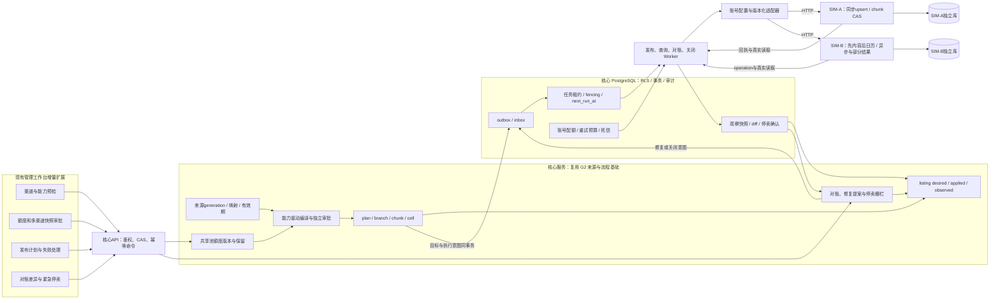
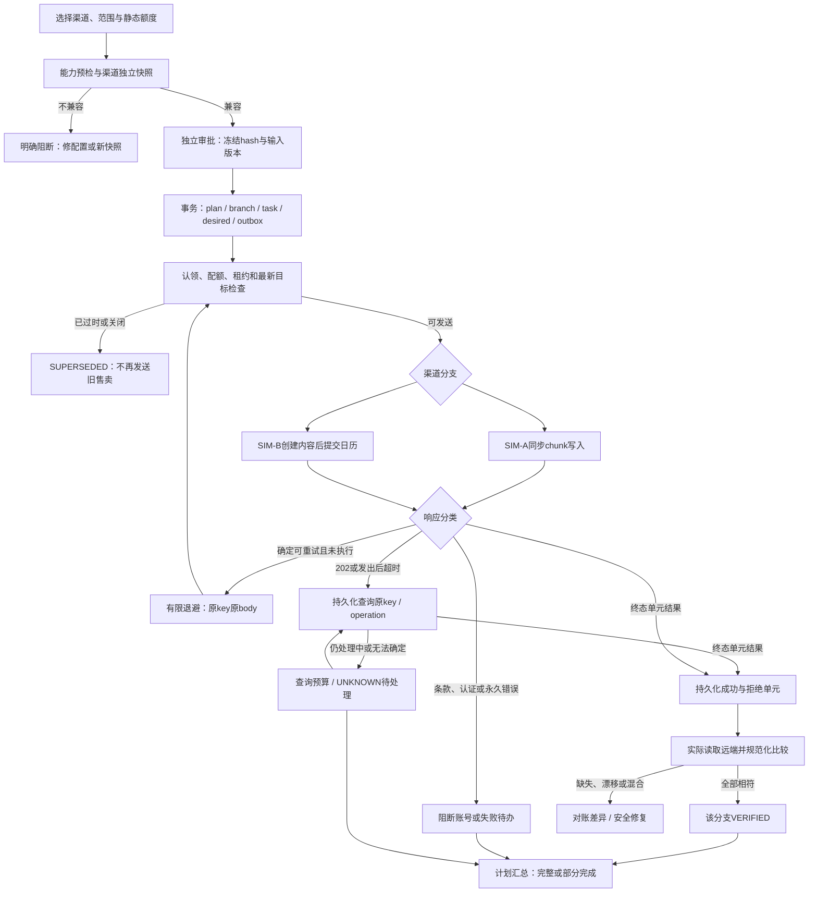
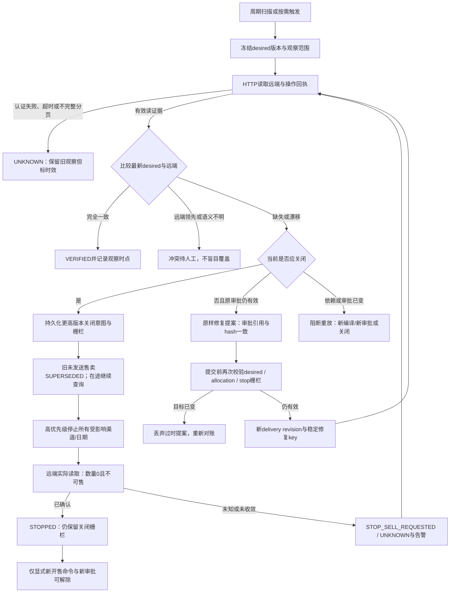
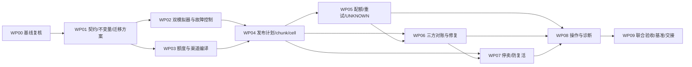

# AI 酒店库存匹配与多渠道分销平台：G3 阶段详细实施计划

> 版本：v1.0  
> 编制日期：2026-10-26  
> 阶段定位：多渠道发布与故障闭环  
> 状态：已实施并完成本地限定范围验收（2026-10-27）；146项回归通过，双模拟渠道真实HTTP与浏览器发布/关闭闭环通过。详见 [G3实施与验收报告](docs/acceptance/g3-report.md)。原计划作为设计基线保留，实际范围与限制以验收报告为准。  
> 推进方式：按依赖、工作包与退出门槛推进，不精确到天。

## 1. 设计依据与阶段目标

依据以下本地资料编制：

- 《AI酒店库存匹配与多渠道分销平台-产品技术设计说明书.html》，重点为静态库存分配、双模拟渠道、可靠发布、三方对账、停卖和 G3 退出要求。
- `docs/acceptance/g2-report.md`、G2 实测附件与 `G2阶段详细实施计划.md`。
- 当前 `services/core/g1/offers.py`、`distribution.py`，`services/core/g2/jobs.py`、`worker.py`、`workflow.py`，独立 SIM-A 实现和渠道契约。
- 当前数据库迁移声明 `services/core/version.py`：核心 **007**；SIM-A 历史迁移 **001**。

**G3 要证明：同一份有效来源能够按安全库存额度分发至两个能力不同的模拟渠道；面对限流、异步处理、部分失败、结果未知、旧请求迟到和进程崩溃，系统仍能解释每个渠道的实际状态，并通过对账或停卖收敛。**

退出不能只看 HTTP 200/202、任务发送成功或单一“完成”标识，必须具备独立远端落地、读取内容、版本顺序与单次效果的证据。

本次仅制定计划：没有重跑 G2 测试、执行迁移、安装依赖、调整运行中的服务或启用第二渠道。

### 1.1 已有交接基线与实际缺口

| G2 实际基线 | G3 必须补充 | 保留要求 |
| --- | --- | --- |
| G2 报告记载完整 93 项通过；G1 独立入口 57 项通过 | 开工复跑并形成当时的交接证据 | 历史结果不能冒充 G3 当前实测 |
| CSV/XLSX/JSON、来源 generation、日期分区 CAS | 给渠道编译冻结 generation、映射、额度与能力版本 | 原件与历史快照不改写 |
| 编译器选择 SIM-A，payload 固定 sim-a-v1 | 显式选择渠道，按能力编译独立快照 | 能力不兼容不能丢字段后继续发布 |
| `publish_task` 一快照一任务，无持久化多渠道计划 | plan → channel branch → 内容/日期 chunk → cell 结果 | 已成功分支不因另一渠道失败被重发或回滚 |
| 固定 SIM-A 地址 8001、同步整包写入 | 配置化适配器；SIM-B 独立进程、库与异步协议 | 核心只通过 HTTP 访问模拟器 |
| 租约/fencing、listing 锁、固定间隔有限重试 | 账号配额、多进程共享限流、分类退避、查询预算、死信 | 本地 token 不等于远端防重 |
| 原 key 查询 + revision/hash/content 核验 | 持续 desired/applied/observed 对账与差异闭环 | 查询失败不得当作远端缺失 |
| 流程暂停/取消，单渠道核验 | 真正的停卖意图、远端确认、旧发布压制与安全恢复 | 暂停、取消与停卖是三种不同命令 |
| 流式暂存十万行有基准，大视图激活容量未证明 | 分别测发布、查询、对账、停卖与共享库竞争 | 不把解析性能外推为渠道吞吐 |

**容易混淆的现状：**当前 `.env` 中 `SIM_A_TOKEN` / `SIM_B_TOKEN` 是 SIM-A 服务内租户 A/B 模拟账号的凭证，并不表示已经存在 SIM-A、SIM-B 两个渠道。G3 必须另建清晰的“渠道 × 租户账号”配置，不能拿现有 `SIM_B_TOKEN` 直接当第二渠道凭证。

### 1.2 固定工程约束

- 工作目录仍为 `D:\hotel`，唯一后端 Conda 环境仍为 **`D:\miniconda3\envs\hotel_project`**；不得使用 base 或另一个项目环境。
- Python/Worker/测试保持 `python -s`；新增依赖确有必要才加入项目环境并更新锁文件。
- 继续模块化单体、PostgreSQL 队列、outbox/inbox、React/TypeScript 操作页；不以 G3 为由新增 Kafka、Redis、微服务或 WebSocket。
- 只连接本机 SIM-A/SIM-B；不连接真实供应商/OTA，不接订单、支付或真实库存锁定。
- 核心迁移从实际最新版本 **008 起追加**，SIM-A 从其最新版本追加，SIM-B 建独立迁移链；禁止修改已执行 SQL。
- 保留 G0/G1/G2 开发数据与验收资料。测试/故障/基准必须使用独立 G3 库，不重置开发库。

## 2. 范围、交付结果与不做项

### 2.1 必须实现的结果

1. 一份来源针对 SIM-A/SIM-B 得到不同渠道编码、能力检查、库存额度和渠道快照。
2. 一个持久化发布计划能汇总多渠道、多 chunk、部分日期结果；失败有精确位置与恢复动作。
3. 同共享池跨渠道分配不重复计数，额度调整有 CAS、保留与释放证据。
4. 多 Worker 共用账号限流；429、5xx、认证错误、业务拒绝、请求后超时分别处理。
5. 异步 202 不显示成功；丢失 operation_id 时能按客户端业务键查询，不能盲目换 key 重发。
6. 已成功日期不被失败日期拖回重试；旧 revision 与迟到请求不能覆盖最新发布或停卖。
7. 三方对账能发现缺失、数值/政策漂移、远端领先、混合版本与读取未知，并保留证据。
8. 符合原审批范围的原样重放可有限修复；业务变化重新编译/审批，修复不得复活停卖商品。
9. 人工紧急停卖与受控安全关闭能持久化、优先派发，并以远端实际读取确认。
10. 有完整故障矩阵、两租户隔离负测、浏览器操作路径、性能口径和正式 G3 验收报告。

### 2.2 范围优先级

| 等级 | 内容 | 退出影响 |
| --- | --- | --- |
| P0 | 双模拟渠道、能力阻断、静态分配、chunk/cell结果、UNKNOWN、安全幂等与顺序、三方对账、停卖、防复活、隔离与故障恢复 | 缺任一项不得宣告 G3 通过 |
| P1 | 配额诊断、死信操作队列、差异预览、按需及周期对账、浏览器操作、可复现基准和恢复手册 | 阶段冻结前完成 |
| 可选 | 通用熔断器、复杂自适应配额、图形统计大屏、更多渠道 | 不进入关键路径，不得替代 P0/P1 |

不做真实渠道准入、复杂取消政策自动提取、实际 AI、自动批准新增商业变更、动态库存镜像、订单回流、锁房、支付、佣金结算、生产高可用。G4 再处理实际 AI 与授权自动化策略。静态额度只是本地演示约束，不是实际防超售保证。

## 3. 开工前必须冻结的业务与一致性语义

### 3.1 三种状态与两种版本分开

| 名称 | 含义 | 更新依据 |
| --- | --- | --- |
| desired | 当前生效且经授权的渠道目标，包含售卖/停卖、范围、额度、政策、快照 hash | 发布/关闭命令成功提交；草稿和待审批快照不是 desired |
| applied | 已有远端执行结果支持的落地情况，可细到 chunk/cell | 可信终态回执；受理202不构成 applied |
| observed | 最近实际读取远端得到的内容与时点 | 真实 HTTP 读取、规范化结果与原响应引用 |
| desired_revision | listing 业务目标版本，业务内容或停卖意图变化时递增 | 同 listing 锁和 CAS 分配，历史不改写 |
| delivery_revision | 实际远端写入顺序号，含同一目标的获准修复重放 | 同 listing 单调分配；是执行顺序，不替代审批 |

同一 desired 可以因漂移原样重放而有多个 delivery revision，但所有重放必须引用同一个有效审批与完全相同的业务目标。新价格、政策、日期、额度、能力版本或重新上架都属于新业务目标，需要新快照与新审批。

现有 G1/G2 快照 revision 保留原义。G3 将旧远端 revision 作为该 listing 新发送序列的下界进行显式接续，不能从1重新开始。远端已领先于已知本地序列时进入冲突处理，不能简单“远端+1”强行覆盖。

### 3.2 发布计划与部分完成

- plan 固定目标渠道、快照、能力版本、分配版本、chunk manifest、审批及创建者；后续不能往已有 plan 悄悄添加渠道或日期。
- plan 下每个渠道为独立 branch；同一 listing 的内容创建与日历更新有依赖，SIM-A 成功不等待 SIM-B 后才记成功。
- 建议汇总区分 `RUNNING / PARTIAL / VERIFIED / BLOCKED / MANUAL / SUPERSEDED / CANCELLED`，同时显示成功、处理中、未知、失败、已替代数量；最终枚举由 WP01 契约冻结。
- `VERIFIED` 只在计划全部要求的分支/日期被当前有效观察覆盖时成立。能力预检被阻断的渠道不能被省略后算作“双渠道成功”。
- 提交请求默认原子校验全部指定快照；任一无效则整体不建可执行计划。运营可另发明确缩小渠道集合的新请求，保留阻断原因。
- 单渠道失败不回滚另一渠道已经发生的外部效果；如果要止损，另建更高版本停卖意图，而不是在本地改成“已回滚”。

### 3.3 幂等键、chunk 与日期格定义

```text
命令幂等：tenant + route + Idempotency-Key + request_hash
逻辑任务：tenant + account + listing + desired_revision + action + chunk_index
执行尝试：logical_task + delivery_revision + attempt
远端请求键：SHA256(tenant | account | listing | delivery_revision | action | chunk_index)
cell身份：实体类型 + 渠道编码 + pool/plan + stay_date + occupancy + currency
```

“日期格”不是单纯日数：一个库存池某日是一格，一个计划某日价格是一格。同一天一个池、两个计划合计3格。SIM-B 上限10格必须按实际请求格数计算，不能按“10天”计算。

- chunk 在派发前确定性生成，保存排序、范围、请求 hash、所引用的根 manifest hash；改变分片算法需新执行定义，不能悄悄重切后沿用旧key。
- 同执行尝试、同key、同hash返回既有结果；同key异hash409。成功响应和部分拒绝结果都是不可变操作事实，重查不重新执行被拒单元。
- 同 delivery revision 的多个 chunk 可依 manifest 顺序执行；远端不能用“相同 revision 就整单冲突”拒绝后续合法chunk。
- 远端同时维护最高接纳 revision 及实际已应用单元版本。更高版本一旦生效，低版本迟到写入必须被拒；旧已成功key仍可查历史回执，但不改变当前远端值。
- 同版本不同chunk允许；同版本同chunk不同hash拒绝。只有全部必要单元核验完成，才有完整 applied/observed 根快照，不能用最大单元版本伪造整单完成。

### 3.4 来源与审批重新校验

编译冻结来源 generation、映射及渠道编码版本、pricing rule、allocation、capability与adapter版本；审批覆盖业务目标及分片/协议转换的可解释输出。

每次新的外部写入前重新检查：当前 desired、有效成员/权限、来源与映射依赖、审批期限、库存保留、账号状态、停售栅栏及有效租约。任何商业语义变化需新快照。

对于已经在途/UNKNOWN的历史任务，审批过期或来源失效不能阻止查询其真实效果；只禁止再发普通售卖写入，并产生关闭/替代待办。禁止全局关掉查询来隐藏不确定结果。

## 4. 目标架构与处理流程

### 4.1 G3 详细架构图



核心数据库不能读取模拟器表替代HTTP对账；测试控制器可通过各模拟器专用故障接口改变其状态，但与核心业务身份和凭证分离。

### 4.2 双渠道发布与 UNKNOWN 流程图



### 4.3 对账、修复与停卖防复活流程图



## 5. 双渠道能力与模拟器契约

### 5.1 能力矩阵及版本接续

| 能力 | SIM-A G3契约 | SIM-B 首版契约 | 核心处理 |
| --- | --- | --- | --- |
| 入口 | 8001，保留既有v1；G3另立版本 | 建议8002，独立服务及库 | 账号选择固定注册表，不接受请求体任意URL |
| 内容/日历 | 同步内容upsert，支持受控日历chunk | 先幂等创建/确认内容，再异步日历更新 | 持久化前置依赖，内容未就绪不得发日历 |
| 最大日期格 | 30格/请求 | 10格/请求 | 确定性拆分，不能丢弃超限日期 |
| 调用配额 | 演示配置建议5次/秒/账号 | 演示配置2次/秒/账号 | 具体写/读/关闭预算由WP01版本化冻结 |
| 取消政策 | 首版保留G2已实现的FLEX/NONREF与明确小时数 | 只支持语义精确定义的二值取消政策 | 72小时取消不能直接改成refundable布尔值 |
| 回执 | 原key查询、同步终态、单元状态 | 202+operation_id；按key找operation；轮询终态 | 202仅受理，丢operation_id也可恢复 |
| 部分结果 | 单chunk原子接受/拒绝 | 允许单元接受/拒绝，返回稳定cell receipt | 保存实际结果，只处理失败单元 |
| 远端顺序 | listing最高接纳revision+chunk幂等 | 同样提供原子顺序保护 | 不拿本地advisory lock当远端CAS |
| 停卖 | 日期范围quantity=0及显式不可售投影 | 等价关闭语义，异步受理后查询 | 读到实际关闭才STOPPED |
| 故障 | 429/500、提交后断连、迟到写/响应 | 异步中、部分拒绝、分页失败、漂移 | 可重复触发，测试与普通业务权限隔离 |

总设计中 SIM-A 取消阶梯是目标能力，当前G2未实现任意阶梯。G3 不为了凑矩阵声称已有支持；P0可维持现有已知简单政策，复杂阶梯作为明确不支持输入并负测。若扩展支持，必须先扩源规范和验证器再扩大能力声明。

SIM-B演示应明确支持一种与内部完全等价的NONREF政策；另给FLEX-72h不兼容样例。双渠道正向闭环使用双方都能无损表达的商品，不能靠删掉不兼容计划完成演示。运营需显式选择受支持的商品子集并获得对应快照审批。

### 5.2 适配器接口

建议统一定义：`capabilities`、`validate`、`compile_wire_payload`、`ensure_content`、`publish_chunk`、`query_operation`、`read_listing`、`stop_sell`、`normalize_observation`。

每次返回携带：结果分类、是否已知接纳、operation定位信息、remote revision、chunk/cell状态、Retry-After、原始回执引用。协议转换只在适配器内完成；核心不解析某渠道的私有字段来推进状态。

分别保留业务规范化hash、根manifest hash、wire request hash。跨渠道wire hash不要求相等；对账按相同业务语义规范化比较，保留每个渠道特有的编码、舍入、时区和policy映射版本。

### 5.3 远端部分写入规则

- SIM-A：一个chunk全有或全无。一个listing多chunk完成之前可出现混合状态，必须可观察，不伪造全listing原子性。
- SIM-B：同chunk可返回部分成功；已成功单元不可因重复轮询而重写。确定的业务拒绝不自动重试；确定短暂拒绝只创建失败单元的后续执行。
- 后续执行使用新delivery revision及新稳定请求key，并引用原逻辑任务和已批准的同一业务目标；同一执行自身重试仍使用原key。
- 若高revision已应用导致旧revision剩余chunk失效，旧剩余单元不能继续补写。核心先读实际情况，按当前desired建立完整的待收敛单元集合。
- 共享池数量与可售计划的依赖要写入manifest。数量下调/关闭先于可能扩大曝光的操作；恢复上架最后执行。协议无法在单次请求容纳依赖组时显式分阶段，必要时先关闭，不能假定跨请求原子。

## 6. 共享库存静态分配与跨渠道额度安全

### 6.1 基本不变量

对同一租户、选定供应来源、库存池及住宿日：

```text
capacity = max(0, source_quantity - safety_buffer)
allocation_A >= 0，allocation_B >= 0
sum(所有渠道有效额度与未释放保留) <= capacity
```

正向样例：原池4间，缓冲1间，可分配3间，SIM-A=2、SIM-B=1。两种计划引用同一渠道池额度，不能每个计划重复分2或1；不同供应来源池共享关系未知时不能相加。

额度需持久化版本、来源generation、日期范围、操作者和审批绑定。编译不能每次按百分比独立计算出两个互不约束的结果。

### 6.2 UNKNOWN期间的保留与安全调整

仅检查最终目标之和不够：从A=3/B=0改为A=0/B=3，如果A实际未降下来，先增加B会瞬间超分。

1. 增加渠道额度前，按同一pool/day锁定保留，计入该渠道已确认远端曝光和未确定写入的保守上界。
2. 额度下调、停卖、取消本地任务不立即释放远端可能仍占用的额度。
3. 只有最新的可信读取及相关在途操作收敛证明旧曝光已降低，才允许释放并把额度转给另一渠道。普通查询404不自动证明安全释放。
4. 跨渠道调拨采用“先减并确认 → 释放旧保留 → 预留新额度 → 再增”，不得先增后减。
5. 来源容量突然下降或远端被故障注入改大，可能已存在超额事实；系统标记`CAPACITY_DEFICIT`、冻结所有增加并优先关闭，不能声称物理远端总量始终受本地约束。
6. safety_buffer变化或另一发布并发抢额度，同样经CAS；任何超额请求整个事务失败，不留下半份保留和发布意图。

### 6.3 G2既有单渠道库存的迁移

G2曾把完整4间发往SIM-A，不能直接新增SIM-B=1并宣称2+1额度安全。

- 先导入既有listing/回执/观察为迁移基线，保留原快照与远端版本。
- 将已有4间计入保守曝光；若新配置capacity=3，明确展示迁移超额，而不是把应用记录改成2。
- 生成新的SIM-A下调/关闭快照并完成所需授权，远端确认降到2后，才启用SIM-B=1。
- 无法核实旧曝光时保持第二渠道不可发布，进入人工处置。

## 7. 数据模型、状态机与事务边界

### 7.1 建议增量模型

具体表名在WP01冻结，可按现有风格调整，但以下职责不能被一个JSON状态字段掩盖。

| 对象 | 必需字段/关系 | 关键约束 |
| --- | --- | --- |
| channel_profile / account配置 | adapter、capability版本、endpoint引用、credential引用、状态 | 账号属于租户；凭证不放回执、日志或UI |
| allocation_version / reservation | 来源池/日期、额度、缓冲、曝光保留、版本 | pool/day锁；非负；跨渠道合计校验 |
| channel_listing | 内部商品、外部编码、desired/applied/observed引用、stop epoch、version | tenant+account+业务listing唯一；CAS |
| delivery_intent | action、desired revision、snapshot/approval、范围、allocation、manifest | 内容不可变，根业务hash可追溯 |
| publish_plan / branch | 目标渠道集合、分支、请求hash、幂等命令 | 指定集合固定，分支真实状态汇总 |
| delivery_task / chunk / cell_result | logical key、delivery revision、chunk/cell身份、request hash、operation、结果 | 相同逻辑单元唯一，历史结果追加 |
| delivery_attempt / receipt | send/query尝试、分类、响应引用、时间、token关联 | 请求与查询分别计数，历史不可清零 |
| quota_state / retry_budget | account、配额桶、cooldown、deadline、已耗次数 | 多进程共享，使用DB时间 |
| observation | listing、读取范围/时间、remote revision、规范化hash、完整性 | 追加；读取失败另记，不覆盖旧证据为“空” |
| reconciliation_run / diff | frozen desired、observation、差异单元、状态、修复引用 | 旧diff不可直接修复新desired |
| stop_sell_command | 原因、授权、范围、stop epoch、各渠道确认、状态 | 幂等；只有全部目标关闭可标整体STOPPED |
| dead_letter / incident | 原因、原任务、预算、最后回执、影响范围、恢复建议 | 处置留理由和审计，不删除未知效果 |

新增表一律tenant_id、FORCE RLS、必要复合外键及资源级鉴权。历史快照/manifest/回执追加保护；不把远端响应的原始敏感信息直接塞到普通页面。

### 7.2 从现有模型演进

- 现有`publish_task`有`UNIQUE(tenant_id,snapshot_id)`，不能直接拿它代表“一个快照多个chunk”。优先新增G3执行子模型及关联，保留G1/G2历史含义。
- 现有offer_snapshot已按channel/listing/revision唯一，编译入口需显式渠道参数；不能修改旧快照channel_id迁往SIM-B。
- G2 workflow有单一snapshot_id/task_id，G3用版本化定义（建议`g3-flow-v1`）关联plan和branches；不原地改写已经成功的g2-flow-v1步骤。
- G1/G2路由与旧Worker保留明确兼容入口，但同一来源/listing只允许一种实际调度所有者，不能双派发。
- 新迁移完成“建表/约束 → 基线导入 → 观察核对 → 新功能开关启用”；无法确认的旧任务保持UNKNOWN，不默认成功。

### 7.3 关键事务边界

| 边界 | 同一事务必须包含 | 事务外行为 |
| --- | --- | --- |
| 新发布目标 | CAS、额度保留、desired、plan/branch/task、审计、outbox | 不发HTTP |
| 新停卖目标 | stop epoch、更高desired、旧待发售卖替代标记、关闭任务、审计、outbox | 不声称远端已关 |
| 认领 | SKIP LOCKED、owner/token、lease | 不长期占用事务睡眠 |
| 配额取得 | 账号配额和请求许可短事务 | HTTP不持锁；许可失效则重新验证 |
| HTTP结果提交 | fencing、不可变receipt、单元状态、applied、事件 | 不把本地回滚当成远端回滚 |
| 对账落盘 | 观察、差异及所依据desired版本 | 远端读取在事务外 |
| 修复提交 | 重查desired/审批/额度/stop epoch、唯一修复意图、审计、outbox | 外部执行继续同一安全链 |

## 8. 限流、重试、查询与死信策略

### 8.1 演示默认预算

以下为**拟议配置**，开工用确定性测试冻结，不是已有实测或生产参数。

- SIM-A写预算5次/秒/账号、SIM-B写预算2次/秒/账号；多Worker共用PostgreSQL配额状态，禁止每进程各自拥有完整额度。
- 读取/operation查询有独立子预算，避免429写入积压饿死UNKNOWN确认；若渠道存在共享全局上限，所有子预算仍受同一父上限约束。
- 关闭任务优先级高于普通发布和修复；普通流量不能耗尽全部预留关闭许可，但关闭也不能绕过渠道硬限流。
- 单逻辑写入最多6次、累计15分钟，以先到为准；请求一旦开始计入尝试，确定仅等待listing锁/配额不扣故障次数。
- 查询单独预算建议最多20次、15分钟；每次查询需调度next_run_at，不在持租约Worker内无限循环。
- 退避使用 `random(0, min(60秒, 2秒 × 2^n))`，n从0开始；单测固定随机源，真实演示记录实际间隔。
- 对账演示周期60秒；停卖超5分钟未确认进入告警。计时以真实运行时钟为准，与2027演示业务时钟分开。

### 8.2 分类动作矩阵

| 结果 | 下一步 | 不允许的行为 |
| --- | --- | --- |
| 本地/远端400、422、语义不支持 | BLOCKED，定位字段/日期，修数据或新快照 | 原错误无限重试、删字段降级 |
| 401/403 | 暂停相关账号新写入，通知管理员；观察记录UNKNOWN | 打印凭证、影响另一租户账号、伪造读取成功 |
| 429 | 解析delta-seconds/HTTP-date Retry-After，账号cooldown、带抖动重排 | 忽略Retry-After；每Worker独立突发 |
| Retry-After缺失/非法 | 按有界退避回退并记录协议异常 | 立即密集循环 |
| Retry-After超剩余窗口 | 保留最早允许时间，期限先到则EXPIRED/MANUAL | 把长等待截短后提前请求 |
| 确认未执行的连接失败/明确拒绝 | 预算内重试原key/body | 新key制造第二操作 |
| 5xx但不能证明未接纳 | 先转UNKNOWN查原操作 | 假定5xx就一定没写入 |
| 发出后读超时/断连/Worker退出 | UNKNOWN，查原key/operation与当前listing | 直接标失败并创建新业务副作用 |
| operation仍处理中 | 定时查询，不重发写入 | 把202/PROCESSING当applied |
| operation查询404 | 默认UNKNOWN；只有契约提供可靠未接纳证明才可重试原请求 | 将短暂查不到当作确定未执行 |
| 旧revision/当前目标已变 | SUPERSEDED或CONFLICT，保留历史并查实际效果 | 强制覆盖新版本 |
| 部分结果 | 保存cell结果；永久拒绝待人工，临时拒绝只处理未完成项 | 整包重发已成功单元 |
| 预算耗尽 | MANUAL/死信、告警与建议操作 | 清零尝试历史后静默继续 |

人工恢复需原因、expected version和当前权限；恢复新建预算周期/执行尝试，保留原逻辑关联、所有历史以及未知效果。恢复UNKNOWN仍先查询，不能通过“强制重试”按钮绕过。

## 9. 三方对账与修复策略

### 9.1 扫描及比较范围

按tenant/account/listing/date/occupancy/policy比较。任务至少包括：按需对账、周期对账、发布后核验、停卖优先核验。调度器重启后从持久化next_due_at补做，多个调度器用唯一计划键或租约去重，不依赖进程内定时器记忆。

远端分页必须固定观察版本或使用读版本令牌；若读取期间版本变动、页缺失、超时或结束标志不可靠，该次观察记不完整/UNKNOWN，不能把未读到页当作缺失商品。

### 9.2 差异分类

| 差异 | 判据 | 处理 |
| --- | --- | --- |
| CONSISTENT | 目标版本、所有必要单元及业务语义相符 | 更新本次verified时点，保留历史 |
| MISSING | 有效账号/范围读取明确证实目标单元不存在 | 目标有效则原样修复；目标已关闭则不创建售卖 |
| DRIFT | 数量、价格、政策、售卖状态或关联编码不符 | 按精确单元展示差异及影响 |
| PENDING / PARTIAL | 已知异步处理、部分单元新版本其他仍旧 | 先收敛原操作，不抢先反复修复 |
| UNKNOWN | 超时、认证错误、分页不完整、无法证实远端事实 | 保留最后可信观察并标过时；有限查询 |
| REMOTE_AHEAD | 远端版本高于本地可解释执行历史 | 人工冲突调查，禁止自动抢版本覆盖 |
| CLOSED_BUT_SELLING | 当前desired应关闭，远端仍可售 | 最高优先级关闭与告警 |

已发送历史任务的VERIFIED是当时证据，不代表listing永久一致。后续漂移可以让listing变为DRIFTED，不能抹掉历史任务成功回执。

### 9.3 原样重放与新审批的边界

允许的确定性修复必须同时满足：原审批仍有效、当前desired未变、业务payload/日期/额度/能力映射完全相同、来源依赖仍有效、无关闭栅栏、重放预算未耗尽。授权来自原已批准目标允许的有限重放，不是新开售或新的商业决策。

原操作key命中旧成功回执通常不会重新写远端，**不能用重发旧成功key来声称修复漂移**。应创建引用原目标的新repair intent、新delivery revision、新稳定修复key；修复提交CAS、派发前复验、远端顺序保护三层都要测试。

如果原审批未涵盖原样重放或其授权含义无法证明，先显示修复提案并由独立审核确认；不得为了自动修复率绕过授权。需要改业务值、扩大日期、改额度、政策或重新上架时，一律新快照/新审批，不能借“修复”跳过。

修复成功以新的真实观察收敛为准。对账发现漂移到修复确认的时间，要分别报告检测、等待人工/配额、执行与读取延迟；总设计“建议≤2周期”仅在有效授权、模拟器可用且无配额阻塞条件下验证。

## 10. 紧急停卖与恢复售卖

### 10.1 三种动作不能混同

| 动作 | 效果 | 对在途任务 |
| --- | --- | --- |
| 暂停新增派发 | 阻止新的普通售卖/修复写入 | 仍查询已发送/UNKNOWN，紧急关闭走独立权限与调度 |
| 取消未发送任务 | 结束本地尚无外部效果的执行意图 | 不可声称撤销已经发出的HTTP |
| 紧急停卖 | 新增更高版本业务关闭目标并发往远端 | 阻止旧售卖恢复，持续核验在途结果与关闭收敛 |

### 10.2 触发、权限与顺序

- 人工紧急停卖：具备独立`distribution.stop_sell`权限的租户管理员，提供范围、理由、expected desired版本和幂等key。普通operator/reviewer不因有审批权限就自动拥有紧急权限。
- 受控安全关闭：来源显式stop_sell、已配置TTL到期或经授权映射撤销等确定条件，可由范围受限的system actor产生“仅减少曝光”的关闭意图。WP01列清触发条件、作用范围与审计，不能扩展成自动开售策略。
- 来源坏行不自动推断为删除；普通parse失败不直接决定停卖。只有明确安全规则命中才触发，并解释规则与证据。
- 停卖不依赖当前失效来源还能否通过普通售卖编译：应基于最后已知渠道listing与受影响范围生成关闭载荷，避免“映射撤销后反而无法关店”。
- 关闭以pool/date为库存安全单元，同时关闭所有依赖计划；共享池部分计划关闭与全池关闭分别建模，不误停无关房型/日期。
- 分配更高desired/delivery revision、记录stop epoch，未发送旧售卖/旧repair标SUPERSEDED；已发送旧请求继续查，远端必须拒绝其迟到覆盖。
- 关闭后读到数量0及渠道定义的不可售状态，单渠道才能STOPPED；一边成功另一边UNKNOWN时整体仍“部分停卖待确认”。数量0不是删除内容，也不释放未经确认的在途曝光。

### 10.3 恢复售卖

恢复是显式新命令：新鲜来源、有效映射、可用额度、新快照、新独立审批、新更高版本和明确引用关闭epoch。周期对账、原审批重放、账号解除暂停都不得自动解除停售栅栏。

如果停卖请求后立刻有人提出开售，必须CAS冲突或等待关闭确认后按新审批处理；不能让并发恢复绕过还未确认的止损。

## 11. 详细工作包与依赖



| 工作包 | 具体实施任务 | 主要输出 | 完成判据 |
| --- | --- | --- | --- |
| WP00 基线 | 确认环境/迁移/PID；复跑93项；梳理G2已发listing、未知任务、历史额度；记录当前文档偏差 | 开工基线清单、测试结果、迁移样本 | 基线无未解释失败；旧数据可追溯；未把SIM-A租户B当第二渠道 |
| WP01 契约 | 冻结cell计数、capability、revision、hash、操作结果、配额/查询预算、修复权限、关闭语义；设计RLS与迁移 | 渠道/发布/对账契约、ADR017起、表/状态设计 | 三方逐字段有明确含义；所有危险竞态有预期结果 |
| WP02 模拟器 | 保留A-v1；实现A-G3与独立B；内容依赖、异步operation、部分结果、顺序栅栏、读取、关闭；受控故障接口 | 两服务及独立迁移/账号、双边契约测试 | 直接HTTP证明幂等/冲突/异步/迟到旧写拒绝；核心不写远端DB |
| WP03 额度/编译 | 配置渠道编码、能力版本与buffer；实现pool/day保留和调拨；显式渠道编译；能力差异和预览；绑定审批 | allocation版本、渠道快照、兼容/阻断样例 | 4-1=3，A2/B1不重复计计划；超分/并发/UNKNOWN不能释放额度 |
| WP04 发布计划 | 原子建plan/branch/chunk/cell/desired/outbox；内容前置依赖；branch汇总；历史任务兼容 | 发布API、版本化workflow、多渠道明细 | 部分失败可定位；重复命令一份效果；重启后继续同计划 |
| WP05 调度恢复 | 多进程共享限流、优先级、Retry-After、full jitter、send/query独立预算、死信恢复、fencing及远端CAS | worker lanes、配额/预算状态、操作日志 | 成功chunk不重发；未知先查；账号故障不拖住其他账号 |
| WP06 对账 | 持久化周期/按需调度，完整读取、业务规范化、三方diff，修复去重/CAS/权限、新delivery序列 | observation/diff/repair、报告与接口 | 读失败UNKNOWN；同payload漂移真正重写并再次观察；旧diff不得修新目标 |
| WP07 停卖 | 人工紧急权限、安全关闭规则、stop epoch、旧任务替代、优先队列、逐渠道确认、显式新开售 | stop命令/事件/状态、权限与恢复策略 | 暂停≠停卖；旧发布/repair迟到不复活；两边确认后才整体STOPPED |
| WP08 工作台 | 原界面增量：渠道/额度预检、分支和日期结果、退避/查询/死信、三方差异、停卖与恢复流程 | 业务操作页、诊断API、错误文案 | 不露凭证/token；只读角色无写权；桌面/窄屏可完成关键路径 |
| WP09 验收 | 正向/负向/竞态/真实进程退出、双库HTTP、浏览器闭环、容量及停卖延迟实测；完善README和手册 | 正式报告、机器证据、基准、G4交接 | 第12节必要场景全通过，不以mock或文档替代远端证据 |

## 12. 验收方案与退出矩阵

### 12.1 四层验收方法

1. **纯逻辑与契约：**金额/取消映射、额度、分片、状态分类、Retry-After与退避；两边验证相同协议不变量。
2. **数据库集成与隔离：**RLS、复合FK、原子意图、预算/配额共享、CAS、并发计划、审批与事件去重。
3. **独立进程真实HTTP：**两个模拟器、独立Worker、实际远端状态、超时/断连、进程退出、迟到写入与部分结果。
4. **浏览器与运营复现：**额度预检、双渠道计划、UNKNOWN恢复、差异检查、停卖待确认及显式恢复；保存界面和后端证据关联。

### 12.2 必测场景（40项）

| 编号 | 场景 | 必须获得的结果 |
| --- | --- | --- |
| G3-01 | G2回归与前向升级 | 开工93项及适配后的兼容回归通过；旧快照/原件/回执与checksum有效 |
| G3-02 | 真正双渠道隔离 | 独立A/B进程、数据库及账号；SIM-A租户B凭证不能当SIM-B身份 |
| G3-03 | 能力正向与负向 | 精确NONREF双渠道可用；72h政策到二值渠道被明确阻断，不静默丢计划 |
| G3-04 | 载荷与编码版本 | 规范化业务可解释、wire hash各自正确；能力/编码变化使旧写入失效 |
| G3-05 | 共享池额度 | 4间buffer1→A2/B1；跨计划不累计、超额请求无半份保留 |
| G3-06 | 并发额度抢占 | 同pool/day两事务竞争，只有满足剩余额度的方案成功，旧CAS失败 |
| G3-07 | UNKNOWN保留与迁移 | G2已有A4未降确认前B不增；本地取消或普通404不能释放潜在曝光 |
| G3-08 | 安全调拨与容量下降 | 先减确认再增；容量下降/远端超额触发deficit并冻结扩张，实际异常可见 |
| G3-09 | 日期格与分片 | 多池多计划按cell计数，30/10上限准确；重复编译相同manifest、无漏格重格 |
| G3-10 | 内容前置与异步 | B内容未确认不得更新日历；202/PROCESSING不记applied/VERIFIED |
| G3-11 | 计划事务原子性 | desired、plan/task、保留、审计/outbox一致提交；提交前退出无半计划 |
| G3-12 | 命令与业务幂等 | 重复命令/事件/任务无第二效果；同key异请求409；无审批快照不能混入 |
| G3-13 | 多渠道部分失败 | A成功B失败时PARTIAL；恢复B不重发A，历史成功不被回滚 |
| G3-14 | 部分日期结果 | B成功单元保存；临时拒绝仅补未完成项；永久拒绝有准确日期与原因 |
| G3-15 | 同版本多chunk | 同revision后续合法chunk可执行；同chunk改hash拒绝；未全齐不能伪造根完成 |
| G3-16 | 多进程共享配额 | 至少两个Worker竞争账号，总量仍受同一配额；一个账号限流不拖住其他账号 |
| G3-17 | 429与Retry-After | 秒数/HTTP-date/缺失/非法/超窗口均有断言；禁止早于服务端允许时间再发 |
| G3-18 | 退避预算与时效 | 抖动范围、最大次数/时限、审批过期分别验证；不无限重试或重写旧载荷 |
| G3-19 | 认证及业务错误 | 401/403暂停对应账号；422不盲重试；日志/UI无凭证、内部URL任意输入被拒 |
| G3-20 | 未知结果与查询404 | 请求后超时/不确定5xx先查询；短暂查无operation仍UNKNOWN，不换key盲发 |
| G3-21 | 丢operation_id | B已受理但响应丢失，可按原客户端key找到同一operation并收敛 |
| G3-22 | 远端落地后崩溃 | 子进程在远端提交后、本地记录前退出；接管查原操作，远端效果一次 |
| G3-23 | 租约与旧owner | 正常心跳不接管；过期后旧owner迟到提交/续租均失败，结果不覆盖 |
| G3-24 | 旧请求迟到执行 | 用屏障让旧HTTP在新发布/关闭后才真正写入，远端原子拒绝旧revision；不只延迟响应 |
| G3-25 | 周期/按需对账恢复 | 调度器重启、双调度器并发不丢周期/不重复业务修复；wait与扫描游标可恢复 |
| G3-26 | 三方证据与读取未知 | 有成功receipt但读漂移不能一致；超时/认证/分页缺失为UNKNOWN，不当MISSING |
| G3-27 | 漂移类型 | 独立注入缺失、库存/价格/政策漂移、混合版本、remote ahead，分类与单元差异正确 |
| G3-28 | 有效原样修复 | 新delivery revision/key真正修复原批准payload；不得只拿旧幂等成功回执冒充修复 |
| G3-29 | 修复权限与竞态 | 过期审批、来源变化、额度变化、旧diff与新desired竞争均阻断旧修复 |
| G3-30 | 人工紧急停卖 | 独立权限/原因/CAS/幂等有效；operator/auditor未授权时不能关闭或恢复 |
| G3-31 | 失效来源可关闭 | TTL/明确stop/映射撤销按授权规则生成关闭；普通坏行不冒充删除；无新鲜售卖快照仍可关旧listing |
| G3-32 | 部分关闭与未确认 | A已关B未知时不得整体STOPPED；仅在范围内所有目标实际不可售后确认 |
| G3-33 | 停卖优先级与暂停 | 普通积压/账号cooldown下关闭优先且不超配额；暂停不停止必要查询与关闭确认 |
| G3-34 | 防复活与重新开售 | 关闭后旧publish/repair/迟到写均不能上架；恢复必须新来源/额度/审批/更高版本 |
| G3-35 | 死信与人工恢复 | 预算耗尽可见、有原始证据；恢复留理由和历史，UNKNOWN仍先查，不能清零审计 |
| G3-36 | 两租户/直接DB隔离 | 新表读写、plan/branch/cell/额度/diff/关闭/导出/故障接口跨租户与角色负测通过 |
| G3-37 | 故障与业务权限隔离 | 普通业务请求不能启用故障或改远端；正常模式关闭测试控制；核心无模拟库访问权 |
| G3-38 | 完整浏览器路径 | 桌面/窄屏预检→审批→部分发布→差异→停卖待确认→已确认，状态与HTTP证据一致 |
| G3-39 | 批量与优先级基准 | 真实cell/request数、吞吐、配额、内存、数据库负载、查询与关闭延迟报告；失败也计入 |
| G3-40 | 联合演示与证据链 | 原件→generation→额度/快照/审批→plan/chunk/cell→receipt/observation/diff→关闭完整可复现 |

40项是业务验收场景数量，不是规定40个测试函数。实际应按格式、账号、事务窗口和故障组合拆分；报告准确列实跑数量、失败、跳过及限制。

### 12.3 故障注入必须能区分的窗口

- 发布意图事务提交前退出；提交后outbox未投递退出。
- Worker已认领但尚未发出；请求已发送但远端未提交；远端提交后响应丢失。
- B受理202后operation_id丢失；部分cell提交后进程退出；本地cell结果提交前后退出。
- 消费者提交后delivery确认丢失；死信预算耗尽；恢复时依赖已改变。
- 对账读取到一半失败；读到旧desired时并发新发布/停卖；修复排队后关闭epoch改变。
- 旧请求延迟到新revision生效后才执行；关闭成功响应丢失；A关闭而B持续429。

必须使用真实子进程退出和同步屏障证明关键窗口，不能全部用内存mock、直接UPDATE任务状态或“延迟响应”代替“迟到执行”。测试专用故障只允许精确命名的G3隔离库。

## 13. 样例、性能口径与联合演示

### 13.1 建议数据目录

```text
datasets/g3/
  compatible/          # 两渠道可无损表达的NONREF、A2/B1、共享池
  capability-blocked/  # 72h政策、缺渠道编码、未知税费
  allocations/         # 超分、G2-A4迁移、先减后增、容量下降
  chunking/            # 恰好/超过10与30格，多池多计划
  async-partial/       # 202、operation丢失、临时/永久cell拒绝
  ordering/            # 同revision多chunk、旧请求迟到
  reconciliation/      # missing/drift/remote-ahead/分页不完整
  stop-sell/           # 部分停卖、旧修复防复活、显式新开售
  scale/               # 可复现生成器与期望计数，不强塞大静态文件
```

所有样例附manifest/输入、预期额度、实际cell数、允许调用顺序、最终远端状态和失败原因；保持虚构。测试数据使用独立资源ID，演示时钟和真实任务/预算时钟分别标记。

### 13.2 基准计划

| 维度 | 测量方法 | 必须避免的误读 |
| --- | --- | --- |
| 编译/物化 | G2已有1万/10万来源规模按可行档位延伸；测合并耗时、fact/投影写放大 | 不宣称G2解析耗时就是激活/发布耗时 |
| 发布规模 | 建议100/1000/10000真实日期格，计算A/B拆分后的实际请求数 | 不以重复自然键或空请求凑规模 |
| 并发 | 1/2/4个Worker、两租户、两渠道；记录账号与全局配额 | 并发增加不应突破渠道额度 |
| 延迟 | 排队、退避、operation处理、查询、核验分别计时 | 不能只计HTTP响应时间 |
| 关闭 | 普通任务积压、429、UNKNOWN下分别测关闭请求到远端确认 | 不以本地状态更新当远端停卖耗时 |
| 对账/修复 | 注入到发现、提案、获准、修复、观察确认分别记录 | 不隐藏人工等待或配额阻塞 |
| 资源 | 硬件、版本、文件字节、cell分布、进程树RSS、核心/模拟库增长 | 不仅测核心进程，不隐藏子进程和写放大 |

在SIM-B每秒2次、每次10格时，10000格仅日历写入理论下界已约500秒，另有内容/查询/核验开销；不能沿用“十万行解析≤120秒”目标要求外部发布也120秒完成。

每个延迟档建议至少20次独立有效重复再报告统计分位数，并说明样本量和分位算法；样本不足只报原始值/范围，不声称生产p95。报告首次/同输入重复、缓存未控制的事实；不为了“冷缓存”重启或清理用户其他服务。

目标候选：无阻塞条件下漂移在两次60秒周期内确认修复；普通积压下停卖优先级可见；超过5分钟未确认告警。上述是待验证演示目标，未达时记录瓶颈，不能过滤超时样本。

### 13.3 联合演示脚本

1. 载入G2有效来源，冻结buffer1、A2/B1，演示跨计划共享池不重复计数。
2. 先展示SIM-B拒绝72h取消语义，再明确选取双方兼容的NONREF商品进行渠道独立审批。
3. 提交一个双渠道plan，A成功、B429/异步处理中，页面显示部分完成和下次允许时间。
4. B发生“已接纳但响应丢失”，Worker退出；重启后原key查询，远端无第二份效果。
5. 注入B某日期价格漂移；实际读取生成diff，经有效原审批范围的原样修复或人工确认后真正收敛。
6. 发起紧急停卖，A关闭、B一度未知；页面保持待确认，不虚构全关闭。
7. 释放一个迟到旧售卖/旧repair请求，证明远端拒绝覆盖；两渠道读到不可售后确认STOPPED。
8. 展示显式恢复售卖所需的新审批及对账审计；跨租户账号尝试读取plan/diff/停卖资源失败。

## 14. 里程碑与冻结门槛

### M3-A：双渠道契约与额度成立

- [x] G2当前基线复跑、历史单渠道曝光清单、迁移方案完成。
- [x] A/B真实独立服务、能力契约、幂等/顺序/查询/关闭语义冻结。
- [x] 共享池静态额度、保留、并发CAS与安全调拨通过。
- [x] 兼容与不兼容快照均可解释，审批绑定输入版本。

退出：不能无损表达的商品被阻断；双渠道未超分，未知旧曝光不会被遗忘。

### M3-B：多渠道发布在故障中可恢复

- [x] plan/branch/chunk/cell持久化、幂等与汇总通过。
- [x] 内容前置、异步/部分结果、账号限流和分类预算通过。
- [x] 落地后崩溃、旧owner拒绝、迟到旧写入测试通过。
- [x] 成功分支不重发，UNKNOWN先查，耗尽可处置。

退出：每个失败有确定归属与合法下一步，远端无重复效果，旧版本无覆盖。

### M3-C：对账与停卖闭环成立

- [x] 三方读取证据、差异分类、周期重启恢复和原样修复通过。
- [x] 紧急权限、安全关闭规则、关闭待确认及优先调度通过。
- [x] 防复活、额度释放、关闭后显式新开售通过。

退出：读取失败不变成缺失；未关闭不显示已停卖；修复不复活关闭商品。

### M3-D：联合验收与交接

- [x] 两租户、直接DB、角色/凭证/故障接口隔离负测通过。
- [x] 必要40项场景有实际证据，无未解释失败。
- [x] 浏览器、真实HTTP、独立进程、基准与恢复手册齐全。
- [x] 正式G3验收报告、README实际范围和G4交接清单完成。

退出：计划、实现、实测和模拟边界明确分开；不能仅凭本计划宣称阶段完成。

## 15. 交付目录、运行入口与后续风险

### 15.1 建议交付位置

```text
contracts/channels/sim-a/v2/       # 兼容v1的新契约
contracts/channels/sim-b/v1/
contracts/distribution/v1/        # plan/chunk/cell/revision/hash
contracts/reconciliation/v1/      # observation/diff/repair/stop
services/core/g3/                 # 模块化领域实现，可内部细分
services/core/adapters/channels/  # 协议隔离
services/channel_simulator/       # SIM-A兼容升级
services/channel_simulator_b/     # 真正独立SIM-B
infra/migrations/008_*.sql...     # 实际最新版本后追加
infra/simulator_migrations/      # A追加，不改已执行001
infra/simulator_b_migrations/
infra/scripts/g3.ps1
datasets/g3/
tests/test_g3_*.py
docs/decisions/ADR-017...*.md
docs/runbooks/g3-local.md
docs/runbooks/g3-unknown-and-dead-letter.md
docs/runbooks/g3-reconciliation.md
docs/runbooks/g3-stop-sell.md
docs/acceptance/g3-report.md
docs/acceptance/g3-tests.xml
docs/acceptance/g3-http-smoke.json
docs/acceptance/g3-faults.json
docs/acceptance/g3-benchmark.md
docs/acceptance/g3-browser*.png
```

### 15.2 运行、测试和兼容要求

- `g3.ps1`建议提供prepare/setup/start/stop/status/test/contract-test/fault-test/reconcile/demo/benchmark。命令名称在实现时冻结，不在计划阶段伪称存在。
- 核心开发库保留hotel_project，SIM-A保留hotel_project_sim；SIM-B建议hotel_project_sim_b并用独立应用/迁移角色，不共用核心账号。
- G3隔离测试库建议hotel_project_g3_test、hotel_project_sim_a_g3_test、hotel_project_sim_b_g3_test，故障程序校验精确库名；不能仅靠模糊含有test字符串放行。
- SIM-B仅127.0.0.1:8002，注册表限制本机协议/目标；禁止随请求传URL并带凭证访问任意主机。A/B凭证按渠道与租户分别配置，旧SIM-A变量只保留明确兼容别名。
- 开启G3调度前停止同listing的G1/G2发布Worker；解析/控制组件复用也应明确所有权，不能两个版本同时处理。
- PID停止前校验解释器、模块与项目路径；测试结束恢复原本运行的普通模拟器及相应Worker，不遗留故障开关或测试库连接。
- 普通演示可提供新增一组虚构数据的命令；重置只允许精确隔离目标，默认不删除开发数据和历史证据。

### 15.3 风险与处理

| 风险 | 本阶段应对 | 是否阻塞验收 |
| --- | --- | --- |
| 把租户B误当SIM-B | 独立身份命名、服务/库/凭证与负测 | 是 |
| 两边独立发完整库存 | 版本化额度、保留、先减后增、迁移核实 | 是 |
| 布尔退款标记丢失72h条款 | 精确语义映射，不兼容阻断 | 是 |
| 旧成功key无法修复漂移 | 新repair intent/delivery序列，原审批范围复验 | 是 |
| 多chunk被一个revision状态掩盖 | 最高接纳序列与逐单元应用分开，混合状态真实可见 | 是 |
| 停卖被旧repair复活 | desired/stop epoch/远端revision三重保护 | 是 |
| 429或大任务饿死关闭/查询 | 共享父配额、预留优先许可、独立查询预算 | 是 |
| 对账不完整读误删/误补 | 读版本与完整性证明，失败UNKNOWN | 是 |
| 本地回滚被说成外部撤销 | 独立关闭补偿及实际确认 | 是 |
| 物化成本或大规模发布慢 | 分阶段资源基准、合理规模与明确理论下界 | 容量口径/证据缺失阻塞；不强加生产SLA |
| 随G3扩大到真实接入/AI/订单 | 固定双模拟渠道，其他另阶段 | 是 |

G3完成后，G4的输入应包括：稳定渠道能力与失败分类、完整来源到远端证据链、已验证审批/停卖边界、可供AI提案但不可越权写入的领域接口、已记录容量限制，以及仍需人工决定的异常清单。G3成功不自动授予AI发布权限或真实渠道接入资格。
