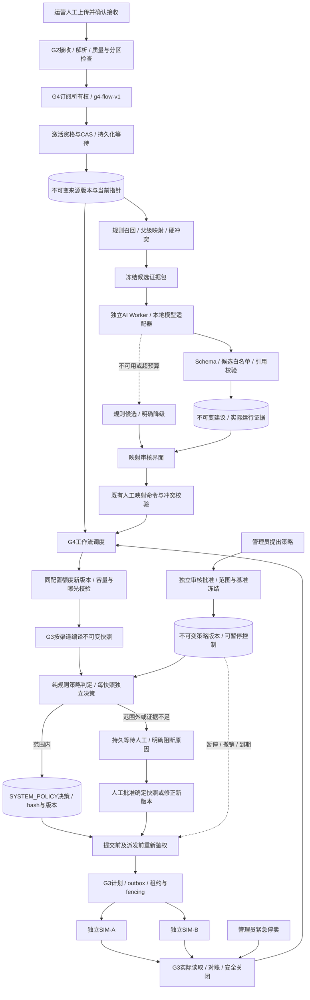
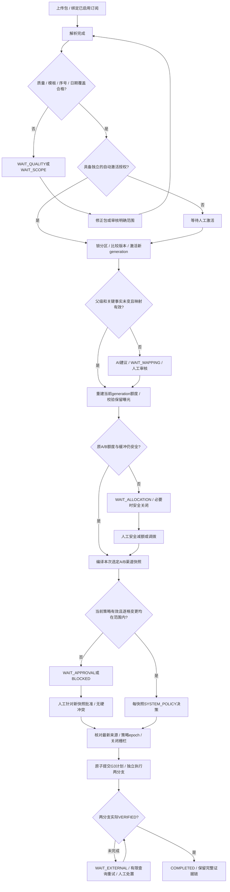
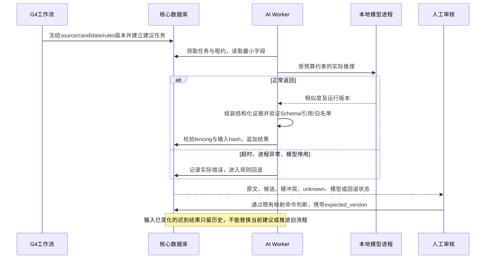

# AI 酒店库存匹配与多渠道分销平台：G4 阶段详细实施计划

> 版本：v1.0  
> 编制日期：2026-10-27（Asia/Shanghai）  
> 阶段定位：实际 AI 辅助、明确授权策略与常规更新自动流转  
> 状态：已实施并完成G4本地限定范围全项验收（2026-10-27）。完整回归201项和独立60组冻结难例通过，桌面/窄屏、恶意文本、异常恢复及双渠道页面关闭完成。详见 [G4实施与验收报告](docs/acceptance/g4-report.md) 与 [50项证据矩阵](docs/acceptance/g4-scenario-matrix.md)。原设计基线保留，实际范围以报告为准。
> 推进方式：按依赖、工作包和退出门槛推进，不精确到天。  
> 环境：沿用 `D:\miniconda3\envs\hotel_project`，不使用 base，不另建其他项目环境。

## 1. 设计依据、现状与阶段目标

### 1.1 依据

- 《AI酒店库存匹配与多渠道分销平台-产品技术设计说明书.html》：AI辅助匹配、自动化运行模式、模型风险控制、评估与 G4 交付定义。
- [G3实施与验收报告](docs/acceptance/g3-report.md)及其 JUnit、真实 HTTP、浏览器和环境附件。
- [G3详细实施计划](G3阶段详细实施计划.md)、现有渠道及工作流契约、ADR-017～021。
- 当前代码：`services/core/g1/matching.py`、`offers.py`、`services/core/g2/workflow.py`、任务/事件设施、`services/core/g3/domain.py`、`engine.py`、`routes.py`。

### 1.2 已有能力与真实缺口

| 领域 | 当前已实现 | G4需要补齐 |
| --- | --- | --- |
| 来源 | CSV/XLSX/JSON、暂存、检查点、质量门槛、分区CAS激活与溯源 | 显式订阅下的常规更新接续、可审计的自动激活资格判定 |
| 匹配 | 酒店/房型/计划分层人工映射、确定性硬冲突 | 实际模型辅助、可验证引用、候选版本、回退及必要评估 |
| 候选排序 | G1遍历候选，无冲突给1分、有冲突给0分 | 可解释规则基线、真实语义辅助排序；旧分数不能称模型置信度 |
| 工作流 | G2持久化等待和恢复；G3接管来源变为`G3_MANAGED`并暂停旧流 | 新流程所有权与事件路由，连接解析、激活、映射、额度、G3发布 |
| 审批 | G3不可变快照、独立人工批准、明确原样修复授权 | 独立预授权策略；每个新快照单独生成机器策略决策 |
| 分销 | 两个独立模拟渠道、共享额度、UNKNOWN、对账、关闭栅栏 | 复用原机制，增加自动化授权的提交/派发前有效性校验 |
| 界面 | 六阶段操作页，真实审批/发布/关闭 | 在已有任务位置展示建议、等待原因、策略和自动流转证据 |
| 证据 | G3最终146项回归通过；真实HTTP与浏览器闭环 | G4新增机器证据、实际模型输入输出、规则对照和自动恢复闭环 |

146项是上一阶段保存的历史验收基线。G4开工仍须复跑，不能直接把旧报告算作本次运行结果。

### 1.3 G4要证明的三条业务链

1. **首次映射有实际AI辅助**：冻结来源 → 规则候选 → 实际模型计算 → 结构化建议/证据 → 人工独立判断 → 继续既有发布链。
2. **常规更新可自动完成**：人工上传并确认接收 → 解析 → 已批准规则判定激活范围 → 复用有效映射 → 重新校验额度 → 新渠道快照 → 独立策略决策 → G3计划 → 两渠道实际VERIFIED。授权范围内不逐步点击激活、编译、批准或发布。
3. **异常能够停住并恢复**：越界价格/关键事实变化/额度不足等 → 持久化等待 → 人工针对确定版本处理 → 事件唤醒 → 从等待点继续；不重新上传，不重复成功分支。

实际模型不可用时，三条链中的人工路径仍可运行；模型不获得事实写入、映射批准、策略批准、发布或解除停售权限。

## 2. 范围冻结与首版取舍

### 2.1 必须交付

- 一个可替换的实际模型能力，优先采用**本地多语言语义向量，对酒店候选进行辅助排序**。模型不能用固定回答、随机数、简单字符串分数或录制结果冒充。
- 模型/规则提案统一契约、来源引用、输出校验、超时/预算/缓存、人工回退及实际评估。
- 默认关闭的自动化策略；管理员提议、独立审核者批准；每个快照有独立策略决策。
- G4版本化持久工作流，与G2解析/激活和G3发布衔接，支持两渠道常规更新及异常恢复。
- 运行中策略暂停/撤销/到期、来源变化、重复事件、崩溃、旧结果迟到的处理。
- 现有工作台的建议/策略/等待证据操作，完整报告、演示数据、恢复手册。

### 2.2 首版明确不做

- 不接自主Agent，不让模型调用业务写工具，不自动批准新映射。
- 不同时引入多个模型供应商；不将属性提取、自由文本政策理解和生成式摘要同时作为必做项。
- 不自动创建/合并标准酒店，不自动升级房型，不从缺失文本推断政策、税费、时区。
- 不自动扩大日期/渠道/来源范围，不自动改缓冲或调拨额度，不自动解除停售。
- 不扩展真实OTA、订单、支付、儿童、汇率或复杂取消阶梯。
- 不在G4解决G2十万行全业务链容量、真实分页远端读取或生产高可用；保留G3已列限制。
- 外部模型默认关闭。外部传输不是本地模型下载许可的延伸；如实施时确需替换为外部服务，先形成具体数据字段、目的地、许可及成本方案，再取得相应授权，不能悄悄上传来源。

### 2.3 模型选型门槛

WP1选择一个可本地推理的模型，记录模型标识、精确revision、许可证、文件SHA-256、运行库版本和实际CPU/内存要求。选型先在本机做小样验证，再冻结；本文不提前宣称某模型可用或更优。

下载只取配置/权重等必要文件，优先安全权重格式，禁止任意远程代码执行。权重放项目明确目录（建议`.runtime/models`），提供独立准备命令、缓存校验与清理说明；启动服务不静默联网下载。新增Python依赖仅安装于hotel_project并更新锁文件。没有拿到实际权重和真实推理证据，不能宣布G4完成；人工回退通过不能代替此门槛。

## 3. 架构与流程图

### 3.1 组件架构

AI Worker与分销Worker分离，避免模型占用CPU或阻塞导致紧急关闭延误。AI仅接收必要字段及租户内候选，不持有模拟器凭证或业务写权限。尽可能使用独立最小数据库角色、列白名单和受限写入口，不只靠提示词约束。

### 3.2 常规更新与异常分流

### 3.3 模型调用与迟到结果

## 4. 领域契约与数据设计

以下为拟议对象。优先复用已有原件、generation、mapping、job、outbox/inbox、审计及G3快照，不复制整份事实层。

### 4.1 模型提案契约

统一保留`extract_attributes`、`retrieve_candidates`、`rank_candidates`、`summarize_evidence`接口边界；首版仅`rank_candidates`接实际本地模型，其余明确标识`RULE`或`NOT_SUPPORTED`，不能均标AI已实现。

输入至少绑定：tenant、source_entity_id、source_version/hash、父级映射版本、candidate_set_id/hash、target_version_ids、rules_version、normalizer_version、model_revision、adapter_version、配置hash。

输出至少包括：

| 字段 | 约束 |
| --- | --- |
| entity_type / source_id / candidate_set_hash | 必须与当前请求相同 |
| ranked_candidates | 去重；最多K项；candidate_id及target_version必须来自冻结候选包 |
| rank_score / score_kind | 有界有限数，注明语义相似度或规则分数，禁止NaN；不是正确概率 |
| evidence | 字段路径、原文摘录、原始行定位与raw_record_hash；服务端可验证 |
| hard_conflicts / unknown_fields | 由确定性规则计算；模型无法删除或降级 |
| evidence_coverage | 必需事实的可核对覆盖率；不能把模型补造字段计入 |
| decision_hint | 仅REVIEW、CONFLICT、INSUFFICIENT、NONE等建议，不含APPROVED/PUBLISH |
| engine / model / prompt / rules | 本地向量无生成式prompt时明确`prompt_version=null`，记录输入模板版本 |
| status / fallback_reason | AI_AVAILABLE、RULE_FALLBACK、STALE、INVALID等，不能失败后静默冒充AI |

结构化输入直接解析；向量模型只排序。模型解释不得编造：展示确定性字段对照和真实分数即可，不必为“看起来像AI”再加一个语言模型生成理由。

### 4.2 候选与匹配资格

- 酒店先按租户、国家/城市及当前版本约束召回；名称、地址、已批准别名构成规则基线，语义只做软排序。初始K=10，参数版本化。
- 缺城市/坐标不填默认值；不确定地域进入独立复核，不跨租户或全库无边界召回。
- 保留分店号、Airport、Annex等区分词。NFKC、大小写与空白归一化不删除业务差异。
- 房型仅在已批准父酒店内比较；床型、床数、人数等冲突仍由规则阻断。计划的餐食/付款/税费/取消阶梯按现有确定性规则判断。
- 保留NONE与“新建主数据需人工”结果，禁止没有证据仍强选Top1。
- 新建议不能修改既有映射；接受建议仍走既有映射接口和CAS，完整硬冲突复验。
- 复用映射必须创建指向新source version的复用证据，绑定原批准记录和当前target version。关键事实指纹变化则NEEDS_REVIEW；无关空白变化的规范化规则需测试。
- 被拒绝配对记录negative pair，作用域含来源/目标事实及规则版本；事实变化后允许重新生成，不能永久封禁某酒店ID。

### 4.3 持久对象

| 拟议对象 | 核心用途 / 不变量 |
| --- | --- |
| ai_candidate_set | 冻结候选ID/版本、租户、来源hash、召回配置及证据 |
| ai_proposal / ai_attempt | 不可变有效结果及每次实际尝试、耗时、错误、worker fencing；失败尝试不能覆盖成功历史 |
| mapping_reuse_evidence | 旧人工映射→新来源的安全复用链，含关键事实指纹 |
| automation_policy_version | 不可变策略内容、hash、范围、阈值、基准、有效期及提议人 |
| automation_policy_control / review | 当前启用指针、epoch、暂停/撤销状态；独立人类批准证据 |
| automation_subscription | tenant/supplier/property/contract/template/channel范围和工作流所有权 |
| automation_run / step / wait | g4-flow-v1、输入hash、检查点、等待原因、恢复事件及G3引用 |
| snapshot_policy_decision | 每个新快照独立ALLOW/REVIEW/DENY，绑定payload_hash、策略/来源/映射/额度/能力/基准及system actor |

可以合并具有相同生命周期的表，但不能把关键历史压成一行可覆盖JSON。所有业务表带tenant_id、FORCE RLS、复合外键、资源鉴权；不可变对象保护业务字段。原始模型文本/调试数据不放普通日志。缓存必须按租户和完整输入版本隔离。

核心当前010，后续仅追加011起迁移，具体编号按实施时实际分配；不修改已执行008～010。SIM-A/B协议不因G4自动化而重置或放宽。

## 5. AI运行、缓存与故障预算

| 项目 | 首版拟议值 / 行为 |
| --- | --- |
| 默认状态 | AI关闭仍可启动；显式准备模型后才能启用实际模型能力 |
| 工作隔离 | 独立AI Worker/本地子进程，不占用分销lane；每租户并发1，本机总并发先定1 |
| 候选与文本 | 每实体至多10候选；每候选必要字段总文本限长，超限明确标记而非改变原事实 |
| 调用预算 | 热推理单任务超时初始15秒、最多2次尝试、总预算初始40秒；启动加载单列初始120秒 |
| 超时终止 | 子进程/可中断执行器使deadline真正生效；线程future超时不等于推理已经停止 |
| 限额 | 每run及租户配置最大建议数、最大并发和总预算；超额转规则人工路径，不阻断关闭任务 |
| 缓存键 | tenant + source_hash + candidate_set_hash + target_versions + model_revision + adapter/rules/normalizer/config |
| 成功缓存 | 只缓存通过校验的实际结果；来源/目标/模型/规则变化即不同键 |
| 失败缓存 | 短期冷却与明确原因，不把永久失败结果无限复用；失败不污染成功缓存 |
| 结果迟到 | 复验任务owner、fencing及输入hash；旧结果可留历史，不能更新当前指针 |
| 降级 | 超时、缺权重、输出非法、进程退出、预算耗尽均展示RULE_FALLBACK；人工流程继续 |
| 回滚 | 停用模型或切回规则不撤销人工事实，不自动重编译/重发已批准商品 |

参数需在实际本机验证后冻结，并在ADR和报告说明调整原因。网络不可用时能使用已准备的本地模型；模型完全关闭时也有真实人工闭环。

## 6. 授权策略与审批语义

### 6.1 策略生命周期与角色

`DRAFT → SUBMITTED → APPROVED → ENABLED`；拒绝为REJECTED，到期EXPIRED；运行控制可PAUSED/REVOKED。已批准内容修改必须创建新version，再独立批准。

- 管理员创建/提交策略；审核者与提议人必须不同主体，即使双方都具管理员角色也不能自批。
- 只有在批准后的原hash上启用；启用操作记录主体、时间和epoch。
- 默认所有租户MANUAL，初期仅合成演示租户A可显式opt-in；B不受A策略影响。
- 管理员可立即暂停/撤销，正常策略恢复不等于解除G3停售栅栏。
- 未明确匹配唯一策略时进入人工等待；首版禁止同订阅范围内重叠启用策略，不临时按“最宽松”选取。
- AI Worker无权创建/批准/启用策略；前端不能通过自报`role/system_actor`绕过服务端身份。

### 6.2 策略必须明确的字段

tenant、supplier S-A、property/source_key、contract/template及版本、channel account白名单、计划编码NONREF、日期范围、source TTL及允许时间偏差、source_sequence规则、允许文件mode、允许变更字段、buffer和A/B额度引用、pricing rule、能力版本、映射复用规则、价格/库存变更边界、基准快照hash、有效期、单次范围/频率预算、自动激活开关、自动发布开关、repair授权开关。

自动激活与自动发布是两个独立授权。允许发布不代表可以改变来源覆盖范围；允许激活也不代表批准任何新售价。

### 6.3 首版允许和禁止

| 变更 | 默认策略行为 |
| --- | --- |
| 已批准等价映射上的有效同币种日价格变化 | 逐格落入阈值、基准、时效及编译规则后可ALLOW |
| 原日期内库存变化，既有静态额度仍安全 | 校验新容量及原曝光，新额度版本沿用同配置；符合库存阈值可ALLOW |
| 库存不足以承载原A/B额度 | REVIEW/WAIT_ALLOCATION；不能自动缩buffer或抢占他渠道额度，必要时G3安全关闭 |
| 新酒店/房型/计划或实质属性变化 | WAIT_MAPPING；人工确认后再重新评估，不直接自动批准 |
| 取消、餐食、付款、税费、币种、人数、加价规则变化 | 不能自动批准；语义不兼容/关键未知直接DENY，不能普通“确认风险”绕过 |
| 日期增加/缩减、覆盖声明变化、snapshot缺失行 | 默认WAIT_SCOPE；delta缺行仍是不变；完整删除语义须G2检查后显式处理 |
| 渠道账号/能力/映射目标版本变化 | 重新校验及必要人工；不延用旧策略决策 |
| 重新开售、移除stop标记、修改buffer或调拨 | 默认禁止自动化；按G3新快照/新独立审批/显式reopen流程 |
| 已有效原目标普通漂移修复 | 沿用G3明确repair授权；与“新价格自动更新”分开，不能互相充当授权 |

### 6.4 价格基准与渐进越界防护

不能只与上一轮自动发布价格比较，否则连续小幅涨价会累计突破人类原授权。

- 策略同时冻结**人类已批准基准快照**和允许的逐次/累计边界；同一canonical cell分别比较净价及编译后售价。
- 使用Decimal，口径固定USD每晚两成人；禁止float；百分比边界写清是否包含端点。
- 示例演示配置：逐次及相对固定基准均不超过±10%，另设绝对金额上限；这些是可配置的演示授权，不是行业风险阈值。
- 基准为0、缺日期/价格、币种变化、基准不存在或规则不同，不能计算合法百分比，应进入人工。
- 新基准只能经新的独立批准策略版本或明确人类基准决定建立；自动决策不重置累计锚点。
- 单次减价、零价、异常库存骤降、范围缩小单独列风险原因；无配置即人工，不用“价格变化小”代替全部判断。

### 6.5 每快照独立策略决策及撤权

决策输入hash必须覆盖：快照payload_hash、策略版本/epoch、基准hash、当前源/映射/额度/能力/定价版本、显式选择范围和判定规则版本。

输出包含ALLOW/REVIEW/DENY、逐项条件结果、差异、system actor、decision_time和expiry。有效期取来源、快照、策略等最早到期时间。`SYSTEM_POLICY`不是人类签名，不能伪造`reviewer`调用现有人工审批接口。

G3校验扩展为明确的`HUMAN`或`POLICY`授权来源；策略ALLOW可使快照获得机器授权，但仍保留来源/映射/额度/关闭校验。公开API不接收任意`system_actor`、`approved_by_policy=true`等绕过字段。

策略暂停/撤销的语义：

1. 在策略决策、计划提交及每次新售卖HTTP派发前检查当前epoch；与撤权使用一致锁序，定义“发出前已获许可”为线性化边界。
2. 尚未获派发许可的自动售卖任务暂停或失效；恢复后重新判定，不自动复用旧ALLOW。
3. 已发送或未知请求无法保证远端撤回，继续原key查询/对账；页面明确显示“已发出待核实”。
4. 暂停策略不代表已经停售；需要远端关闭时显式走G3停卖。查询、对账、安全关闭始终可继续。
5. 新来源使当前输入失效时，旧ALLOW/旧计划不得继续售卖；已确认效果保留审计，必要时安全关闭。模型/事件迟到不能唤醒旧目标。

## 7. G2→G4→G3衔接与状态机

### 7.1 所有权及幂等边界

- G4为**显式订阅**创建`g4-flow-v1`，保存受管source_key和account集合；未订阅数据仍按现有人工方式处理。
- 在解析/激活事件进入旧G2发布链前确定所有权，防止首次接管到`G3_MANAGED`之间的窗口触发旧单渠道发布。G4受管来源不得由旧G1/G2创建售卖任务。
- G2只提供接收、解析、质量、分区激活能力；G4不复制另一套CSV解析器，也不直接改source_head。
- G3接管校验旧曝光仍必须实际CLEAR/CLOSED。首次接管、映射及初始化额度由人完成，不假定可自动跳过。
- 旧g2-flow-v1实例保留定义与历史，不批量改状态冒充G4。新订阅针对新run创建G4流程；历史实例通过明确交接记录关联。
- 消费者独立命名、inbox去重，事件与任务同事务；唯一键含tenant/run/step/input_hash，按当前事实推进，不按旧事件载荷倒退。
- 标准锁序保持source → policy控制（如需要）→ listing → task；具体统一实现前需用并发测试确认，禁止API/Worker各自相反顺序。

### 7.2 自动激活限制

仅对已确认模板、明确覆盖语义、已批准订阅范围、严格递增来源序号、质量合格且无范围改变的常规包允许自动激活。先读取expected partition versions，提交时仍CAS；冲突不覆盖新版本，重新判断或STALE。

WARN按已批准规则逐项处理；ERROR及不完整snapshot不得当作合法删除。无source_sequence、未知模板、首次范围、缩范围、补历史日期等进入WAIT_SCOPE/WAIT_QUALITY。人工批准部分范围须绑定本次分区和版本，不复用旧范围确认。

### 7.3 映射与额度跨generation接续

- 新generation产生新的source entity引用，不能只因为natural_key相同就沿用人工批准状态。校验父级、关键事实指纹、标准对象当前版本和旧映射有效性后，写系统复用证据。
- 相同额度配置也要绑定当前activation重新建立不可变额度版本，携带expected allocation version。先校验当前capacity及尚未释放的曝光；不能直接沿用指向旧activation的allocation_id编译新来源。
- 原配置安全则沿用buffer/A2/B1等已授权配置，数量下调释放仍须远端确认。容量不足进入人工并触发已有安全关闭机制，不自动调拨。
- 额度变更的人工决定唤醒等待流程后必须重新编译快照；旧hash审批不能带到新额度。
- 首版相同source_key按最新generation串行协调，旧run标STALE/SUPERSEDED，保留已成功历史；不把两次更新混成一个计划。

### 7.4 状态约定

| 状态 | 进入条件 | 恢复依据 |
| --- | --- | --- |
| RECEIVED / PROCESSING | 已确认接收、解析进行中 | 持久解析任务完成事件 |
| WAIT_SCOPE / WAIT_QUALITY | 激活范围/质量不具授权 | 对确定run/分区的人工处理事件 |
| RESOLVE_MAPPINGS / WAIT_MAPPING | 新实体或关键事实需判断 | 版本匹配的映射决策；AI结果本身不能解锁 |
| WAIT_ALLOCATION | 当前容量不能安全承载原配置 | 新额度决定及远端必要减额确认 |
| COMPILE / EVALUATE_POLICY | 当前输入完整 | 新快照及独立策略结果 |
| WAIT_APPROVAL | 无策略、越界或策略停用 | 人工批准确定新快照或新策略后重评 |
| READY / RUNNING / WAIT_EXTERNAL | 已形成G3计划、等待实际结果 | G3任务/观察事件；有限重试和人工处置 |
| COMPLETED | 本次选定的全部分支实际VERIFIED | 仅历史终态，不代表未来一直可售 |
| BLOCKED / PAUSED | 硬冲突、配置失效或显式暂停 | 原因消除后带理由恢复并重新校验 |
| STALE / SUPERSEDED / CANCELLED | 已被当前输入替代或合法取消 | 不直接恢复售卖；按最新来源建立新运行 |

等待记录必须保存resource_id、expected_version、input_hash、reason_code、可操作主体、恢复事件和时间。人工拒绝不进入成功；不能通过通用resume绕过具体闸门。已发送请求的取消仍按G3外部效果规则处理。

## 8. 接口、操作界面与审计

### 8.1 拟议接口

实施时统一列入`contracts/openapi/g4.json`，建议沿用`/v4`新能力；原G1/G2/G3接口保持兼容。所有写命令校验角色、版本、幂等键和租户，body禁止多余字段。

| 接口组 | 建议动作 |
| --- | --- |
| AI建议 | 创建/查看建议任务、冻结候选、查看尝试及引用；限制调用预算 |
| 映射复用 | 查看跨来源复用证据；人工映射决定仍复用既有命令 |
| 策略 | 草拟、提交、独立review、启用、暂停、撤销、查看版本差异 |
| 订阅 | 创建/暂停明确范围订阅，查看当前所有权；不得任意恢复旧发布器 |
| 工作流 | 列表/详情、等待点、步骤、受控重试/暂停、证据链 |
| 策略决策 | 只读每快照判定及逐项原因，不提供公开强制ALLOW接口 |
| 模型运行状态 | 只读启用状态、准确版本、可用性、降级及预算，不返回密钥/任意文件路径 |

模型注册不接受用户URL或任意Python模块名；加载固定注册表中的已准备权重，避免引入任意网络访问与代码加载入口。

### 8.2 现有工作台的增量

1. **实体映射**：原文/目标并列、规则与模型来源、TopK/无匹配、硬冲突、unknown、引用定位、实际模型版本和失败原因；新映射始终人工。
2. **流程与质量**：标识g2/g4定义、当前等待原因、对应待办入口、最近恢复事件；成功步骤不要求重做。
3. **策略管理**：清晰展示范围、基准价格、逐次/累计阈值、启用/暂停状态、提议者与批准者。明确“暂停自动更新”与“远端停卖”的差别。
4. **双渠道与对账**：快照显示HUMAN或SYSTEM_POLICY授权；原样修复权限单列；目标、回执、观察及关闭展示继续保留。
5. **操作反馈**：禁止仅显示“AI成功/自动化成功”；给出具体建议、授权条件、等待点和远端状态。分页/筛选限制返回量，避免把无限历史堆到页面。

不新增无关大屏。页面实施时按界面技能审查；实际浏览器验收至少覆盖一个桌面和一个窄屏视口，记录真实尺寸、关键操作及截图，不声称全设备适配。

### 8.3 必须能回放的证据链

`artifact/row → processing_run → generation/activation → source entity → candidate_set → actual AI attempt/proposal → human mapping or reuse evidence → allocation → snapshot/hash → policy_version + fixed baseline → per-snapshot decision → G3 plan/task/cell → remote observation → stop fence`。

审计保留实际人类身份、system actor和授权来源，不能把机器决定写成人类审核。展示来源使用文本转义；模型输入、错误及审计导出都做租户过滤，日志不输出凭证与连接串。

## 9. 工作包及依赖顺序

| 工作包 | 实施内容 | 交付与验证 | 依赖 |
| --- | --- | --- | --- |
| WP0 基线与合同 | 复跑146项、核验schema010/服务、盘点旧工作流和受管来源；冻结G4范围与所有权方案 | 开工基线、差异清单、契约草案；无未解释回归失败 | 无 |
| WP1 实际模型最小切片 | 权重/许可证/资源小样验证；独立实际推理；规则基线；冻结版本与输入模板 | 实际输入输出、hash/耗时、缺模型和停用演示；不接业务写入 | WP0 |
| WP2 建议与证据 | 候选包、Schema/引用、硬冲突、缓存、租约/超时/回退、人工接受路径 | 正常/非法/跨租户/迟到/超时测试；最小审核页 | WP1 |
| WP3 预授权及决策 | 策略生命周期、四眼审核、固定基准、逐格判定、G3明确授权来源 | 纯规则与集成测试，撤权竞争；无绕过人工接口 | WP0；不依赖AI成功 |
| WP4 端到端编排 | G4所有权、事件路由、受控激活、映射复用、当前额度新版本、双渠道计划 | 一条真实常规更新自动VERIFIED；旧G2不抢发 | WP2、WP3 |
| WP5 异常与恢复 | WAIT_*、旧输入失效、重复/崩溃、策略停用、模型停用、关闭优先 | 故障窗口证据、异常人审后无需重传恢复 | WP4 |
| WP6 评估与页面闭环 | 冻结数据、规则/模型对照、困难子集、桌面/窄屏实际操作 | 指标原始记录、浏览器截图、实际模型证据 | WP2、WP5 |
| WP7 正式验收与交接 | 完整回归、真实HTTP/独立进程、环境锁定、报告、runbook | 验收矩阵逐项结论、范围限制、G5交接 | WP0～WP6 |

每个包先完成纵向可运行小切片，再扩大异常覆盖。WP3可先用规则事实实现，但WP7不能因策略部分完成而省略真实AI。

## 10. 冻结数据与AI评估方案

### 10.1 数据分组

建议`datasets/g4/`包括：模型候选评估集、授权策略场景、常规更新/异常文件包、故障脚本输入、预期结果与生成器版本。全部虚构，无真实客户数据。

- 酒店检索初始至少200个query：至少140个MATCH、60个NONE；来源于至少50个物业组，包含中英别名、同名异城、同城不同分店、地址缺失、Airport/Annex、候选相近及提示注入文本。
- 按物业组及别名派生家族切分dev/test，建议100/100；同物业别名不能跨切分。测试集冻结hash，调参只看dev；每侧MATCH/NONE计数单列。
- 房型/政策硬冲突必测集至少60对，包含King/Twin、人数、餐食、可退/不可退、未知税费、错误父级；这组验证规则，不能作为模型召回成绩。
- 策略和工作流至少覆盖第11节全部场景；阈值端点、累计越界、删除语义与暂停竞争要有手写预期，不能只用实现代码自动生成期望。
- 人工金标准与来源引用说明独立保存；自动生成标签明确标识。没有独立双人裁定时，不冒称真实双人金标准。

### 10.2 对照及指标

同一冻结候选、同一split运行规则基线和规则+实际模型。酒店分开报告**召回阶段Recall@10**与**固定候选中的排序Top1/MRR**；只重排候选不能宣称扩大召回。NONE单独报告误建议率与拒识覆盖，不能排除后只报准确率。

报告样本数/分母、正确数、分桶覆盖率、95%置信区间（如Wilson）、关键困难子集及实际错误。建议Recall@10≥95%为设计参考，需先测规则基线；99%高置信精确率不能靠极小桶证明。分数不是概率，新映射仍人工，不为达标调测试集。

G4验收要求实际模型评估可复跑、硬冲突必测零漏过、结果完整诚实。若模型相对规则无改善或某子集变差，记录并默认降级/仅shadow，仍展示真实实际能力；如计划启用为默认辅助排序，必须在冻结测试集无新增硬冲突漏过，并达到事前在dev冻结的排序非劣/提升门槛，不能测试后修改门槛。

### 10.3 运行性能口径

记录冷启动加载、首请求、热请求分别耗时；初始热请求30次以上，报告样本数、p50/p95/最大值、成功/失败/超时、模型进程及驱动RSS。说明硬件、CPU线程、batch、候选数、文本长度、模型字节数、缓存命中与时钟口径。

另做小规模完整业务链：从接收确认到两渠道VERIFIED、异常处理后恢复、模型停用后人工完成。记录多个样本及原始时间；不套用G3一万格协议基准，不将数据库内存排除后称“整个系统内存”。若无法达拟议预算，需调整配置并解释，不修改原始实测。

## 11. 验收矩阵：必要场景

全部是待实施规格。每项须在正式报告绑定用例名、原始结果或真实HTTP/浏览器证据；不是要求恰好新增50个测试函数，参数化可覆盖多个场景，但不能重复计数冒充独立证据。

| 编号 | 场景 | 预期与必要证据 |
| --- | --- | --- |
| G4-01 | G3兼容基线复跑 | 原146项无未解释失败；保存本次JUnit |
| G4-02 | 实际本地模型推理 | 精确模型revision/hash、真实输入输出及实际计算记录；不只mock |
| G4-03 | 结构化字段与模型职责 | 已结构化事实不被模型覆盖；只有实际rank接口标AI |
| G4-04 | 冻结候选白名单 | 不存在/跨租户/错误target_version的输出被拒绝 |
| G4-05 | 引用及原文核验 | 摘录/字段/行hash不实不能进入有效建议 |
| G4-06 | 非法Schema/数值/超大输出 | 缺字段、额外写命令、NaN、重复ID等明确失败并回退 |
| G4-07 | 同名异店与NONE | 不强选同名酒店，NONE误报单列；人工可不采用任何候选 |
| G4-08 | 房型/政策硬冲突 | 高语义分不绕过King/Twin、人数、父级、退改/税费规则 |
| G4-09 | 输入提示注入/HTML | 来源文本只作数据；不能发布、越权、执行或在页面注入 |
| G4-10 | 缓存隔离和版本失效 | 租户/源/候选/目标/规则/模型任一变化不错误命中 |
| G4-11 | 缺模型/断网/停用 | 明确RULE_FALLBACK；实际人工映射发布仍完成 |
| G4-12 | 真正超时与预算 | 受控推理进程超时可终止；最多尝试数、并发和总预算生效 |
| G4-13 | AI Worker崩溃与旧结果 | 重新租约恢复，旧owner/旧source结果不更新当前指针 |
| G4-14 | 模型无写权限 | 不能直接改来源、映射批准、策略、快照授权或渠道任务 |
| G4-15 | 策略默认关闭与跨租户 | A显式opt-in不影响B；未启用停在人工等待 |
| G4-16 | 策略四眼审批 | 自批/越权/伪system actor被拒绝；内容改变必须新版本 |
| G4-17 | 策略范围与重叠 | supplier/property/channel/date/template逐项校验；重叠不选宽松策略 |
| G4-18 | 两类授权分离 | 自动发布许可不自动允许激活；反向也不成立 |
| G4-19 | 常规小幅价格更新 | 新快照新hash新策略决策，双渠道自动VERIFIED |
| G4-20 | 阈值端点及Decimal | ±阈值边界、绝对金额、零基准/缺值/浮点输入明确处理 |
| G4-21 | 连续小涨累计越界 | 对固定人审锚点越界进入人工；自动结果不重置锚点 |
| G4-22 | 条款/币种/规则变化 | 不自动通过；硬不兼容不能普通风险确认绕过 |
| G4-23 | 安全库存更新 | 新activation额度版本、原保留曝光正确；不重复分配池 |
| G4-24 | 容量不足或库存骤降 | WAIT_ALLOCATION及必要安全关闭，不自动减buffer/抢调拨 |
| G4-25 | 范围/删除与文件mode | delta缺行不删；不完整snapshot不自动关；缩范围需明确审核 |
| G4-26 | 无来源序号/模板未知 | 不能按上传时间当新鲜度，进入人工确认 |
| G4-27 | 每快照独立机器决定 | payload/inputs/policy/baseline/expiry和actor完整；旧批准不复用 |
| G4-28 | 旧人审接口不能伪机器批准 | 额外body字段或假系统身份不能取得授权 |
| G4-29 | 决策到提交之间撤权 | 暂停/撤销/到期使旧ALLOW失效，待发计划不通过 |
| G4-30 | 派发许可前后暂停竞争 | 未许可写阻止；已发出继续查询，不能假称撤回 |
| G4-31 | 停用不等于停售 | 页面语义准确；对账/关闭仍运行，显式关闭最终STOPPED |
| G4-32 | 停售防复活 | 自动策略、恢复派发、旧建议均不能解除stop epoch |
| G4-33 | 工作流所有权 | 显式G4订阅不被G1/G2旧发布链抢发，历史定义不被覆盖 |
| G4-34 | 合格更新无逐步点击 | 从上传接收确认起独立Worker自动激活到双渠道VERIFIED |
| G4-35 | 映射安全复用 | 纯规范化复用有证据；关键变化/标准对象更新进入复核 |
| G4-36 | 新实体等待与恢复 | AI只提案；人工映射后事件恢复，不重传原件 |
| G4-37 | 策略外异常人工批准 | 绑定新快照，批准后自动继续；拒绝保持拒绝 |
| G4-38 | 质量/范围人工处理 | 精确run/分区CAS，通用resume不能跨越质量闸门 |
| G4-39 | 额度修正恢复 | 人工减额/调拨确认后重新编译审批，不借旧hash发布 |
| G4-40 | 新来源并发/迟到事件 | 旧run过时，旧策略决定不售卖；当前分区不被覆盖 |
| G4-41 | 重复消费与并发Worker | 重放至少100次事件/决策，唯一plan/decision及远端有效效果 |
| G4-42 | 真进程崩溃窗口 | 决策提交前/后、计划提交后确认前退出；恢复不丢不重复 |
| G4-43 | G3故障兼容 | 429、异步、UNKNOWN、部分失败、漂移及关闭继续正确收敛 |
| G4-44 | AI高负载下关闭 | 模型占用/积压不占分销lane；真实独立进程验证关闭优先 |
| G4-45 | RLS/FK与资源鉴权 | 新表两租户DB/HTTP负测，缓存/导出/建议同样隔离 |
| G4-46 | 真实浏览器闭环 | 独立审批策略、建议审核、自动更新、异常恢复、关闭；记录桌面/窄屏 |
| G4-47 | 规则与实际模型对照 | 固定split/hash、原始预测、MATCH/NONE及困难子集分母完整 |
| G4-48 | 实际性能与预算 | 冷/热/缓存分开、原始时延/RSS/失败；不伪造p95/SLA |
| G4-49 | 全链追溯与安全展示 | 随机抽样能走完第8.3节链路；日志/附件无凭证 |
| G4-50 | 独立进程最终演示与交接 | 正常、越界、停用模型、策略暂停、关闭均有真实HTTP证据和手册 |

单元测试可以使用受控替身验证错误分支，但G4-02/11/34/44/46/47/48/50必须具有对应真实运行证据。故障控制默认关闭且独立鉴权；不能为了演示把正常接口变成任意修改事实的入口。

## 12. 环境、脚本及交付文件

### 12.1 运行约定

- 后端唯一解释器：`D:\miniconda3\envs\hotel_project\python.exe -s`；模型相关包也装于该环境，不借base或别的项目环境。
- 正常开发库保持hotel_project及两个独立SIM库；G4验收使用精确命名独立测试库（建议hotel_project_g4_test、hotel_project_sim_a_g4_test、hotel_project_sim_b_g4_test），不重置开发数据。
- 提供拟议`infra/scripts/g4.ps1`：prepare-model、setup、start、stop、status、test、eval、demo；prepare-model与普通启动分开，eval与功能test分开。
- start/status核验API、G2解析/控制、G4编排、AI及两个G3 Worker；只启动一个对应事件所有权的编排消费者，不同时开启旧售卖lane。
- stop核验PID、专属解释器和模块；test结束恢复正常服务及原故障开关。模型目录不可用时status显示降级，人工业务ready不能假装模型ready。
- 配置中模型与自动策略分别开关；仓库仅`.env.example`键名，不提交口令、权重密钥或真实外部凭证。

### 12.2 预期交付清单

| 类别 | 拟议路径及内容 |
| --- | --- |
| 核心 | services/core/g4：模型适配/候选/提案、策略判定、工作流/事件、路由及Worker；边界清晰而非一个巨型模块 |
| 增量接缝 | g1匹配证据/复用、g2事件所有权、g3授权来源和派发检查；保留旧兼容 |
| 数据 | 011起核心增量迁移、新表RLS/复合FK/不可变保护、版本化种子 |
| 契约 | contracts/ai/v1、automation/v1、workflows/v2、openapi/g4.json |
| 设计决策 | ADR-022起：本地模型边界、策略/基准、工作流所有权、撤权线性化、评估数据隔离 |
| 数据集 | datasets/g4生成器、manifest、split/labels/预期、注入和异常变体 |
| 测试 | tests/test_g4_*，完整兼容回归；真实退出子进程与独立模型运行 |
| 手册 | g4-local、model-unavailable、automation-policy、workflow-recovery、evaluation |
| 正式证据 | docs/acceptance/g4-report.md、g4-tests.xml、g4-http-smoke.json、g4-ai-eval.json/.md、g4-model-runs.jsonl、g4-faults.json、g4-environment.json、g4-browser.json及截图 |
| 交接 | README当前实现范围、G4计划状态、G5遗留与风险清单 |

模型原始输入输出仅保留本地合成最小字段，报告关联hash与必要证据；对外分享版应过滤路径、机器名及无关信息。评估命令使用固定数据和种子，可重复执行，不读取开发库动态记录作为测试金标准。

## 13. 阶段里程碑与退出门槛

### M1：实际AI建议闭环（WP0～WP2）

- [x] G3本次基线复跑、所有权与兼容差异清单完成。
- [x] 实际权重、许可证、精确版本和依赖准备完成，至少一项真实本地推理可复跑。
- [x] Schema、引用、候选白名单、冲突、缓存、超时、降级和无写权限验证通过。
- [x] 人工看真实建议后可通过现有受控命令完成映射。

### M2：授权策略与自动流转（WP3～WP4）

- [x] 四眼策略、两个独立授权开关、固定基准及逐快照决策完成。
- [x] G4订阅所有权明确，旧发布链不能抢发。
- [x] 新generation映射复用与额度接续安全；常规上传后无逐步点击到双VERIFIED。
- [x] 提交前/派发前撤权校验、停止栅栏与当前输入校验通过。

### M3：异常、恢复与界面（WP5～WP6）

- [x] 质量、映射、额度、审批等等待持久化，人工后恢复且不重传。
- [x] 模型停用、策略暂停、旧来源、重复事件及崩溃窗口验证通过。
- [x] 实际桌面/窄屏操作、原文证据、SYSTEM_POLICY区别及关闭状态验证完成。
- [x] 冻结评估集与规则/实际模型对照、性能原始结果齐全；未达目标如实记录。

### M4：正式验收与G5交接（WP7）

- [x] G4-01～50均有实际证据与结论，必要场景无未解释失败。
- [x] 至少一项真实AI能力、模型关闭人工闭环、正常自动更新、异常恢复、策略撤权、双渠道关闭在同一当前版本实例演示通过。
- [x] 完整回归、前端构建、依赖/静态检查通过；正常服务故障开关关闭。
- [x] 正式报告区分设计目标、实际实现、实测及未证明能力；所有数字注明环境/分母/时间。
- [x] README、契约、恢复手册、可复现脚本、锁文件与G5交接清单完成。

**不能通过的情况**：只有mock或缓存没有实际AI；只做建议没有授权自动流转；自动化仍靠逐步点击；机器伪造人类审批；每次小涨绕过累计边界；暂停后旧决定继续新售卖；新来源复用旧快照；模型停用导致人工发布中断；只看HTTP200/202就宣布双渠道成功。

## 14. 主要风险与G5交接

| 风险 | G4处理与剩余边界 |
| --- | --- |
| 本机权重/内存不足或语义效果差 | 先小样后冻结、独立推理、规则回退；无真实推理不能以假数据补验收 |
| 合成评估高分被误解为生产准确率 | 固定分组切分、NONE/困难集/区间完整；明确没有真实分布泛化证明 |
| 策略比代码更宽，自动化隐式放权 | 不可变版本、独立批准、最小范围、逐格判定、固定锚点及撤权epoch |
| 更新激活后旧曝光失效 | 保留G3安全关闭及曝光占用，不能为连续售卖绕过当前来源校验；不承诺更新零停售窗口 |
| 多流程竞争或旧任务复活 | 唯一所有权、版本化定义、source锁、输入hash、事件幂等及G3stop fence |
| 暂停和HTTP存在在途窗口 | 明确派发许可边界，已发出继续核验；暂停不宣称远端已关闭 |
| 模型阻塞关闭 | 独立Worker/进程及预算，做实际竞争验证；不据此宣称生产容量保证 |
| G3既有限制被自动化掩盖 | S-A/单来源物业/USD两成人/NONREF、独立模拟器、有界整份读取等全部继承 |

G5负责更全面安全/观测、审计回放体验、备份恢复演练、新机器复现、容量与混合负载验证、移动端/无障碍完善和最终演示材料。G4自身必需的权限/恢复/证据不得推迟到G5。真实渠道接入、外部数据处理许可及生产风险预算始终另行评估，不因G4通过自动取得。

G4最终交付的判断标准：每一条建议能够说明“模型实际做了什么、原文依据在哪里”；每一次自动更新能够说明“谁预先授权、当前快照为何在范围内”；每一次失败能够说明“停在哪、如何恢复、远端到底怎样”。
