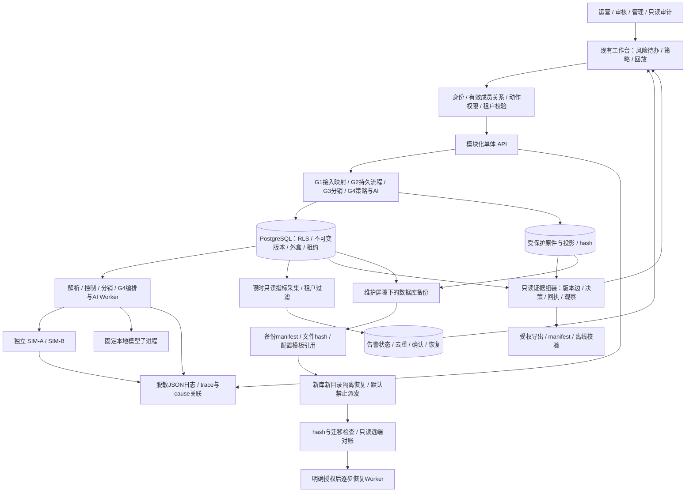
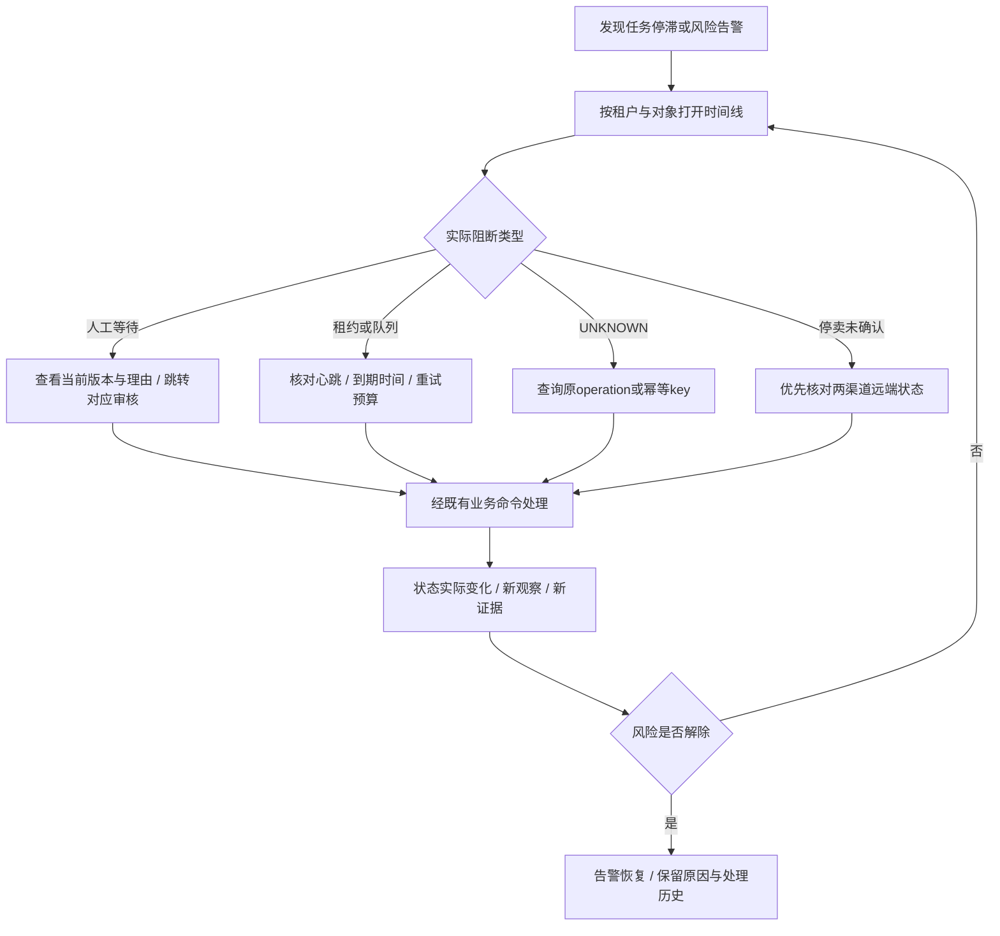
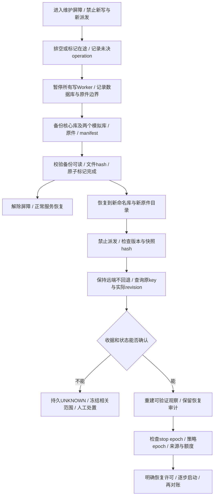
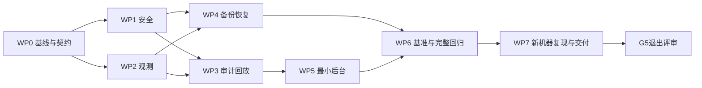

# AI 酒店库存匹配与多渠道分销平台：G5 阶段详细实施计划

> 版本：v1.0；编制日期：2026-10-28（Asia/Shanghai）。  
> 阶段定位：安全、观测、审计回放、恢复与可复现交付。  
> 状态：正在实施与验收；本文数字为验收目标或实验规模，实际结果以 `docs/acceptance/g5-report.md` 与原始证据为准。  
> 推进方式：按依赖、工作包和退出门槛推进，不精确到天。  
> 唯一项目环境：`D:\miniconda3\envs\hotel_project`，后端统一使用该环境的 `python.exe -s`，不使用 base。

> 范围调整（2026-10-28 用户确认）：当前没有独立 Windows 主机或虚拟机，先完成全部本机实施与验收。场景47保留为 `DEFERRED_BY_USER`；本机新目录、新库复现只证明本机隔离重建，不替代新机器验收，也不据此宣称原始全项退出门槛已满足。

> 交付调整（2026-10-28 用户确认）：用户选择“不录屏，将录像列为待补交付项”。场景49（P1）记录为 `DEFERRED_BY_USER`；保留浏览器操作与截图证据，不将截图序列冒充连续录屏。其余本机P0验收继续完成。

## 1. 依据与阶段目标

依据总设计《AI酒店库存匹配与多渠道分销平台-产品技术设计说明书.html》的 security、observability、testing、roadmap、handoff 章节，以及 [G4验收报告](docs/acceptance/g4-report.md)、[50项证据矩阵](docs/acceptance/g4-scenario-matrix.md)、现有 G0～G4 契约和操作手册。

总设计给 G5 的交付定义是：权限负测、性能基准、审计回放、队列指标、备份恢复、最小后台完善、录屏、README 与 runbook；退出时 P0 通过、目标与实测分开、新机器可复现、故障证据齐全。

G4 已在本地限定范围通过验收：历史完整回归201项，另外60组冻结难例专项通过，两次执行分别保留原始报告。G5 开工重新收集并执行当前套件；预计包含这些用例，但不得把历史261项合计直接写成本阶段实测结果。

本阶段必须回答五个问题：

1. 租户、角色、原件、导出、运维入口和模型证据是否都受相同的权限约束？
2. 出现 UNKNOWN、等待、积压或停卖未确认时，能否定位到具体阶段和原因？
3. 任意抽样发布能否回到真实原件记录、当时的审批和实际远端观察？
4. 丢失本地状态后，能否恢复并避免重复发布、旧任务复活和误报成功？
5. 其他人能否按说明重新建立环境，复现正常与故障链路？

## 2. 范围、优先级与继承边界

| 优先级 | 必须交付 | 完成定义 |
| --- | --- | --- |
| P0 | 安全闭环 | 端点权限矩阵、跨租户/角色/文件/导出负测、凭证与日志脱敏、危险配置阻断 |
| P0 | 观测与处置 | HTTP到Worker到模拟器的关联、真实队列指标、持久告警与恢复记录 |
| P0 | 审计回放 | 只读时间线、版本证据、原件定位、受权导出及离线完整性校验 |
| P0 | 备份与恢复 | 一致性备份、隔离恢复、远端已成功而本地回退窗口的安全收敛 |
| P0 | 可复现交付 | 环境锁定、幂等准备、受限演示重建、离线运行、另一台干净Windows机器实际复现 |
| P0 | 回归与基准 | G0～G4兼容回归、新安全/恢复测试、分层性能报告与明确容量边界 |
| P0 | 最小后台补齐 | 风险待办、审计入口、受控策略重绑、关键键盘/窄屏与错误恢复路径 |
| P1 | 演示与表达 | 完整/精简录屏、架构图、脚本、已知限制与最终交付索引 |

P1 不得替代 P0；计划中的录屏属于交付物，未录制必须标记未完成，不能以静态截图冒充录像。优先完成后端证据，再做演示整理。

继续保持：本地合成数据、独立 SIM-A/B、USD两成人、NONREF、静态库存分配、人工批准新映射、受批策略自动更新。G4 模型在 NONE 上误建议更多的事实和人工闸门继续公开。增加多个合成来源只用于隔离和容量验证，不等于已实现跨供应商共享库存合并。

本阶段不接真实OTA、外部模型、订单支付；不升级为微服务、不引入自主Agent，不承诺生产高可用或真实防超售。G2全量物化、G3完整远端JSON读取、300ms轮询等限制先量化，只有确认为本阶段阻断才做局部优化，不以大规模重构替代验收。

## 3. 架构与流程

### 3.1 G5组件架构

观测和回放只读业务数据。告警确认不等于修复；导出不触发重算、审批或发布；恢复工具不自动清空开发库。

### 3.2 故障定位流程

### 3.3 安全备份和恢复流程

“三个库一起回到旧版本”和“仅本地核心库回退、远端仍保留新状态”是两种不同演练，二者都必须执行。

## 4. 开工盘点与设计冻结（WP0）

输入：现有代码、迁移015、模型manifest、G4报告与契约。输出：`docs/acceptance/g5-baseline.*`、差距清单、ADR及验收矩阵初稿。

1. 记录代码树内容hash、解释器/依赖/前端锁、PostgreSQL版本、迁移checksum、模型revision与hash；无Git提交号时使用源码manifest，不伪造版本号。
2. 重新执行当前完整套件，保存真实收集数、通过/失败/跳过和耗时；发现缺陷先修复或明确阻断。
3. 枚举HTTP端点、Worker入口、受保护下载、导出及CLI；记录角色、租户、输入对象和副作用。
4. 区分既有审计事实、普通日志、任务尝试和远端观察；不假定已有字段足够跨阶段关联。
5. 冻结G5验收规模、超时、资源预算及基准配置文件。后续改阈值必须新版本并解释，不覆盖失败结果。
6. 形成ADR-025起的实际编号，分别记录安全/认证取舍、观测、回放、恢复及基准口径；编号先检查现有目录，避免冲突。

退出：兼容基线通过；P0范围、身份矩阵和证据字段已确定。

## 5. 安全与权限补强（WP1）

### 5.1 授权矩阵

沿用当前 `operator / reviewer / tenant_admin / auditor` 四角色，不直接照抄总设计未实现的“分销经理”新角色。逐端点冻结实际允许动作；任何与总设计的差异写ADR和用户说明。

- operator：授权范围内上传、编译和提交；不能自授策略或冒充系统批准。
- reviewer：映射与独立快照/策略审核；不因审核权限自动获得管理员启用或重绑权。
- tenant_admin：本租户配置、策略提议/启停、受控重绑、紧急关闭；不能绕过独立批准或管理其他租户。
- auditor：只读回放和显式授权的脱敏导出；所有业务写入拒绝。
- Worker：从持久任务恢复租户及owner/fence；不接受客户端提供的SYSTEM_POLICY身份。
- 备份操作：本机运维CLI能力，明确包含多租户数据；不把完整数据库备份开放为租户管理员HTTP下载。

### 5.2 必须覆盖的攻击面

对象ID替换、分页/筛选/导出绕过、缓存串租户、连接池上下文残留、成员撤销后旧JWT、失效/畸形JWT、审批自批、路径穿越、恶意文件结构、XSS、公式注入、出站地址绕过、日志/错误/导出中的秘密。

文件安全采用实际大小、结构和解析资源预算；XLSX展开尺寸/条目数/压缩比超限应在物化前拒绝。拒绝任意服务器路径、外部实体或远程资源加载。CSV展示导出转义危险公式前缀（含前置空白/控制字符），原件下载保留原始字节并明确标识；不能为了安全导出修改原始证据。

模拟器URL只允许已配置的本机端口/固定路径，禁止跟随到白名单外的重定向；不能把用户URL交给HTTP客户端。异常响应和普通日志不得包含JWT、密码、数据库URL、渠道token、完整业务原文。

### 5.3 认证差距处理

当前是开发口令换取短时Bearer JWT、令牌仅页面内存保留；总设计提出的Cookie会话不等于当前实现。G5保留本机Bearer模式，明确记录此取舍：不使用Cookie自动携带凭证，不开放CORS通配或把token写localStorage；为开发登录增加失败限速、受保护的口令哈希验证及安全错误，不留明文回退。

关闭DEV_AUTH后开发登录端点不存在，非development配置仍禁止开发登录。仅本机运行；生产身份系统、HTTPS部署与Cookie/CSRF方案属后续部署关卡。限速状态须覆盖实际服务进程，不能仅靠前端禁用。密码和JWT不冻结到模拟业务时钟。

退出：矩阵对应负测全部通过；权限、文件、导出和日志发现的P0缺陷关闭；形成威胁模型与明确剩余边界。

## 6. 观测、指标与告警（WP2）

### 6.1 关联和日志

扩展现有trace_id，保留 `correlation_id`（跨异步链）、`causation_id`（直接原因）及现有run/step/task/attempt/plan/listing引用。旧历史缺字段显示“未记录”，不追填伪造因果关系。外部提供的追踪头只接受有限长度/格式，不能覆盖服务端可信身份。

结构化日志最少包含UTC时间、level、service、event、trace/correlation、tenant上下文、对象ID、error_code、duration；日志不承担不可变业务审计的唯一存储责任。日志目录轮转、大小与保留策略可配置，清理只针对已确认日志文件，不清审计表和原件。

### 6.2 指标口径

| 分组 | 指标 | 必须解释 |
| --- | --- | --- |
| 队列 | ready/running/retry/expired_lease数量、最老可执行任务年龄 | 人工等待单列，不算Worker积压；due时间和创建时间分别报告 |
| 工作流 | 各WAIT原因、等待时长、过时run、阶段重试 | 失败/等待不能从自动完成率分母中消失 |
| 外盒 | 未消费数、最老提交年龄、重复消费次数 | 事务提交时间作为起点，不使用未来模拟业务时钟 |
| 渠道 | 429、UNKNOWN、回执与VERIFIED时延、死信 | 区分接收成功、执行成功和实际观察确认 |
| 风险 | 来源过期、drift、停卖待确认年龄 | 查询失败不是“无漂移”；STOPPED依据观察状态 |
| 模型 | 排队/执行耗时、回退原因、预算、进程RSS | 缓存命中与真实推理分开，不输出来源文本 |
| 资源 | API分位数、进程树RSS、DB连接池等待/占用 | API/Worker/模型/PostgreSQL/模拟器分别计量 |

租户指标HTTP查询必须鉴权和过滤；平台级采集只走本机运维入口，不泄露其他租户数量。指标标签仅采用有限枚举（阶段、渠道、状态、错误类别）；具体ID留在权限内明细和日志，避免高基数。

### 6.3 告警与运行状态

首版告警：停卖待确认、UNKNOWN超预算、外盒滞留、租约过期/Worker无心跳、死信、来源TTL过期。演示阈值配置化并记录版本；默认停卖阈值5分钟，其余在WP0按实际调度周期冻结。测试使用可控时钟缩短等待，不冒称真实等待了5分钟。

告警按租户+类型+受影响范围去重，保存首次/末次发现、阈值版本、确认者/理由、恢复时间。状态 `OPEN → ACKNOWLEDGED → RESOLVED`；确认不关闭风险，采集失败标记UNKNOWN，不自动RESOLVED。告警本身不新增隐式停卖、重试或策略放宽。暂不集成邮件/企业消息。

退出：注入每类风险能看到对应告警，消除后有真实恢复记录；正常业务不依赖观测采集成功。

## 7. 审计回放与受权导出（WP3）

### 7.1 回放数据链

以listing/revision、snapshot、workflow_run、batch等已有ID为入口，先验证租户，再按有界图查询：

`原件hash/文件 → 原始记录位置 → staging/规范化版本 → activation → 酒店/房型/计划映射与反馈 → 规则/模型建议 → 额度版本 → 快照hash → 人审或策略版本/epoch/机器决定 → plan/branch/chunk/attempt → operation/回执 → observed revision/hash → 对账/关闭`。

每个节点给出对象ID、版本、操作者或系统actor、UTC时间及显示时区、结论、原因、输入hash和下一条引用。按显式版本边组织，不只按时间排序推断因果。对缺失、过期、不可访问和校验失败分别呈现，不把缺记录默认为成功。

G4的staging record_number必须标识“投影记录”；通过G2 provenance定位原始文件/工作表/记录序号。CSV含多行字段时使用逻辑记录号，只有有真实字节/行偏移证据时才显示物理行号；JSON显示明确record index/path，XLSX显示sheet/row。不能把三种格式统一伪称CSV行号。

### 7.2 导出与完整性

首版JSON证据包和人读摘要；必要表格CSV使用安全转义。导出按租户和对象范围冻结，限制节点数、字节数和超时；超限返回明确截断/分页信息，不把不完整包标记完整。

manifest记录导出版本、UTC生成时间、对象范围、各文件SHA-256、已脱敏字段、完整性结果及缺失引用。原件仅在具备下载权限且显式选择时附带；默认包不含凭证、连接串和全租户数据库。校验工具可离线检测包内容改动，但同包hash不是第三方签名或防管理员篡改证明；报告这一信任边界。

回放接口只读，不调用编译/AI/对账写命令；导出请求写独立审计记录。新增安全审计不能阻塞紧急停卖，采用既有事务事实与可恢复外盒，不以“日志成功”作为关停前提。

退出：至少20条分层抽样链100%解释（正常、人工异常、UNKNOWN、重试、漂移、停卖均包含），并有每种文件格式原件定位样例。

## 8. 一致性备份、恢复与灾难窗口（WP4）

### 8.1 备份策略

首版采用可观测的短维护窗口。先建立服务端写入/派发屏障，再停止所有会写入的Worker；等待已许可HTTP完成或保留未决窗口，不只隐藏页面按钮。备份失败也必须以finally退出或清晰保留维护状态，禁止半完成包进入可恢复清单。

使用与本机数据库匹配的备份工具导出核心库、SIM-A/B，并复制不可变原件及模型/代码/依赖manifest。屏障覆盖三个模拟服务的写路径，记录各库快照时间；没有跨库原子事务时，以排空后的稳定边界保证本地联合包一致，说明停机成本。

包内不含.env、明文密码、JWT密钥或渠道token；角色重建由模板与独立安全配置提供。模型大权重可复用hash验证缓存，但“全离线交付包”必须另附已验证必要文件及许可证，不能只有下载地址。

备份目录采用新时间戳/ID、先临时后完成标记、hash校验、容量检查和保留清单。默认不自动删除历史包；以后清理只能删除明确完成且非保留的包。备份包含全租户敏感事实，限制本机访问并记录访问边界；同一磁盘的包只证明恢复流程，不等于抗整盘损坏或异地容灾。

### 8.2 恢复安全性

- 仅恢复到新建且前缀匹配的 `hotel_project_g5_restore_*` 数据库及独立原件目录，不覆盖开发库和历史测试库。
- 恢复模式默认禁止发布/自动化/修复派发；先核验迁移checksum、RLS、原件hash、快照hash、模型manifest、外盒与未决任务。
- 备份前后保留两个故障窗口：远端已成功、本地尚未记账；备份后远端已停卖、本地仍保留旧售卖目标。
- 核心库恢复后保留远端现状，查询原operation/key及revision；不盲目重放外盒，不因为本地旧epoch/旧目标重开售。
- 远端比本地新、stop证据缺失或结果不能确认时，冻结对应scope并持久UNKNOWN/恢复阻断。不能重置远端来“消除不一致”。
- 恢复许可需本机管理员明确提供目标与清单；按查询/关闭优先，再逐步放开业务写，审计恢复者、备份ID与差异。

### 8.3 目标与计时

沿用总设计拟议目标：**RPO≤24小时、RTO≤1小时**，仅本地演示范围。RPO报告故障时刻与最近有效一致性备份的距离；恢复后通过远端补证不等于所有备份后本地数据零丢失。RTO从宣布恢复演练/停止业务起，到校验并完成安全收敛、业务可恢复止，包含复制、恢复、检查和对账。

至少完成两次独立恢复演练，记录包大小、数据规模、各阶段耗时、实际损失范围和未决对象。只验证一次备份不能证明持续满足24小时RPO；需同时实现并验证每日备份调度与陈旧备份告警，离线未开机时明确暴露超期状态。计划任务由可审查的本机脚本显式安装，不静默添加系统服务或开机项。

退出：联合恢复和核心单独回退均通过；远端不产生重复效果、不复活停售；目标未达到则修复重演，不能只更新文案宣称通过。

## 9. 最小后台与受控操作（WP5）

在现有阶段导航内新增风险待办/审计入口，不重做营销页面。待办优先停卖未确认、UNKNOWN、来源过期、死信、漂移和人工等待；每项显示时间、范围、原因及正确的处理入口。

补齐G4策略换版重绑：管理员选已获独立批准的新版本，预览旧/新策略范围、授权开关、基准hash、订阅和当前epoch；提交使用期望版本/CAS，服务端再次确认租户、批准、范围和状态。旧机器决定不得因换绑复用；不默认扩大范围、不自动解除stop fence。失败保留输入，409提示刷新后复核，不自动改绑。

审计页支持对象检索、有界分页、节点详情、原件定位、脱敏导出；历史变更不悄悄替换正在查看的审批版本。界面处理空、加载、401、403、409、503、超时与部分结果；风险文字不只依赖颜色。关键审核/重绑/停卖流程可键盘完成，标签与焦点明确。

验收实际桌面1280×800和窄屏390×844；页面不横向溢出，必要表格局部滚动。浏览器只读DOM检测与实际点击结合；按页面操作和HTTP准备分别记录，不能混称全浏览器操作。基础无障碍检查不等同完整认证或所有设备兼容。

## 10. 性能、稳定性与回归（WP6）

### 10.1 分层基准

| 层级 | 固定实验规模 | 采样与输出 |
| --- | --- | --- |
| 解析/暂存 | CSV/XLSX/JSON各1万、10万条逻辑记录；先冻结各实体组成 | 每种规模1轮预热+至少5轮计时；解析与激活/物化分别计时，报告峰值RSS |
| 查询/回放 | 已冻结数据规模；详情、风险列表、20条审计链 | 至少100次计时，报告p50/p95/max、失败数、返回字节及扫描边界 |
| 分销协议 | 100/1000/10000真实日期格 | 沿用G3口径复测，明确不等于完整业务编译容量 |
| 完整自动链 | 10个独立合成来源、每来源30日期×2渠道，5轮 | 人工基准/映射先准备；计量文件接收至双VERIFIED，各阶段及队列时间 |
| 竞争与停卖 | 实际模型任务/编排/分销并行，注入10次关闭 | 报告所有关闭确认耗时、失败/UNKNOWN、AI进程与队列数量，不以循环推理冒充任务积压 |
| 稳定性 | 连续运行至少60分钟，有节奏更新、查询与真实推理 | RSS/连接数/积压时间序列、起止资源、已完成与未完成数 |

同一来源更新串行，跨来源并发按1/2/4分档；共享账号配额如实纳入。规模越大先做资源预检，超预算终止并记录；不靠无限延长deadline掩盖瓶颈。十万记录仅解析达标不能表述为十万记录完整自动链达标。

### 10.2 目标与判定

安全正确性为硬门槛：越权成功0次、必测硬冲突漏过0次、重复远端效果0次、停售复活0次、成功状态无伪报、恢复无不可解释hash差异。

沿用总设计的解析实验目标p95≤120秒、解析进程峰值≤1GiB；样本少时p95采用明确算法并同时列出全部样本，不宣传统计稳定性。若现有实现达不到，先修复再测；调整目标必须保留旧结果、给出资源依据和范围决定，不能自动降级通过。

WP0冻结完整链和交互响应的本机性能预算。没有基线前不编造SLA；报告明确预算是否满足，未满足项不能从矩阵消失。自动完成率分母包含所有已接收且预先判定符合策略的更新，失败/等待/超时单列；故障场景另外报告，不与正常负载混算。

资源计量涵盖API、各Worker、模型子进程、模拟器和PostgreSQL，进程树去重，内存指标声明RSS求和的共享页重复计算限制；另列主机CPU/可用内存。报告硬件、OS、依赖、模型、数据库、并发、冷热缓存、seed、请求清单及运行时间。

全部测试使用专属 `hotel_project_g5_test` 与SIM-A/B测试库；恢复和基准使用各自前缀和独立文件目录，绝不重置开发库。新迁移只追加到015后，版本号由实际实现确定。测试结束关闭故障入口并恢复此前正常服务状态。

## 11. 新机器复现、演示与交付（WP7）

### 11.1 可复现运行包

计划提供 `infra/scripts/g5.ps1` 的 setup/start/stop/status/test/security-test/benchmark/demo/evidence 等明确动作，以及独立 backup/restore/verify-backup 脚本。它们是待实现接口，不是当前可执行命令；完成后写runbook的实际参数。

准备流程核验项目根目录、专属解释器、PostgreSQL工具、端口、Node与锁文件；重复setup不覆盖.env、不重写已应用迁移、不清已有业务数据。停止前核对进程可执行路径、模块、工作目录/项目标识，不按端口杀任意进程。

新机器复现必须在另一台干净Windows主机或独立Windows虚拟机实际执行：创建相同专属Conda环境、安装锁定依赖、配置本机秘密、初始化新库、准备固定模型、构建、测试、演示和备份恢复。只有当前机器的新目录/新数据库结果只能叫“隔离复现”，不能替代新机器验收。没有可用主机时此项保持BLOCKED，G5不得标记全项通过；本阶段仍完成其他工作和可交付脚本。

联网准备与离线运行分开：准备可下载锁定依赖/模型，正常启动不能静默下载；准备完成断网后实际走人工/模型禁用闭环，模型已缓存时再走真实推理。包记录权重许可与校验，不包含本机秘密。

### 11.2 演示可重建

不对当前开发租户执行破坏性reset。首版重建命令仅针对白名单演示数据库/目录：先输出解析后的绝对目标与运行进程检查，再新建固定seed/ID/业务时钟的场景。已有目录默认拒绝覆盖，可改用新run ID；重跑验证两次相同业务预期。总设计的reset-demo在此采用“隔离实例重建”实现，并记录差异。

完整演示12～15分钟：来源/坏行 → 实际AI及硬冲突 → 独立审批/策略 → 双渠道自动更新 → 越界人工恢复 → UNKNOWN查询 → 漂移/关闭 → 审计导出 → 恢复证据。精简演示约2分钟，重点解释问题、自动化边界和一条故障证据。脚本每步列前置身份、预期状态、失败后的恢复入口；录像显示合成/模拟标识。

README更新当前能力与限制，补充版本清单、运行入口、契约、测试/基准、模型评估、完整证据索引和真实接入G6门槛。G4效果原始结果继续保留；如模型/规则未变不强制反复调参，变更后重新冻结评估版本且保留旧结果。

## 12. 持久对象、接口与代码落点

以下是实现边界建议，WP0确认实际复用后冻结，避免重复建设已有表。

| 内容 | 设计要求 | 建议落点 |
| --- | --- | --- |
| 关联元数据 | trace/correlation/cause及历史缺失标记；原事实不改写 | 现有HTTP/外盒/任务尝试与 `services/core/g5/` |
| 告警/事件 | 租户、有限类型、范围指纹、阈值版本、状态/理由/时间；历史仅追加 | 新增前向SQL、告警服务 |
| 维护/恢复状态 | 恢复实例ID、备份ID、写/派发屏障、许可及检查结果 | 持久控制记录+CLI，不靠浏览器内存 |
| 回放/导出 | 版本化响应、游标/上限、缺失引用、权限复核、导出审计 | `contracts/audit/v1/`、只读路由 |
| 观测接口 | 租户过滤、有限标签、采集时间、失败/陈旧标记 | `contracts/operations/v1/`、运维路由 |
| 恢复清单 | 数据库/原件/模型/代码hash、版本、快照边界、未决operation | `contracts/recovery/v1/`、`infra/` |
| 前端 | 复用现有风格和阶段导航，风险/回放/重绑组件 | `apps/admin/src/` |
| 验收 | 实际HTTP/数据库、进程故障、浏览器、原始基准与报告 | `tests/test_g5_*.py`、`docs/acceptance/g5-*` |

新增租户业务表必须FORCE RLS、复合tenant外键、只追加历史保护；运维全局控制表不给普通租户直接访问。API先冻结契约，再导出实际 `contracts/openapi/g5.json`；不新增可绕过既有业务命令的“万能修复”接口。

## 13. 依赖顺序与里程碑

每个工作包实施后先完成对应验收，不把所有验证推迟到最后。以下均保持未完成状态，实施时以真实证据勾选：

- [x] M0：当前回归基线通过，范围、性能预算、权限和恢复契约冻结。
- [x] M1：安全矩阵及新增负测通过，认证取舍与剩余边界归档。
- [x] M2：真实指标、跨异步关联、告警发现/确认/恢复闭环。
- [x] M3：20条回放抽样及三格式原件定位、导出校验通过。
- [x] M4：一致性备份、两类恢复、停卖不复活和恢复目标验证。
- [x] M5：策略重绑、风险待办、桌面/窄屏/关键键盘实际完成。
- [x] M6：分层基准、60分钟稳定性、完整回归及故障测试通过。
- [ ] M7：另一干净Windows实例复现、离线闭环、两次演示重建通过。
- [ ] M8：录像、README、runbook、证据清单、限制和最终评审签结。

## 14. 全项验收场景与证据矩阵

实施时生成 `docs/acceptance/g5-scenario-matrix.md/.json`，逐项记录状态、执行时间、用例/脚本、原始证据和限制。PASS/PARTIAL/FAIL/BLOCKED/SKIPPED分别保留；P0不得用PARTIAL或SKIPPED退出。下表全部为**待执行**。

| ID | 优先级 | 场景与预期 | 主要证据 |
| --- | --- | --- | --- |
| 01 | P0 | 重新执行G0～G4当前完整套件，统计实际收集数与全部结果 | baseline JUnit |
| 02 | P0 | 新增迁移不改写旧checksum；升级后旧业务数据与RLS保留 | migration/security JSON |
| 03 | P0 | 全端点角色矩阵；只读审计所有写动作拒绝 | security JUnit/矩阵 |
| 04 | P0 | 两租户互换对象/任务/原件/建议/策略ID，无越权读取写入 | HTTP与DB负测 |
| 05 | P0 | 连接池复用、后台任务、缓存、分页/筛选均无租户串漏 | 集成测试 |
| 06 | P0 | 旧/畸形JWT、成员撤销、开发登录关闭与失败限速有效 | 认证负测 |
| 07 | P0 | 独立审批不可自批；客户端不能伪造机器actor或恢复许可 | 权限负测 |
| 08 | P0 | 路径穿越、伪装格式、畸形/超限XLSX和长字段受控拒绝 | 文件安全样例及资源记录 |
| 09 | P0 | 来源XSS/提示指令仅字面显示，无映射/发布副作用 | 浏览器+状态证据 |
| 10 | P0 | CSV公式前缀含空白变体安全导出；原件hash不变 | 导出字节对照 |
| 11 | P0 | 出站URL及重定向绕过被拒绝，不触达未授权地址 | transport负测 |
| 12 | P0 | 日志、错误、导出、交付包扫描无真实秘密 | 脱敏扫描摘要 |
| 13 | P0 | HTTP→外盒→Worker→模拟器→回执关联可查询 | 真实异步链证据 |
| 14 | P0 | 队列数量/最老年龄与数据库事实对照；人工等待单列 | metrics快照 |
| 15 | P0 | 外盒滞后/租约过期/死信告警发现与恢复；不伪成功 | 告警时间线 |
| 16 | P0 | UNKNOWN/429/来源过期/停卖待确认告警正确，确认不等于解除 | 故障注入证据 |
| 17 | P0 | 指标租户隔离、标签有界、采集失败标记陈旧/UNKNOWN | 安全及观测负测 |
| 18 | P0 | 采集故障不阻断业务和紧急关闭 | 并行故障HTTP证据 |
| 19 | P0 | 20条分层链全部回到版本、审批和实际观察 | audit sample JSON |
| 20 | P0 | CSV多行字段、XLSX sheet/row、JSON record/path定位准确 | 三格式原件对照 |
| 21 | P0 | G4投影记录和原件记录明确区分，引用缺失可见 | 回放截图/响应 |
| 22 | P0 | SYSTEM_POLICY、模型revision、人工反馈和epoch均可追溯 | G4回放包 |
| 23 | P0 | 回放不重算/发任务；稳定分页和对象上限有效 | 只读性与边界测试 |
| 24 | P0 | 导出跨租户/越权拒绝；脱敏包离线验证及篡改失败 | export manifest/负测 |
| 25 | P0 | 备份维护屏障阻止新写/派发，未决在途有记录 | 维护竞态测试 |
| 26 | P0 | 联合备份完整；失败/磁盘不足包不可标完成，服务可恢复 | backup/failure JSON |
| 27 | P0 | 恢复到新库新目录，拒绝开发库/错误路径/不完整包 | restore安全负测 |
| 28 | P0 | 核心+两模拟库联合恢复，hash/迁移/RLS一致 | restore报告1 |
| 29 | P0 | 核心回退而远端已成功：查询原key，远端无重复效果 | restore报告2/收据 |
| 30 | P0 | 远端备份后已停卖：恢复旧目标不复活，旧epoch阻断 | stop恢复竞态 |
| 31 | P0 | 无法确定远端状态时保持UNKNOWN/冻结，未自动放行 | 故障恢复负测 |
| 32 | P0 | 两次恢复计时，RPO/RTO如实计算；每日调度/超期告警可验证 | 时间戳/调度记录 |
| 33 | P0 | 风险待办可跳正确处理入口，空/错/部分结果可理解 | 浏览器证据 |
| 34 | P0 | 已批准策略换版重绑；旧决定失效，CAS冲突不误绑 | HTTP+浏览器 |
| 35 | P0 | 桌面与390窄屏完成回放/导出/重绑/关闭，无整页横溢 | 截图/DOM尺寸 |
| 36 | P0 | 关键流程键盘完成；焦点、标签、风险文字和401/409恢复有效 | 操作记录 |
| 37 | P0 | 三格式1万/10万解析基准，解析与后续物化分开 | benchmark原始样本 |
| 38 | P0 | API/回放至少100样本、协议三档复测，保留失败与max | benchmark JSON |
| 39 | P0 | 十来源双渠道完整自动链五轮及1/2/4并发，统计全分母 | E2E原始清单 |
| 40 | P0 | 实际模型任务竞争下10次关闭，确认远端状态并报告所有耗时 | 混合负载证据 |
| 41 | P0 | 60分钟资源/队列稳定性，无不可解释增长或遗失任务 | 时间序列与结案清单 |
| 42 | P0 | 100次固定seed随机重复/乱序投递，远端无重复效果 | seed/投递/远端对照 |
| 43 | P0 | 最终完整回归、安全/契约/恢复均通过，正常故障入口关闭 | 最终JUnit/环境 |
| 44 | P0 | setup重复运行保留.env/数据；停止仅影响已核验项目进程 | 脚本幂等证据 |
| 45 | P0 | 白名单隔离实例两次重建；范围错误拒绝，不清开发租户 | demo replay JSON |
| 46 | P0 | 准备后断网，人工/禁模型完整闭环；缓存模型真实推理可用 | 离线HTTP与推理记录 |
| 47 | P0 | 另一干净Windows实例按文档完成安装、测试、演示与恢复 | 外部实例环境/日志 |
| 48 | P0 | 最终包无秘密，源码/依赖/模型/证据manifest可校验 | release manifest |
| 49 | P1 | 12～15分钟与约2分钟真实录屏，标注版本和模拟边界 | 视频/脚本 |
| 50 | P0 | README/runbook/限制齐全；所有P0有证据，目标与实测分列 | report/矩阵/摘要 |

一行可对应多项测试，一个测试也可能提供多行证据；测试数量不等于场景数。UI、安全、恢复、基准与新机器复现不能靠单元测试通过替代。

## 15. 最终交付目录与退出门槛

2026-10-29执行结论：本机授权范围48项PASS；第47项独立Windows和第49项录像为DEFERRED_BY_USER。原始退出要求保留，不把本机隔离目录当新机器，不以截图替代录像。逐项实测见[最终场景矩阵](docs/acceptance/g5-scenario-matrix.md)及[验收报告](docs/acceptance/g5-report.md)。M0–M6本机工作已落实，M7完成两次本机隔离复现、独立Windows待环境，M8文档与校验包已交付、录像待补。

计划交付：

- `docs/acceptance/g5-report.md`：结论、真实环境、执行结果、性能、恢复、剩余限制。
- `g5-scenario-matrix.md/.json`：50项逐条证据及状态。
- `g5-baseline.xml`、`g5-tests.xml`、专项JUnit、真实HTTP与故障原始记录。
- `g5-security.md/.json`、`g5-benchmark.md/.json`、`g5-restore.md/.json`、`g5-reproduction.md/.json`。
- `g5-browser.json`与桌面/窄屏截图，演示脚本及实际录像。
- `g5-environment.json`、`g5-acceptance-summary.json`、源码与证据hash清单。
- 观测/告警、审计导出、备份恢复、离线运行、新机器复现、演示重建runbook。
- 实际OpenAPI、audit/operations/recovery契约、迁移、ADR和锁文件。

G5退出需同时满足：

1. 所有P0场景PASS，完整回归无未解释失败/错误/跳过；P1完成情况单独列出。
2. 越权、硬冲突绕过、重复远端效果、停售复活均未在必测集发生。
3. 20条抽样审计链可解释，三格式原件定位和安全导出实际可验证。
4. 两类恢复、两次计时、陈旧备份告警及RPO/RTO目标得到实际证据支持。
5. 分层基准和稳定性完成，容量限制公开；没有拿G3协议或G4模型单项结果充当全链容量。
6. 另一干净Windows实例真实复现，离线和演示重建通过；缺少实例则保留阻断，不签全项。
7. 服务恢复正常配置，开发数据和历史证据保留，故障入口关闭；README与最终报告结论一致。

达到后可宣布“G5本地模拟范围验收通过、MVP交付证据齐全”。这不自动取得真实渠道、生产安全、商业SLA或灾备准入；G6按总设计另行研究授权、协议、sandbox和应急责任。
