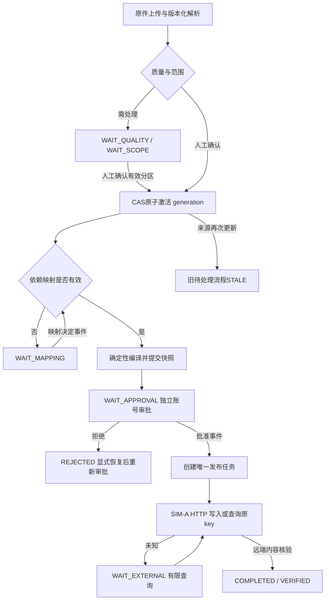

# g2-flow-v1

唯一运行键：(tenant,processing_id,definition)。PARSE / ACTIVATE / COMPILE / PUBLISH是持久化成功步骤，按(step_key,input_hash)去重，attempt另存execution_job/job_attempt。输入变化建立新的成功输出记录，既有快照业务payload不可变。

wait保存gate/resource/expected_version及resolved_event_id。人工等待释放执行租约，页面关闭/进程重启不丢。唤醒后重新读取依赖、snapshot、审批与版本，事件不是授权。每个物业/listing流程独立；G2不支持一个物业内任意商品子图的局部发布。

pause停止新增外部派发，解析与已在途查询可完成；cancel仅允许尚无不可撤销外部效果的流程，不能将UNKNOWN伪装取消。resume是显式命令及事件；被拒绝/过期且未建任务的snapshot会重新编译，必须重新独立审批。没有通用截止时间调度器，审批期限在推进和派发前再校验。
