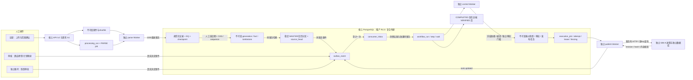

# G2 阶段实施与验收报告

> 日期：2026-10-26。结论：**G2 有界本机演示范围内的功能验收通过，可进入 G3 计划准备。**不是生产上线验收、真实 OTA 接入验收或生产 SLA 证明。
>
> 实施依据：根目录总设计说明、G2阶段详细实施计划、G1验收基线。实现目录收敛为services/core/g2，未照计划建议目录拆成更多服务。G0/G1原件、历史快照和决策保留。

## 1. 实测结论与证据

| 项目 | 实测结果 | 证据 |
| --- | --- | --- |
| 开工基线 | 原57项通过，16.71秒 | 本次开工实跑；G1历史报告另存 |
| 最终完整回归 | **93 passed，0失败/错误**；pytest报告66.84秒，JUnit suite65.940秒 | g2-tests.xml；含原57项及新增36项，不把30场景矩阵当测试函数数量 |
| 真实崩溃与竞争 | 7个独立故障/并发用例通过，含多个子进程与真实HTTP渠道效果 | g2-faults.json、tests/test_g2_faults.py、infra/g2_fault_child.py |
| 独立进程HTTP闭环 | CSV、XLSX、JSON三个snapshot及一次JSON delta，均COMPLETED / VERIFIED | g2-http-smoke.json；真实登录、独立parse/control/publish Worker、独立SIM-A |
| 浏览器 | 人工范围确认、5项映射、独立快照审批完成后自动核验；最终COMPLETED / VERIFIED | g2-browser.json、g2-browser.png |
| 规模处理 | 10000/100000唯一自然键、三格式、首次及同原件重解析；提交数与输入一致 | g2-benchmark.md / .json；完整方法限制见第6节 |
| 基准摘要 | 十万条首次/重复解析16.810～33.320秒，进程树峰值71.67～82.02MiB；完整12样本全部成功 | g2-benchmark.md / .json；不报告p95 |
| 静态与构建 | ruff check及format检查通过；TypeScript与Vite构建通过；pip check无损坏依赖 | 项目命令实跑；无额外测试包污染base |
| 环境与迁移 | 项目专属Python3.12.15；PostgreSQL18.4；核心001～007、模拟库001 | g2-environment.json；前向升级与checksum重复检查 |

测试出现1项既有Starlette/httpx TestClient弃用警告，功能断言通过。开发API真实HTTP不使用TestClient。实施中修复了UI映射后误用G1批次刷新、测试错误信封字段断言，以及大压缩样本测试名超过Windows环境变量长度的问题；最终报告没有隐藏失败项或标记为跳过。

## 2. 实现架构

三组Worker按可信A/B租户名单公平调度，不使用迁移账号或BYPASSRLS。每个作业认领使用SKIP LOCKED、数据库时钟租约和递增token；旧执行者提交与续租必须失败。物业锁保护合并，listing锁保护外部并发，二者不替代分区CAS或远端幂等。

## 3. 工作包交付

| 工作包 | 交付 |
| --- | --- |
| WP01 契约 | contracts/files/v2、events/v1、workflows/v1；ADR013～016；demo-v1固定序号流 |
| WP02 格式与处理 | CSV / read-only XLSX / ijson，1000行检查点，版本化run，定位与DQ，受限预览/导出 |
| WP03 来源视图 | snapshot authority、delta继承、tombstone、不可变generation、真实血缘、G1兼容投影 |
| WP04 并发 | MASTER/逐日稳定分区、期望版本向量、严格序号、原子激活、幂等命令 |
| WP05 事件 | outbox与业务同事务，inbox与效果同事务，重复/迟到保护，有限重投及原事件恢复 |
| WP06 流程 | run/step/wait、冻结输入hash、人工决定后推进、拒绝/暂停/取消/显式恢复 |
| WP07 执行 | 三组Worker、租约/心跳/fencing、有限预算、原key查询恢复、可信租户轮询与背压 |
| WP08 操作页 | 新“流程与质量”页、检查点/问题/日期确认/流程等待/审核跳转/诊断/预算恢复；保留既有视觉 |
| WP09 验收 | 93项、真实进程退出/竞争、四次HTTP链、浏览器链、批处理基准及恢复手册 |

## 4. 30项验收场景对应

下表“通过”针对本报告固定契约和实现边界。压缩/类型/并发/权限不是只检查接口返回成功；用例同时检查DB事实与副作用数量。

| 场景 | 结果与具体证据 |
| --- | --- |
| G2-01 G1及迁移 | 通过：原57项保留，独立G1入口再次57 passed（17.42秒）；test_migrate_and_seed_repeat检查checksum与幂等；实际004开发库/新G2测试库前向至007 |
| G2-02 格式等价 | 通过：test_g2_formats_and_reparse同时断言三格式view_hash及业务payload_hash一致；原定位分别保留 |
| G2-03 格式安全 | 通过：类型/公式/编码前导零、JSON金额类型、重复JSON键、宏/外链/路径穿越/压缩比守卫负测；金额域既有Decimal测试 |
| G2-04 流式暂存 | 通过：每1000记录事务，预览50/问题500/导出10000上限；十万唯一自然键实测；不是全链路常量内存承诺 |
| G2-05 检查点 | 通过：真实子进程exit73在首个提交块后退出，接管后恰好1017记录，无重复前缀 |
| G2-06 原件重解析 | 通过：同参数复用run，新受支持模板产生新run，原件及已激活事实不静默改写 |
| G2-07 坏行 | 通过：负库存/类型问题保留位置并阻断对应分区，包级哈希与结构错误整包阻断 |
| G2-08 部分激活 | 通过：坏日全选409，确认只激活好日；同run其余独立日期后续提交，不重放MASTER |
| G2-09 delta继承 | 通过：一条价格变化保留其他5条价格、库存和原来源，parent_id及多文件血缘可核验 |
| G2-10 tombstone | 通过：显式删除一键，主数据删除拒绝，历史来源保留；缺价格后编译不伪造完整商品 |
| G2-11 snapshot权威 | 通过：authority缺失拒绝；声明集合中缺一价格仅形成一个tombstone |
| G2-12 重叠分区 | 通过：并发测试检查重叠冲突及不相交日更新均保留，不按scope hash误建独立事实 |
| G2-13 序号与幂等 | 通过：旧序号/同序号新内容409；同key原body返回既有generation，同key异body409 |
| G2-14 CAS竞争 | 通过：两个线程共享屏障以同旧向量竞争相同分区，恰好一个提交 |
| G2-15 原子激活 | 通过：子进程exit75提交前无generation/事件，exit76提交后两者恰好一份；没有半套指针 |
| G2-16 编译依赖 | 通过：generation加入输入向量；G1快照不可变及来源失效测试保留；delta后重新审批，历史payload不改写 |
| G2-17 outbox窗口 | 通过：消费者提交后exit74、尚未标送达，原事件重投恢复，不丢意图 |
| G2-18 inbox原子性 | 通过：消费者事务抛错后无inbox/效果；重复事件恰好一个流程/一个消费记录 |
| G2-19 乱序事件 | 通过：旧映射版本inbox记STALE且不enqueue，完成事件按当前持久化状态推进，不将ACTIVE回退 |
| G2-20 步骤幂等 | 通过：唯一processing+definition及step+input_hash；完整流程保留PARSE/ACTIVATE/COMPILE/PUBLISH输出 |
| G2-21 人工恢复 | 通过：真实映射决定后自动编译/提交，独立审批后自动建任务和核验；其他物业独立流程可完成 |
| G2-22 重复迟到决定 | 通过：旧expected版本冲突、重复event_id去重、迟到映射版本忽略，不生成第二发布任务 |
| G2-23 重启/依赖变更 | 通过：run/wait落库，Worker启动无内存步骤依赖；来源改变/快照过期在推进和派发前再次阻断。浏览器刷新后可重开原run |
| G2-24 Worker竞争 | 通过：正常租约claim竞争返回空，心跳续租；三组真实独立进程完成HTTP链 |
| G2-25 fencing | 通过：双进程屏障B接管，A迟到finish退出78；旧token续租/提交失败，结果保持B成功 |
| G2-26 外部落地崩溃 | 通过：真实SIM写入后exit77，本地仍SENDING；接管查原key到VERIFIED，publish_task.attempt仍1，远端原操作可查 |
| G2-27 暂停/取消/预算 | 通过：暂停不推进、取消未发送流程、已取消不得恢复；一轮预算耗尽MANUAL，显式恢复保留逻辑key。已在途效果不可伪装取消 |
| G2-28 隔离 | 通过：17个新增表均FORCE RLS；跨租户读空、写被拒、跨租户FK失败；issues导出/预览/详情404，auditor不能恢复任务 |
| G2-29 公平背压 | 通过：同tick A/B各一任务；lane过滤；8个待解析任务后新run429且错误可解释。有限任务轮询，不承诺严格实时公平 |
| G2-30 联合与基准 | 通过：故障、三格式+delta真实HTTP、浏览器COMPLETED、基准和本报告齐备；冷缓存/p95/大视图容量限制明确列于第6节 |

## 5. 数据与运行安全

自动测试仅hotel_project_g2_test / hotel_project_sim_g2_test，原件在.runtime/test-artifacts；故障子进程校验精确库名与test模式。未删除/重置开发库或历史测试库。测试入口暂时切换SIM到测试库，结束恢复普通模拟器和原本运行的Worker。

开发库追加的HTTP/浏览器样例均虚构。唯一环境D:\miniconda3\envs\hotel_project，依赖锁定requirements.lock.txt；没有安装到base。迁移只追加005、006、007，不修改001～004已执行SQL。API与SIM仅监听127.0.0.1；仍无真实供应商/OTA连接。

当前入口：infra/scripts/g2.ps1 prepare/setup/start/stop/status/test/fault-test/benchmark。fault-test为完整套件含故障。G1 test默认保留57项历史套件，G2 test跑全部；G1 dispatcher不能与G2 Worker混跑。

## 6. 性能、范围收敛与未证明事项

1. **基准只覆盖解析、规范化、校验、暂存与检查点。**10000/100000为唯一房型记录，五个文本字段，单并发、默认1000记录事务；不包括上传、来源激活、报价或渠道，不是完整可发布十万行数据包。最终数字见g2-benchmark.md。同机还有开发API/SIM及空闲Worker，不能消除系统负载噪声。
2. 首次是新逻辑文件、新进程，重复是同一原件用复核模板新run、新进程。未清空OS/DB缓存，**不声称严格冷/热缓存控制**。每档每状态仅一个样本，不报告p95，也不据此确认总设计建议的p95≤120秒生产目标。固定1000条提交，本次未证明不同提交批大小的性能曲线。一次早期基准被主动中断以修正重复原件方法；不计入最终有效测量，遗留测试记录不删除。
3. generation合并及G1兼容投影仍为有界全量物化，最多300000事实，存在写放大和逐事实读取。实测小样例中一条delta输入仍写14条generation fact+14条投影staging（仅这两表28倍），见g2-view-cost.json；不是全部SQL/WAL成本，**大视图激活性能尚未证明**。
4. 固定单物业、S-A、demo-v1、USD、两成人、固定映射模板；delta为自然键整条upsert，非任意稀疏JSON patch；仅inventory/rates可delete。不接受未声明的主数据级联删除。语义引用冲突在激活事务明确422，需新包修正，不承诺自动生成所有跨记录DQ修复建议。
5. 独立流程粒度为物业/listing。一个物业内存在依赖缺口时整份商品编译阻断；尚无任意DAG子图局部发布。wait持久化但无通用截止时间调度器，过期在实际推进/派发时重查。
6. 本次浏览器验收使用实际窄视口，修复并确认映射刷新衔接；没有声称完成所有桌面断点、浏览器兼容或完整无障碍审计。上传由HTTP准备；浏览器实际执行范围确认、映射、独立审批及查看核验。
7. 自动fencing仅约束本地提交；HTTP已经发出不能撤销。外部单次效果依靠SIM的原key幂等/revision与查询协议，不代表任何真实OTA均具相同保证。多渠道、配额、对账/漂移与停卖属于G3。

这些限制不影响本阶段正确性退出门槛：乱序/并发不覆盖新事实，关键崩溃可恢复，重复事件/决定不重复副作用。它们必须作为G3容量和外部连接准备的输入，不可因本报告通过而隐去。

## 7. 交接与复现

- 操作：docs/runbooks/g2-processing.md。
- Worker恢复：docs/runbooks/g2-worker-recovery.md。
- 事件恢复：docs/runbooks/g2-events.md。
- 契约：contracts/openapi/g2.json；contracts/files/v2/README.md；events/v1、workflows/v1。
- 决策：docs/decisions/ADR-013～016。
- 样例：datasets/g2/README.md，恢复/排序/权威集合均有独立例子；规模集由脚本生成。

G3建议先冻结第二模拟渠道能力差异、渠道配额和重试矩阵，再做三方对账、漂移修复、紧急停卖与多渠道联合故障。实际供应商序号流和覆盖契约必须先配置验证，不能直接沿用demo-v1猜测生产语义。大视图性能、批大小对照、严格缓存控制和更充分采样列入后续容量验证。
