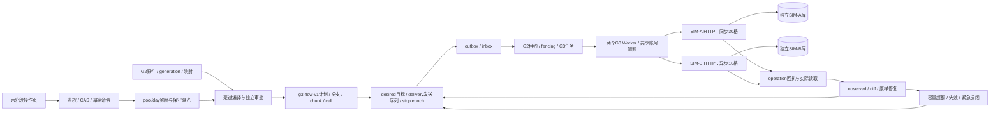

# G3 阶段实施与验收报告

> 交付日期：2026-10-27（Asia/Shanghai）。  
> 状态：本地限定范围验收通过。最终全量146项通过，0失败、0错误、0跳过；真实HTTP与浏览器均完成双渠道发布核验及关闭确认。  
> 范围：S-A合成来源、单来源物业计划、USD两成人、两个独立本机模拟渠道，不是生产上线或真实OTA验收。

## 1. 依据与实际交付

依据总设计说明书、G3详细计划和G2交接结果实施。G3开工实跑G2基线93项通过（48.55秒），见g3-baseline.json；不把此前历史报告当作本次开工实测。

交付包括双渠道独立存储/身份、能力驱动快照与独立审批、静态额度/曝光保留、plan/branch/chunk/cell、共享配额、UNKNOWN/异步查询、有限重试与死信、实际读取三方对账、原样修复、紧急关闭/安全关闭/防复活及操作页。

| 证据 | 实际内容 |
| --- | --- |
| g3-tests.xml | 146项通过，0失败/错误/跳过；pytest墙钟403.58秒，JUnit suite 403.280秒 |
| g3-faults.json | 从实际JUnit提取的进程退出、竞争和故障用例结果 |
| g3-http-smoke.json | 真实登录、独立API/两个G3 Worker、独立SIM-A/B，双渠道VERIFIED及两边STOPPED |
| g3-benchmark.json / .md | 100、1000、10000唯一日期格，实际请求、异步查询、耗时、驱动与两模拟器RSS |
| g3-browser.json / 截图 | 浏览器中的独立审批、计划及关闭操作，与服务端结果关联 |
| g3-environment.json | 专属解释器、数据库版本、迁移、正常故障开关和运行进程核验 |

## 2. 实现架构及边界

核心010：008增量模型、009就绪标记、010持久化定义。SIM-A追加002协议/003配额，既有001及/v1保留；SIM-B独立001协议/002配额。未修改已执行SQL，既有G0/G1/G2来源、快照和回执保留。

主要新增表16个，全部FORCE RLS并有复合外键：g3_source_control、account、allocation/head、snapshot、listing、reservation、plan、intent、task、receipt、cell_result、observation、diff、stop、dead_letter。快照/执行请求保护不可变字段，历史回执追加；没有把多渠道状态塞到一个“成功”字段。

当前旧SIM_B_TOKEN是旧SIM-A租户B身份；G3凭证按渠道×租户区分，SIM-B为独立进程与hotel_project_sim_b。核心业务角色通过HTTP而非直接操作模拟表。

## 3. 核心正确性结论

- 额度是每个池/住宿日的共享约束。默认4-1=3、A2/B1，不按计划重复库存；未知与下调未确认曝光保留，转额度必须先减确认。实际观察到更大库存提高保留并触发CAPACITY_DEFICIT安全关闭，不将超额当普通价格漂移。
- SIM-B wire取消政策为refundable=false，与内部NONREF/0/stay_total精确对应；FLEX72h拒绝，业务hash与wire hash分开。
- desired和delivery分开递增。每格参与稳定分片，内容/chunk manifest保护同版本多块；低版本真正迟到执行也在远端原子拒绝。
- 202仅受理，回执APPLIED与实际VERIFIED分开。部分成功保留逐格结果，临时拒绝只处理未完成项，永久拒绝保持阻断。
- 账号许可由核心DB共享，模拟器另有真实DB令牌桶。429尊重Retry-After；未知先查询原key，丢operation_id也可恢复。写6次/15分钟、查询20次/15分钟，有限预算恢复留理由和历史。
- 对账周期及按需任务持久化，旧目标观察不能认证新目标。UNKNOWN不当MISSING，REMOTE_AHEAD不盲抢版本；普通漂移仅在明确有效原授权范围内重放，使用新delivery/key及同业务hash。
- 停卖是新目标。源失效仍可依据最后已知商品关闭，旧发布/repair不得复活；5分钟未确认有持久告警。恢复须关闭后新快照、新独立审批及显式reopen。
- 首次计划确无任何外部发送才可取消；已有曝光或更新计划不能“本地回滚”。源锁、listing锁、job fencing与远端revision分别保护不同窗口。
- 旧协议迁移关闭序号在HTTP前保留，G1编译同锁接续该序号，防止关闭后新快照撞远端revision。G3接管来源之后G1/G2新售卖被阻断，旧效果仍可查。

## 4. 40项场景与证据对应

表中“通过”的依据是最终保存的全套JUnit、实际HTTP及浏览器证据；实现范围的收敛见第7节，不将未做的真实渠道能力计为通过。

| 编号 | 验证内容与对应证据 |
| --- | --- |
| G3-01 | 原93项兼容回归；迁移/种子重复、历史不可变测试；真实旧协议关闭后继续编译版本接续 |
| G3-02 | dual_channel_real_http、channel_identity_control_and_rls_are_distinct；独立服务/库/凭证 |
| G3-03 | capability_blocks_lossy_policy_and_enforces_approval；NONREF正向、FLEX72h到B422 |
| G3-04 | wire_policy_is_distinct_and_lossless；hash、编码/能力冻结；manifest_hash_tamper负测 |
| G3-05 | dual_channel_real_http、overallocation_and_stale_allocation，A2/B1与超额拒绝 |
| G3-06 | concurrent_allocation_versions_commit_only_once双连接屏障竞争，一次提交一次版本冲突；stale_allocation负测与安全调拨；不宣称跨真实平台原子额度 |
| G3-07 | legacy_exposure_requires_explicit_close；未知/旧曝光不能直接增加第二渠道 |
| G3-08 | safe_allocation_transfer_waits_for_remote_reduction；observed_inventory_overallocation_retains_exposure_and_safely_closes |
| G3-09 | real_cell_chunk_counts多档；真实六日12格B分0/10/2，不按天数算格 |
| G3-10 | CONTENT前置、B异步真实HTTP、每task写/查结果；202不能使branch核验完成 |
| G3-11 | real_intent_commit_windows：子进程退出81/82，提交前0计划、提交后计划/意图/事件完整 |
| G3-12 | atomic_target_set_and_idempotency；重复key同结果，异body及旧expected冲突 |
| G3-13 | partial_cell_results、unknown_and_retry_classification；A成功B异常不重发A |
| G3-14 | partial_temp/partial_permanent：5格成功1格拒绝，原成功结果不抹掉，永久拒绝BLOCKED |
| G3-15 | real_multi_chunk_manifest_and_cell_limits、远端chunk hash检查；同版本多块真实完成 |
| G3-16 | shared_quota_with_independent_db_connections、两个真实Worker闭环；远端独立令牌桶及规模实测 |
| G3-17 | Retry-After秒数/日期/非法/缺失纯测试，真实429重试；长等待按期限处理，不提前请求 |
| G3-18 | 既有过期快照/依赖测试、budget_exhaustion_and_audited_resume；代码预算与抖动边界 |
| G3-19 | auth_failure_is_account_scoped_and_recoverable；字段拒绝/URL注入/角色负测 |
| G3-20 | after_commit/lost_operation故障、原key恢复；404查询不被当成可盲重发证据 |
| G3-21 | lost_operation真实HTTP，未保存operation_id时仍原key定位 |
| G3-22 | remote_commit_then_real_worker_death退出83，接管只query，send_count仍1 |
| G3-23 | G2双进程barrier/token/续租负测全保留；G3结果提交复用同guard |
| G3-24 | old_http_actually_executes_after_new_close：持久屏障，先高版本实际关闭，再释放旧HTTP，低版本被拒且远端仍不可售 |
| G3-25 | G2/G3消费者崩溃恢复；持久next_due_at/任务唯一键，最终块后再次核验调度有效 |
| G3-26 | incomplete_read_is_unknown_not_missing；一次完整读取与complete故障标记，未声称实现真实分页协议 |
| G3-27 | drift/missing/read_failure/incomplete/remote_ahead与CAPACITY_DEFICIT分别验证 |
| G3-28 | drift_repair_really_rewrites_remote；新delivery序号、相同业务hash、最终实际读取一致 |
| G3-29 | stale_diff_cannot_resurrect_new_stop、ungranted_repair_denied、依赖/额度/期限拒绝 |
| G3-30 | stop_confirmation_and_fence，operator关闭403，管理员真实关闭 |
| G3-31 | expired_base_can_still_be_safely_closed、容量超额安全关闭；原件坏行语义回归 |
| G3-32 | 全范围双渠道STOPPED与部分日期目标核验；未经实际读取不确认关闭 |
| G3-33 | stop_dominates_paused_sale_and_old_repair；emergency_close_overtakes_ordinary_reconciliation_backlog（100条对账积压） |
| G3-34 | new_approval_can_reopen_after_confirmed_stop；旧快照/旧repair/迟到写入不能开售 |
| G3-35 | budget_exhaustion_and_audited_resume、认证修复后显式恢复；历史回执和预算轮次保留 |
| G3-36 | 16新表FORCE RLS、跨租户读空/写拒绝/FK失败；快照不可变、资源与角色负测 |
| G3-37 | 旧租户B凭证不能当SIM-B；仅业务Bearer不能用故障控制；正常模式关闭控制 |
| G3-38 | 浏览器独立审批、计划、逐渠道核验和管理员关闭证据；实际视口限制单列，不声称全设备兼容 |
| G3-39 | 6组100/1000/10000日期格真实协议基准；实际双渠道关闭耗时；积压优先级用例。核心大视图/大队列吞吐未外推 |
| G3-40 | g3-http-smoke.json及浏览器，从原件→generation→额度/快照/审批→plan/task/cell→observation→关闭证据完整 |

## 5. 故障与复现说明

最终验证：146项全量回归通过（包括既有G2基线93项及G3新增53项），0失败/错误/跳过，403.58秒。1条Starlette/httpx测试客户端弃用提示，不影响本次断言；未为消除提示更换依赖。Python静态检查、格式检查、依赖一致性检查和前端正式构建通过。运行环境为专属hotel_project，核心schema010，三套开发数据库与三套测试数据库隔离。

最终真实HTTP小样例：发布至双渠道VERIFIED为3.719秒，两边停卖确认STOPPED为1.906秒，来源追溯记录14条。该单次结果不作为生产SLA。

浏览器使用G3-HTTP-373ce7ab来源：a.reviewer独立批准两快照，a.operator提交9f3ff601计划，实际两分支VERIFIED，a.tenant_admin分别关闭，最终两边STOPPED且目标/观察均为2。SIM-A首次页面关闭未生效，刷新当前listing后重新确认成功；过程未当作已关闭。最终页面构建刷新后再次登录核对。证据见[g3-browser.json](g3-browser.json)、[实际页面截图](g3-browser.png)及g3-browser-dom.txt；对应服务端关闭记录另存server_confirmations。

独立核心测试库hotel_project_g3_test，两个远端测试库hotel_project_sim_a_g3_test / hotel_project_sim_b_g3_test。真实进程退出81/82/83/84分别证明意图提交前/后、远端提交后本地记录前、消费者提交后确认前。G2原有73～78窗口继续回归。

测试Worker显式分配本用例listing范围；保留历史测试数据而不将其他旧样例的周期任务混进当前断言。旧G2 Worker只认领PARSE/WORKFLOW/PUBLISH，避免误消费新G3任务。预算用例按资源ID认领，避免复跑时碰到上次人工恢复的同类任务。

实施中发现并修复：最终chunk核验被过粗去重窗口吞掉、HTTP演示代理漏传查询参数、旧协议关闭版本未计入下次编译、历史同类预算测试任务误认领、按日期STOP误夹带未选日期开售单元。失败和中断的开发轮次不冒充最终通过，正式JUnit取最终全量结果。

## 6. 实测性能口径

| 日期格 | SIM-A耗时/写请求 | SIM-B耗时/写请求/operation查询 |
| --- | --- | --- |
| 100 | 0.922秒 / 5 | 5.407秒 / 11 / 10 |
| 1000 | 7.516秒 / 35 | 51.843秒 / 101 / 100 |
| 10000 | 73.640秒 / 335 | 516.281秒 / 1001 / 1001 |

全部6组逐格VERIFIED，实际限流响应0次；配额由驱动按配置节拍以及独立远端DB令牌桶共同约束。峰值为驱动+两个模拟器RSS，约172～229MiB，**不包括PostgreSQL服务内存**。独立测试库，额外本机端口8003/8004；记录唯一键、请求字节、原始结果和平台信息。

该基准是wire序列化/分片、真实HTTP、远端配额、异步操作查询及最终逐格比较；**不包含核心报价编译、额度校验、核心Worker队列**。每档单样本，缓存未控制，不报告p95，不宣称生产SLA。SIM-B一万格的日历写理论下界约500秒，不能套用十万行解析≤120秒指标。

正常完整业务链的发布/停卖耗时以g3-http-smoke.json原始实测为准；属于小规模无故障单样例。100条普通对账积压下的关闭优先级为正确性用例，不等于持续混合发布洪峰下的容量保证。

## 7. 范围收敛与未证明事项

1. S-A固定演示合同，单来源/物业一计划、USD两成人；不合并未知跨供应商共享库存，也不是任意渠道协议引擎。
2. SIM-A仅现有简单FLEX/NONREF政策；SIM-B只允许精确NONREF二值表达。不支持任意取消阶梯、儿童、复杂税费或汇率。
3. SIM-B异步由operation查询推动远端完成，非独立远端后台消费器。远端一次有界完整JSON读取，只有完整性标记负测，没有真实分页/读版本令牌实现。
4. 周期为60秒、有限原样修复3次，5分钟未关闭告警使用可注入时钟做阈值断言，不靠实际等待5分钟冒充压力实测。通用熔断器未引入。
5. G2大视图全量物化及投影写放大仍存在；没有把协议规模实测当作十万行全业务链证明。严格冷/热缓存、多样本p95、数据库服务RSS和生产队列上限另做容量验证。
6. 部分日期关闭保留未选日期，整体显示目标核验而非全listing STOPPED。当前如需整份重新开售，先完整关闭确认，再新快照/独立审批；不提供复杂子商品DAG恢复。
7. 首次未发送计划可取消；已有外部效果或更新计划需查询/关闭，不提供危险的本地伪撤销。
8. 浏览器在实际1265×712桌面视口完成独立审批、运营提交、双分支核验、管理员两边停卖，以及刷新交付版本后的关闭确认。未完成移动端多断点、全浏览器兼容及完整无障碍审计。
9. 本地fencing只保护本地提交，外部去重依赖模拟器幂等与revision/CAS；不是对任意真实OTA的端到端恰好一次保证。没有真实订单、支付、锁房或防超售承诺。

以上限制必须随G4交接，不得因功能验收通过而抹去。

## 8. 交付与交接

代码services/core/g3、services/sim_g3、services/channel_simulator_b；迁移008～010及两模拟链；contracts/distribution、reconciliation、channels/sim-a/v2和sim-b/v1；OpenAPI g3.json；ADR017～021；datasets/g3源包与九组场景说明。

运行及恢复见docs/runbooks/g3-local.md、g3-unknown-and-dead-letter.md、g3-reconciliation.md、g3-stop-sell.md。脚本提供prepare/setup/start/stop/status/test/contract-test/fault-test/demo/benchmark；contract-test/fault-test当前均跑完整套件，不误称精准子集。demo追加虚构数据；测试与基准不重置开发库。

G4可基于已受控接口研究实际AI提案、明确授权策略与评估；模型无权直接改事实、扩审批范围或解除停售。真实渠道准入和大规模容量仍需独立验证，不因G3完成自动获得授权。
